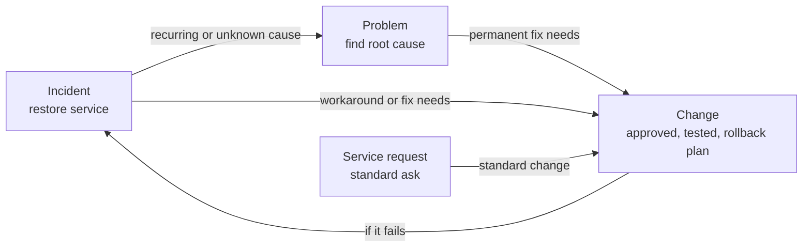
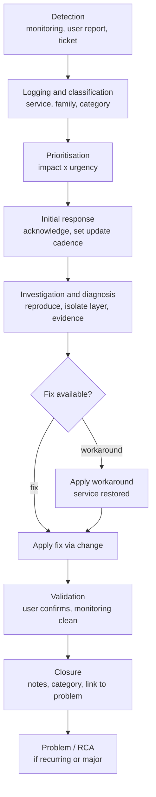
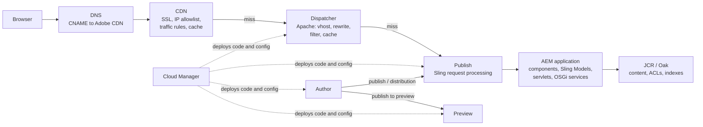
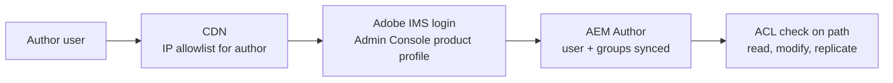
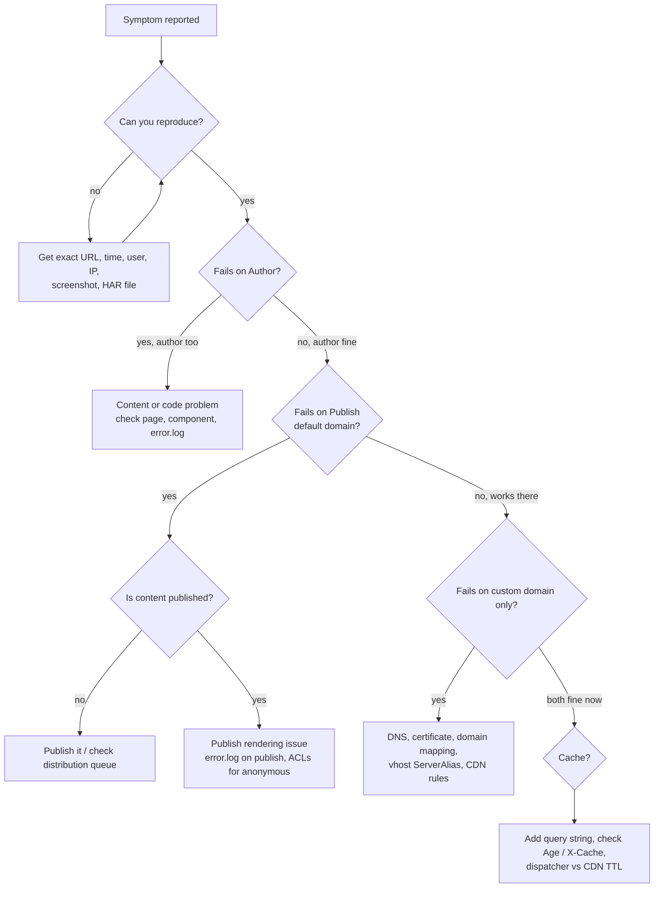
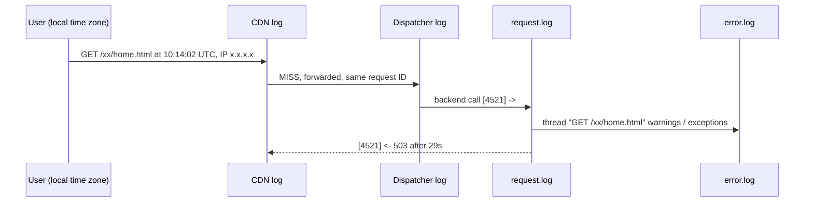
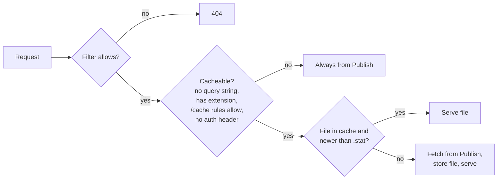

# Production Support and AEM Troubleshooting

> Module 1. Goal: understand production support as one subject: how incidents are managed, how an AEM request travels, how to find the failing layer, how to read the evidence, and how to prove a root cause.
>
> Labels: **[Hands-on]** your work · **[Adjacent]** touched it, theory is new · **[Theory]** study only · `[fill in]` a detail only you know.

---

## Contents

1. [Production support fundamentals](#1-production-support-fundamentals)
2. [The AEM troubleshooting architecture](#2-the-aem-troubleshooting-architecture)
3. [Isolating the failing layer](#3-isolating-the-failing-layer)
4. [HTTP errors in depth](#4-http-errors-in-depth)
5. [AEM logs and correlation](#5-aem-logs-and-correlation)
6. [Dispatcher and CDN troubleshooting](#6-dispatcher-and-cdn-troubleshooting)
7. [Case studies from your work](#7-case-studies-from-your-work)
8. [Root cause analysis](#8-root-cause-analysis)
9. [Production troubleshooting checklist](#9-production-troubleshooting-checklist)
10. [Revision sheet](#10-revision-sheet)

---

## 1. Production support fundamentals

### 1.1 What production support means in an enterprise AEM environment

Production is the environment real users depend on: the public websites visitors read and the production Author where business users create and publish content. Production support is the discipline of **keeping it available, correct and fast**, and **restoring it quickly** when it is not, without causing new damage.

In an AEM enterprise program (for example, many country sites on one platform) production support covers:

| Area | Examples |
|------|----------|
| Availability | Site down, 5xx errors, author unreachable |
| Correctness | Wrong or old content, broken images, broken links, forms not sending |
| Access | Authors cannot log in, 403s, missing permissions |
| Performance | Slow pages, timeouts, slow author UI |
| Publishing | Content not reaching Publish, workflows stuck |
| Platform changes | Deployments, certificates, domains, DNS, IP allowlists |
| Requests | New users and groups, new sites, config changes |

### 1.2 The three families of issue

Every incident falls into one family. Naming the family early decides **who** fixes it and **where** you look.

| Family | Meaning | AEM examples | Usually fixed by |
|--------|---------|--------------|------------------|
| **Application** | Code or configuration you deploy is wrong | Component throws exception, Dispatcher filter too strict, OSGi config wrong, Repoinit missing | Development / platform team, via pipeline |
| **Infrastructure** | The platform, network or external service | CDN, DNS, certificate expiry, IP allowlist, SMTP server, Adobe platform defect | Platform team, network team, or Adobe |
| **Content** | What authors created or migrated | Page with too many components, asset with wrong extension, unpublished reference, bad migration data | Authors, content admins, migration team |

Your log contains all three: Dispatcher filter for `.JPG` (application), IP allowlist for regional authors (infrastructure/network), a regional page with excessive containers (content), workflow definitions wiped by migration input (content process).

### 1.3 ITIL processes: incident, problem, change, service request [Adjacent]

Most enterprises (and Adobe's own support organisation) use ITIL vocabulary. Know the four processes and how they link.

| Process | Definition | Goal | Example |
|---------|-----------|------|---------|
| **Incident** | An unplanned interruption or reduction in quality of a service | Restore service as fast as possible | "Regional authors get 403 on prod author" |
| **Problem** | The underlying cause of one or more incidents | Find and remove the root cause | "Office IP ranges are not maintained in the allowlist" |
| **Change** | Adding, modifying or removing anything that could affect services | Make changes safely, with approval and rollback | "Add CIDR range to Cloud Manager allowlist" |
| **Service request** | A standard user request, not a failure | Fulfil efficiently | "Create author group for a new country" |



Change types: **standard** (pre-approved, low risk, e.g. adding a user), **normal** (assessed and approved, often by a Change Advisory Board), **emergency** (urgent fix during an incident, approved fast, documented after).

### 1.4 Severity, priority, impact, urgency, SLA

- **Impact**: how much of the business is affected (one user, one country site, all sites, revenue).
- **Urgency**: how fast it must be fixed (workaround exists? deadline? launch?).
- **Priority** = impact × urgency. It drives the order of work.
- **Severity**: how serious the technical failure is. Many organisations use priority and severity interchangeably; Adobe customer cases use priority levels **P1–P4**.

| | High urgency | Medium urgency | Low urgency |
|---|---|---|---|
| **High impact** (prod site down, all authors blocked) | P1 Critical | P2 High | P3 |
| **Medium impact** (one country site, one feature) | P2 High | P3 Medium | P4 |
| **Low impact** (one user, cosmetic) | P3 | P4 Low | P4 |

**SLA** (Service Level Agreement): the contractual targets, usually **first response time** and sometimes **update frequency** or **resolution target**, per priority. Exact numbers depend on the contract and support plan; do not quote numbers you have not seen. Internally teams also have **OLAs** (operational level agreements between teams).

### 1.5 Incident lifecycle



Key habits at each stage:
- **Detection**: note the exact time it started, not the time you were told.
- **Classification**: record environment (prod author / prod publish / preview), site, URL.
- **Response**: acknowledge fast even before you know the answer.
- **Diagnosis**: change one thing at a time; write down what you checked.
- **Validation**: the user who reported it confirms; you also check logs are clean.
- **Closure**: a ticket closed without a cause and action is a future incident.

---

## 2. The AEM troubleshooting architecture

### 2.1 The route of a request



Each stop can **answer the request on its own** (with content or with an error). Troubleshooting is the act of finding **which stop produced the response the user saw**.

| Stop | Can produce | Typical own errors |
|------|-------------|--------------------|
| DNS | Wrong or no address | Site not found, wrong environment |
| CDN | Cached copy, edge redirect, block | 403 (allowlist/WAF), 503/504 (origin timeout), SSL error |
| Dispatcher | Cached file, redirect, block | 404 (filter), 301/302 (rewrite), 502/503 (backend down) |
| Publish (Sling) | Rendered page | 404 (no resource / no read), 500 (exception), 403 (no privilege) |
| Application code | Content or error | 500, wrong output, slow |
| JCR | Data | Missing node, permission, query traversal (slow) |

### 2.2 Author-side issues and production author access

Production Author is a different route: **Browser → CDN → Author** (no Dispatcher cache in the delivery sense; author is not cached for visitors). Authentication goes through **Adobe IMS**.



Author problems you will meet:

| Symptom | Layer | Check |
|---------|-------|-------|
| 403 before any login page | CDN IP allowlist | User's public IP vs allowlist [Hands-on] |
| IMS error / "no access to this environment" | Admin Console | User in correct product profile for that environment |
| Logs in but sees no sites | AEM ACLs | Group membership, read on `/content/<site>` |
| Cannot publish | AEM ACLs / workflow | `replicate` privilege, or must use approval workflow |
| Workflow / Manage Publication broken | Workflow models / content | Models and launchers present and synced [Hands-on] |
| Slow author UI | Performance | Requests, queries, asset processing, browser |

### 2.3 Comparing a working environment with a failing one

The fastest diagnosis is often **a difference**. If QA works and PROD fails, the cause is in what differs between them.

| Compare | How |
|---------|-----|
| Code version | Cloud Manager: last successful pipeline per environment, commit ID |
| Dispatcher config | Same commit? Environment variables used in vhosts/rewrites |
| OSGi config | Run-mode folders (`config.prod` vs `config.stage`), Cloud Manager environment variables |
| Content | Page published? same version? references (images, XFs) published? |
| Access | IP allowlist per environment, product profiles per environment, groups |
| Domain | Custom domain vs default `publish-p<prog>-e<env>.adobeaemcloud.com` |
| Data | Migration sets, ingestion dates |
| Time | What changed since the last time it worked (deploy, publish, cert, DNS) |

Also compare **working vs failing user**, **working vs failing page**, **working vs failing time**. One difference that explains every symptom is usually the cause.

---

## 3. Isolating the failing layer

### 3.1 The outside-in method



### 3.2 Tools for isolation

| Tool | What it tells you |
|------|-------------------|
| Browser DevTools → Network | Status, which request failed (page, image, clientlib, XHR), timing, headers, redirects chain |
| `curl -v` / `curl -I` | Exact headers without browser cache; follow redirects with `-L`; send a header with `-H` |
| Query-string cache bust (`?x=1`) | Dispatcher does not cache URLs with query strings, so this forces a fresh render path |
| Author vs Publish vs Preview | Content issue vs delivery issue |
| Default domain vs custom domain | Platform/domain issue vs everything behind it |
| Logs per layer (section 5) | Where the error status first appears |
| Another network (mobile hotspot) | IP-based restriction or corporate proxy |
| Another user | Permission vs global problem |

```bash
# headers only, follow redirects, show each hop
curl -sIL https://www.example.com/content/page.html

# same page, bypass dispatcher cache
curl -sI "https://www.example.com/content/page.html?nocache=1"

# time each phase (DNS, connect, TLS, first byte)
curl -o /dev/null -s -w "dns=%{time_namelookup} tls=%{time_appconnect} ttfb=%{time_starttransfer} total=%{time_total}\n" https://www.example.com/
```

---

## 4. HTTP errors in depth

For each error: **what it means**, **who can produce it**, **how to investigate**.

### 4.1 400 Bad Request
- Meaning: the server refuses the request as malformed.
- Causes: invalid URL encoding, headers or cookies too large (often many cookies on a domain), invalid parameters to a servlet, CDN rejecting a malformed request.
- Investigate: does it fail in a private window (cookies)? Is the URL encoded correctly? Which layer's log shows the 400 first?

### 4.2 401 Unauthorized
- Meaning: authentication is missing or invalid.
- Causes: Author without a session, expired IMS session, a protected API called without a token, Closed User Group page without login.
- Investigate: is a login expected? Is the token/cookie sent? On Publish, is the page behind a CUG?

### 4.3 403 Forbidden
- Meaning: identity known (or not needed) but access denied.
- Causes by layer:
  - **CDN**: IP not in allowlist [Hands-on], traffic filter / WAF rule [Theory].
  - **AEM**: user lacks a privilege for the action (modify, replicate, delete); POST without CSRF token; servlet path not allowed.
  - **Dispatcher**: rare; custom deny returning 403.
- Investigate: who is affected (everyone vs some users vs one network)? Compare with a working user. Check CDN logs for the client IP and status; check `access.log` for the user; check effective permissions in Tools → Security → Permissions.

### 4.4 404 Not Found
- Causes by layer:
  - **Dispatcher filter deny** → 404 without Publish ever seeing it [Hands-on].
  - **Rewrite** sends the URL to a path that does not exist.
  - **Publish**: page not published, wrong path, **no read permission for anonymous** (unreadable looks like missing), missing extension.
  - **CDN / domain**: domain mapped to the wrong environment or tier.
- Investigate: exists on author? published? reachable on publish via default domain? exact path and **case** of extension? dispatcher log shows "filter rejects"?

### 4.5 500 Internal Server Error
- Meaning: AEM (or a script) failed while processing.
- Causes: exception in component/HTL/Sling Model/servlet, NullPointerException on missing property, unsatisfied OSGi service, invalid content (unexpected node type), workflow process step failure.
- Investigate: find the request in `request.log`, then the matching stack trace in `error.log`; read the last `Caused by`; identify whose code (project package vs `com.day`/`org.apache`); check what changed (deploy, content).

### 4.6 502 Bad Gateway
- Meaning: a proxy (CDN or Dispatcher) got an invalid response from the next layer.
- Causes: Publish pod restarting or crashed mid-response, backend closed connection, misconfigured origin in a customer CDN.
- Investigate: is it intermittent (pod restarts, deployment in progress) or constant (config)? Time of deployment?

### 4.7 503 Service Unavailable
- Meaning: the server cannot handle the request now.
- Causes: no healthy backend, render took too long (timeout), overload, maintenance.
- Investigate: is it one page (render cost) or all pages (platform)? `request.log` durations for that URL; thread contention (Module 5). Your heavy-page 503 case: one heavy page [Hands-on].

### 4.8 504 Gateway Timeout
- Meaning: a proxy waited too long for the backend.
- Causes: slow page render, slow query (traversal), slow external API call without timeout, large export servlet.
- Investigate: `request.log` time for the URL; error.log for query traversal warnings or socket timeouts; reproduce with `curl -w` timing.

### 4.9 Redirect loops (`ERR_TOO_MANY_REDIRECTS`)
- Meaning: A redirects to B, B redirects back to A (or to itself).
- Common causes:
  - http → https rule that ignores `X-Forwarded-Proto` behind the CDN, so every request looks like http.
  - Trailing-slash or `.html` rewrite rule fighting with a Sling mapping or vanity URL.
  - Language/country redirect that redirects the target again.
  - Login redirect: a page requires login, the login page itself also requires login.
  - Experience Fragment or header link authored to a URL that redirects back.
- Investigate: `curl -sIL` and read the `Location` header of each hop; identify which layer adds each redirect (CDN edge rule, Dispatcher rewrite, AEM redirect component, Sling mapping).

### 4.10 Timeout errors
- Where timeouts live: browser, CDN origin timeout, Dispatcher/Apache backend timeout, AEM request processing, outbound HTTP clients, database/SMTP connections.
- A timeout is always a symptom: something is **slow** or **unreachable**. Find which hop waited and what it waited for (Module 5 thread dumps show this precisely).

### 4.11 Content not loading or displaying incorrectly
| Symptom | Likely cause |
|---------|--------------|
| Page loads unstyled | Clientlibs blocked (`/etc.clientlibs` filter), wrong `allowProxy`, minification error |
| Images missing | Asset not published, filter extension/case, rendition missing, DAM path changed |
| Old content | CDN TTL, dispatcher not invalidated, browser cache, publish failed |
| Different between users | Personalisation, cache variant by header/cookie, CDN geo |
| Broken component on publish only | Missing published reference (XF, content fragment), anonymous lacks read |
| Mixed content warnings | http asset URLs on https page |

---

## 5. AEM logs and correlation

### 5.1 The logs

| Log | Where | What one line represents | Use |
|-----|-------|--------------------------|-----|
| **error.log** | AEM author/publish (cloud name: `aemerror`) | A log statement from Java code: ERROR, WARN, INFO, DEBUG | Stack traces, failing components, workflows, bundles, distribution, queries |
| **request.log** | AEM (`aemrequest`) | Two lines per request: incoming `->` and outgoing `<-` with status and ms | Which URL, status, how long |
| **access.log** | AEM (`aemaccess`) | Apache-style access line with user, status, bytes | Who requested what; 401/403 by user |
| **audit.log** | AEM 6.5 `crx-quickstart/logs` | Repository/page events (create, modify, replicate) | Who changed or published what and when [Theory for cloud] |
| **replication.log** | AEM 6.5 | Replication agent activity | Queue and transport issues on 6.5 [Theory] |
| **Dispatcher logs** | Apache (`httpdaccess`, `httpderror`, `aemdispatcher`) | Requests at Apache; dispatcher decisions (filter, cache hit/miss, backend) | "filter rejects", cache behaviour, rewrite errors |
| **CDN logs** | Adobe CDN | Edge request: client IP, host, status, cache result, rules | Allowlist/WAF blocks, cache hit ratio, geography |
| **Cloud Manager logs** | Pipeline execution | Build, code scan, deploy, test step logs | Why a deployment failed |

Notes for AEMaaCS:
- Download per environment, per service, per day from Cloud Manager → Environments → Logs; or tail live with the Adobe I/O CLI (`aio cloudmanager:tail-log`).
- There is no separate `replication.log` or `audit.log` to download in the cloud; content distribution messages appear in `aemerror`, and page/replication audit events are stored in the repository (`/var/audit`) and visible in page timelines.
- Log levels change only via an OSGi logger config deployed by pipeline.

### 5.2 Reading request.log

```
25/Nov/2026:10:14:02 +0000 [4521] -> GET /content/site/xx/home.html HTTP/1.1
25/Nov/2026:10:14:31 +0000 [4521] <- 503 text/html 29012ms
```
- `[4521]` is the request counter: it pairs the in and out lines.
- 29 seconds is the clue: this request was slow, and something upstream gave up.
(Illustrative lines.)

### 5.3 Reading error.log

```
25.11.2026 10:14:02.311 *ERROR* [10.1.2.3 [1795600442311] GET /content/site/xx/home.html HTTP/1.1]
  com.day.cq.wcm.core.impl.WCMComponentFilter Error processing component
org.apache.sling.api.SlingException: ...
Caused by: java.lang.NullPointerException
  at com.example.site.core.models.HeroModel.init(HeroModel.java:42)
```
- Timestamp, level, **thread name** (contains client IP and the request line), logger, message.
- Read to the **last `Caused by`**; the first frame in project code shows the guilty class and line.
(Illustrative lines.)

### 5.4 Correlation: tying evidence together

| Key | Where it appears | How to use |
|-----|------------------|-----------|
| **Timestamp** | Every log | Narrow to the incident window; convert time zones (user in another time zone, logs in UTC) |
| **URL / path** | request, access, dispatcher, CDN, error (thread name) | Follow one URL through all layers |
| **Request counter** | request.log `[n]` | Pair start and end lines |
| **Request ID header** | CDN and dispatcher logs in AEMaaCS (e.g. `x-request-id`) | Follow one exact request from edge to origin |
| **Client IP** | CDN, dispatcher access, AEM access/error thread | Find all requests from the affected user/office; check allowlist |
| **User ID** | access.log, audit events | Who did it; reproduce with the same permissions |
| **Stack trace** | error.log | Exact failing code |
| **Recent changes** | Cloud Manager pipeline history, Git log, change tickets, publish history, cert/DNS changes | "What changed?" usually finds the cause |



Practical rule: **convert every timestamp to UTC first**, then search ±5 minutes around it.

---

## 6. Dispatcher and CDN troubleshooting

### 6.1 Cache behaviour



- Dispatcher caches responses as **files** in the docroot, mirroring the URL path.
- **Invalidation**: on publish, a `.stat` file is touched at a folder level (`/statfileslevel`). Any cached file older than the nearest `.stat` is stale and re-fetched next time. Files are not deleted, just treated as stale (auto-invalidation for `.html`), or deleted for the exact path activated.
- In AEMaaCS, publish triggers dispatcher invalidation automatically.
- **CDN cache** is separate: it expires by TTL from `Cache-Control` / `Surrogate-Control`. So after a publish: Dispatcher is fresh at once, the CDN may serve the old page until TTL ends.

### 6.2 Filter rules

```
/filter {
  /0001 { /type "deny"  /url "*" }                                   # deny everything first
  /0100 { /type "allow" /path "/content/site/*" /extension '(html|json|jpg|jpeg|png|svg|gif|pdf)' }
  /0101 { /type "allow" /path "/etc.clientlibs/*" }
  /0200 { /type "deny"  /selectors '(feed|rss|infinity|tidy|sysview|docview|query|[0-9-]+)' }
}
```
- Rules are evaluated in order; **the last matching rule wins**.
- Regex values in single quotes are **case-sensitive**: `jpg` ≠ `JPG`.
- A denied request returns **404**.
- Deny dangerous selectors (`infinity`, `json` dumps of the repository), admin paths (`/crx`, `/system`, `/libs/granite/security`).

### 6.3 Client IP and access restrictions
- **CDN IP allowlist** (Cloud Manager) per environment and tier → 403 at the edge [Hands-on].
- **Traffic filter rules / WAF** (config pipeline `cdn.yaml`) → block or rate-limit by path, country, IP [Theory].
- **Dispatcher** can restrict by `Require ip` in Apache or by header checks [Theory].
- The real client IP arrives in headers such as `X-Forwarded-For` / `True-Client-IP`; behind a corporate proxy, the IP Adobe sees is the **proxy's public egress IP**, not the laptop's address. That is why you needed the office's CIDR range.

### 6.4 Content on Publish but not through Dispatcher

| Check | Why |
|-------|-----|
| Filter allows path, extension, selectors (exact case) | Denied → 404 [Hands-on] |
| vhost `ServerName`/`ServerAlias` includes the host | Otherwise a default vhost answers |
| Rewrite rules map host → content root correctly | Wrong mapping → 404 or wrong page [Hands-on: domain mapping] |
| Cache holds an old copy | `.stat` not touched, or wrong statfileslevel |
| Client headers passed (`/clientheaders`) | Component relying on a header gets nothing |
| `/etc.clientlibs` allowed | Unstyled pages |
| Default domain works, custom doesn't | Domain mapping/DNS/cert, not dispatcher filter |

### 6.5 Origin response vs cached response

| Signal | Cached (CDN) | Origin |
|--------|--------------|--------|
| `Age` header | > 0 | 0 or absent |
| `X-Cache` / cache status | HIT | MISS / PASS |
| Content | May be old | Current |
| Query-string variant | Different cache key | Fresh |

Read `Cache-Control`: `max-age` applies to browsers, `s-maxage` / `Surrogate-Control` to shared caches like the CDN. If the HTML has no header, Adobe's CDN uses a short default TTL.

---

## 7. Case studies from your work

All case studies are sanitized: no real URLs, IPs or names. Facts come only from your task log; missing details are marked `[fill in]`.

### Case 1. Production Author 403 for one region's authors [Hands-on]

| Part | Content |
|------|---------|
| **Technical background** | Production Author in AEMaaCS sits behind the Adobe CDN. Cloud Manager can restrict each tier to an IP allowlist written as CIDR ranges. Requests from outside the list are blocked at the edge with 403 before AEM or IMS sees them. Separately, AEM permissions can also cause 403 on actions. |
| **Symptoms** | Authors in one region received 403 Unauthorized on the production author URL. Other authors were not affected. |
| **Investigation** | 1. Checked the individual users' access in AEM: groups and permissions were correct. 2. Checked that the users had been migrated to the cloud. 3. Checked the logs for their requests and found their client IP. 4. Compared that IP against the Cloud Manager IP allowlist: it was outside every listed range. |
| **Root cause** | The network egress IP range used by those authors was not included in the production author IP allowlist. |
| **Resolution** | Obtained the CIDR range for that region's network `[fill in: from whom, e.g. network team]`, added it to the Cloud Manager IP allowlist for production author, applied it. |
| **Validation** | Asked the affected users to log in again; access worked as expected. |
| **Prevention** | `[fill in what was actually done]`. Typical actions: keep an owned register of office/VPN CIDR ranges per region; network team informs the platform team before egress IP changes; onboarding checklist for new regions includes the allowlist. |
| **Concept lesson** | Some users fail, others do not → find what differs: permissions **and** network location. Check both layers before changing anything. |

### Case 2. Workflows and Manage Publication broken after content ingestion [Hands-on]

| Part | Content |
|------|---------|
| **Technical background** | During migration, the Content Transfer Tool extracts listed paths into a migration set; ingestion into the cloud can run with **wipe** (clears target content first). Workflow models live under `/conf/global/settings/workflow/models` (design) and `/var/workflow/models` (runtime); Manage Publication with workflows depends on them. |
| **Symptoms** | After a content ingestion, content workflows and Manage Publication did not work. Logs showed a `cq:Workflow` content violation exception. `[fill in: exact status code users saw, e.g. 500, and the exact exception text]` |
| **Investigation** | 1. Verified the logs and found the `cq:Workflow` violation. 2. Deep-dived into the ingestion logs. 3. Found that the CSV file used to export the filter paths contained empty rows. |
| **Root cause** | Empty rows in the path CSV caused the ingestion to wipe out the workflow definitions on the target. The bad input reached production because the CSV was not validated before ingestion. |
| **Resolution** | Reverted to the previous good version `[fill in: how, e.g. restore / re-ingestion of known-good set]`, then performed the content ingestion again with a corrected CSV. |
| **Validation** | Verified workflows and Manage Publication functionality; worked as expected. |
| **Prevention** | Informed the team; introduced a **peer review of the CSV report** before every content ingestion. Further options: script to reject empty or root-level rows; run ingestion first on a lower environment; back up `/conf` workflow models before wipe ingestions. |
| **Concept lesson** | A migration tool does exactly what its input says. Input validation and a dry run on non-prod are preventive controls. |

### Case 3. Images and files 404 on the live site [Hands-on]

| Part | Content |
|------|---------|
| **Technical background** | Dispatcher filter rules allow requests by path and extension; regex is case-sensitive; a denied request returns 404. |
| **Symptoms** | Some images did not render on the live site. Later, another user reported the same with an `.xlsx` file. |
| **Investigation** | 1. Checked the image exists in Author: yes. 2. Checked it exists on Publish directly: yes. 3. Therefore the problem was in front of Publish: checked Dispatcher. 4. Noticed the images used an uppercase `.JPG` extension, which the filter did not allow; requests returned 404 at Dispatcher. |
| **Root cause** | The Dispatcher filter's allowed-extension list did not include `JPG` (uppercase) or `xlsx`. |
| **Resolution** | Allowed the extensions in the Dispatcher filter; deployed via pipeline `[fill in: full-stack or web-tier pipeline]`. |
| **Validation** | Images and the `.xlsx` file loaded on the live site. |
| **Prevention** | `[fill in]`. Options: case-insensitive extension patterns, an agreed list of allowed asset types, asset naming guidance for authors, Dispatcher SDK tests for new file types. |
| **Concept lesson** | Prove the content exists at each layer, then the first layer where it disappears is the cause. |

### Case 4. Preview links and redirects; Experience Fragment / header redirect

**What your record contains** [Hands-on]: on the cloud preview environment, a page link did not navigate to the correct target. You created a Dispatcher rule that appends `.html` for the site's content paths, so links resolve to the HTML rendering.

| Part | Content |
|------|---------|
| **Technical background** | Sling chooses the renderer by extension; extensionless URLs may not resolve to the page. Dispatcher rewrites run before Sling. Headers and footers are often **Experience Fragments** (XFs) included in every page; their links are authored once, so one wrong link affects all pages. |
| **Symptoms** | Preview: links from a page did not navigate to the correct page. |
| **Investigation** | `[fill in: what you checked: link URL in the page source, response for the extensionless URL]` |
| **Root cause** | Links resolved without `.html`; no rule handled that on preview. |
| **Resolution** | Dispatcher rewrite appending `.html` for site content paths. |
| **Validation** | `[fill in]` |
| **Prevention** | `[fill in]` |

**Experience Fragment / header redirect issue**: your task log does not describe this incident, so no details are written here. To build this case study, write down: which XF (header/footer), what users saw (loop, wrong page, 404), which layer issued the redirect (curl `-sIL` output), the root cause, and the fix. Background you will need:
- XF pages live under `/content/experience-fragments/...`; pages include them by reference, so the XF itself must be **published**.
- Links in XFs should be authored as content paths; link rewriting (Sling mappings / externalizer / dispatcher rewrites) turns them into public URLs. A link that points to a short URL which a rule then redirects back can create a **loop**.
- After changing an XF, the pages that include it may stay cached until invalidated.

### Case 5. Namespace-related failures across environments [Hands-on]

| Part | Content |
|------|---------|
| **Technical background** | JCR property and node names can use namespace prefixes (`jcr:`, `cq:`, `dam:`, custom). A custom prefix must be **registered** in the repository before content using it can be saved. In AEMaaCS this is done in code via Repoinit (`register namespace (prefix) uri`) so every environment has it. |
| **Symptoms** | While migrating content from on-premise to the cloud, namespace errors occurred across RDE, QA, STAGE and PROD. `[fill in: exact error text, and whether it failed in ingestion, package install or pipeline deploy]` |
| **Investigation** | Identified the namespace(s) that existed on-premise but not in the cloud repository `[fill in]`. |
| **Root cause** | Custom namespace used by migrated content was not registered in the cloud environments. |
| **Resolution** | Created a Repoinit script registering the namespace, deployed through the pipelines to all environments, then completed the migration. |
| **Validation** | `[fill in]` |
| **Prevention** | Use the Best Practices Analyzer report and a namespace inventory before migration; keep all repository structure in Repoinit. |

### Case 6. Duplicate pipeline executions and change control [Hands-on, details to fill]

| Part | Content |
|------|---------|
| **Technical background** | Many enterprises develop in their own Git and sync to the Adobe Cloud Manager Git repository. A Cloud Manager pipeline can start **on Git changes**. Other CI tools (e.g. Jenkins) can also start on webhooks or SCM polling. If a sync pushes a commit, and both sides react, one change produces several runs. |
| **Symptoms** | Dev pipelines were triggered multiple times. |
| **Investigation** | Found that when the destination repository receives the synced commit, it treats it as a new commit and triggers the pipeline automatically. `[fill in: what else triggered: the source-side job, polling]` |
| **Root cause** | Overlapping triggers: the sync to the destination repository plus `[fill in]`. |
| **Resolution** | Updated the dev pipelines `[fill in: e.g. trigger changed to manual, or only one side triggers]`. |
| **Validation** | `[fill in]`: one commit → one pipeline run. |
| **Prevention** | Document a single owner of each trigger; review trigger settings when adding a new pipeline. |

**Production deployment and change control** (general, for the parts of your release management experience to fill in): a production deployment is a **normal change**: change ticket with scope (commit/tag), risk, test evidence from QA/Stage, deployment window, approvers, communication plan, validation steps, rollback plan. In Cloud Manager, the production pipeline deploys to Stage, runs tests, waits for **approval**, then deploys to Production. Write your real process here: `[fill in: who approves, which ticket system, window, smoke tests after go-live]`.

### Additional cases from your record (short form)

- **Heavy-page 503 after publishing** [Hands-on]: logs and publish status checked; page not loading on publish; too many calls because of excessive containers. Re-authored with proper styling and fewer containers; authors told to use the minimum containers. Lesson: render cost and timeouts; prevent with template policies and authoring guidance.
- **Emails not sent** [Hands-on]: SMTP authentication token expired after 90 days of inactivity. New token generated by logging into the service account, configuration updated, team asked to refresh monthly. Lesson: credentials with expiry need an owner and a schedule; store as a Cloud Manager secret variable so rotation needs no code change.

---

## 8. Root cause analysis

### 8.1 Symptom vs cause

| Symptom (what users see) | Proximate cause (what broke) | Root cause (why it could break) |
|---|---|---|
| Regional authors get 403 | IP not in allowlist | No process to keep allowlist in step with network changes |
| Workflows broken | Workflow models wiped | Path CSV not validated before a wipe ingestion |
| Images 404 | Filter denies `.JPG` | Filter written case-sensitively; no agreed list of asset types |
| Regional page 503 | Page too slow to render | No authoring limits on nesting containers |

The **root cause** is the deepest cause you can still act on. Fixing only the proximate cause closes the incident; fixing the root cause closes the **problem**.

### 8.2 Five Whys (worked on Case 2)

1. Why did workflows stop working? The workflow definitions were missing.
2. Why were they missing? The ingestion wiped them.
3. Why did the ingestion wipe them? The path CSV had empty rows, which changed what was ingested.
4. Why did empty rows reach production? Nobody reviewed or validated the CSV.
5. Why was there no review? The migration process had no input-validation step.

→ Corrective: restore and re-ingest. Preventive: peer review (done), validation script, non-prod dry run.

Stop asking "why" when the answer is something you can change with a concrete action, and avoid ending at "human error": ask why the process allowed the error.

### 8.3 Evidence-based RCA

Each statement in an RCA must be backed by evidence:

| Claim | Evidence |
|---|---|
| "Started at 09:40 UTC" | First error in logs, monitoring graph |
| "Caused by deployment X" | Pipeline finish time matches; rollback fixed it; diff shows the change |
| "Only that region's users affected" | CDN/access logs filtered by IP range |
| "IP was not in allowlist" | Screenshot/export of allowlist before change |

Avoid: "probably", "we think", unless clearly labelled as a hypothesis not yet proven.

### 8.4 Corrective and preventive actions (CAPA)

- **Corrective**: fixes this occurrence (add CIDR, re-ingest, allow extension).
- **Preventive**: stops recurrence (register of IP ranges, CSV validation, case-insensitive filter, author guidelines, monitoring/alerts, runbooks).
- Each action has an **owner** and a **due date**.

### 8.5 Incident documentation template

```markdown
# Incident report: <short title>
- Ticket / case: <id>        - Priority: P<n>
- Environment: prod author | prod publish | preview   - Sites affected: <list>
- Start (UTC): <time>   Detected: <time>   Restored: <time>   Closed: <time>

## Impact
Who and what was affected, for how long.

## Timeline
| Time (UTC) | Event |
|---|---|

## Symptoms
What users saw (status codes, screenshots, URLs).

## Investigation
What was checked, in order, and what each check showed.

## Root cause
One clear statement + evidence.

## Resolution
What was changed, by whom, via which change ticket.

## Validation
How the fix was confirmed (users, logs, monitoring).

## Corrective and preventive actions
| Action | Owner | Due | Status |
|---|---|---|---|

## Lessons learned
```

---

## 9. Production troubleshooting checklist

**Intake**
- [ ] Exact URL(s), environment, tier (author / publish / preview), site, language
- [ ] Start time (with time zone), still happening?, intermittent?
- [ ] Who is affected: everyone, one region, one user, one browser?
- [ ] Error shown (status, screenshot, HAR), steps to reproduce
- [ ] What changed: deployment, publish, migration, certificate, DNS, allowlist, user changes

**Reproduce and isolate**
- [ ] Reproduce yourself (`curl -sIL`, DevTools)
- [ ] Author vs Publish vs Preview
- [ ] Custom domain vs default Adobe domain
- [ ] Cache bust with query string; read `Age`, `Cache-Control`, `X-Cache`
- [ ] Different network / different user

**Evidence**
- [ ] CDN log (client IP, status, cache)
- [ ] Dispatcher logs (filter, cache, backend)
- [ ] AEM request.log (status, ms) and error.log (stack trace)
- [ ] access.log for the user
- [ ] Cloud Manager pipeline history; Git diff of last change
- [ ] Permissions (effective permissions for user/path), Admin Console profiles

**Fix**
- [ ] Smallest safe change or rollback; change ticket (emergency if needed)
- [ ] Deploy through the pipeline (no manual changes on cloud)
- [ ] Validate with affected users and in logs

**Close**
- [ ] Root cause with evidence
- [ ] Corrective + preventive actions with owners
- [ ] Update runbook / knowledge base; inform team

---

## 10. Revision sheet

- Production support = availability, correctness, access, performance, publishing, platform changes.
- Families: application, infrastructure, content. Name the family → know who fixes it.
- ITIL: incident (restore), problem (root cause), change (safe modification), service request (standard ask).
- Priority = impact × urgency; Adobe uses P1–P4; SLA = response/update targets per priority.
- Lifecycle: detect → log → prioritise → respond → diagnose → fix/workaround → validate → close → RCA.
- Route: Browser → DNS → CDN → Dispatcher → Publish → application → JCR; Author → Preview/Publish.
- Isolate outside-in; compare working vs failing (env, user, page, time).
- 403 at CDN = IP allowlist/WAF; at AEM = privilege/CSRF.
- 404 at Dispatcher = filter deny (case-sensitive); at AEM = not published / no read / wrong path.
- 500 = exception → error.log last `Caused by`.
- 502 bad backend response; 503 unavailable/timeout; 504 gateway timeout.
- Redirect loop: read each `Location` hop; https rule ignoring `X-Forwarded-Proto`, slash/.html rules, XF links.
- Logs: error, request (`[n] ->` / `<-` ms), access, audit/replication (6.5), dispatcher (httpd access/error, dispatcher), CDN, Cloud Manager.
- Correlate: UTC timestamp, URL, request ID, client IP, user, stack trace, recent change.
- Dispatcher cache: files + `.stat` invalidation; CDN cache by TTL; `Age` > 0 = cached.
- RCA: symptom ≠ root cause; Five Whys; evidence for every claim; corrective + preventive with owners.
