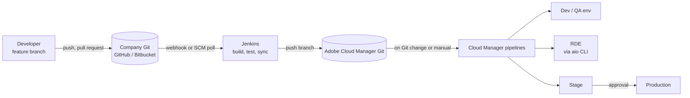
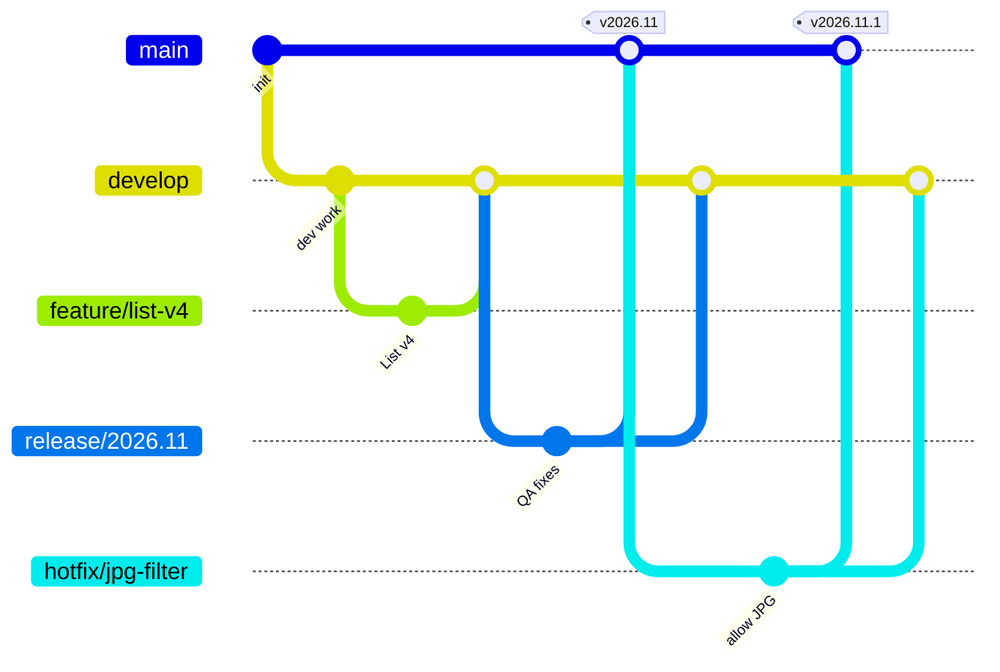
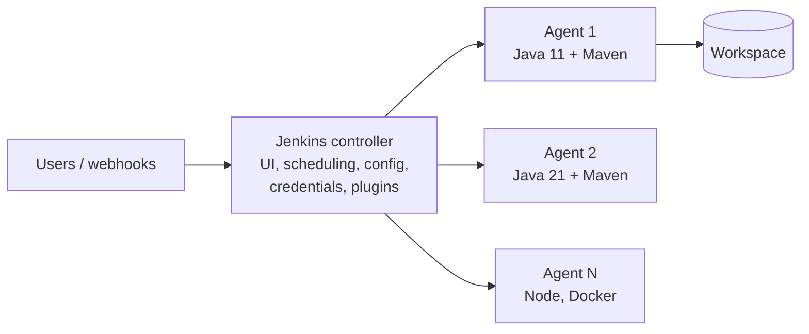
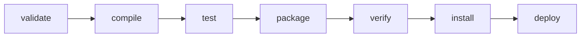
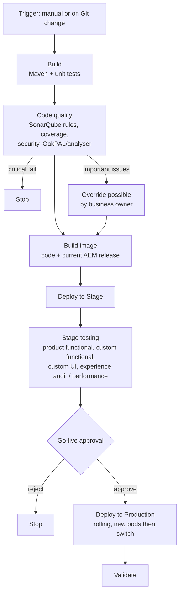
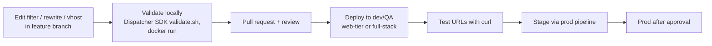

# AEM DevOps and Deployment Lifecycle

> Module 2. Goal: understand how code moves from a developer's laptop to AEM production: Git, Jenkins, Maven, Cloud Manager, environments, change control, validation and recovery.
>
> Labels: **[Hands-on]** your work · **[Adjacent]** touched it, theory is new · **[Theory]** study only · `[fill in]` a detail only you know.

---

## Contents

1. [The lifecycle in one picture](#1-the-lifecycle-in-one-picture)
2. [Git and GitHub](#2-git-and-github)
3. [Jenkins](#3-jenkins)
4. [Maven](#4-maven)
5. [AEM project packaging](#5-aem-project-packaging)
6. [Cloud Manager deployment](#6-cloud-manager-deployment)
7. [Dispatcher deployment](#7-dispatcher-deployment)
8. [Environments, promotion and change control](#8-environments-promotion-and-change-control)
9. [A sanitized end-to-end example](#9-a-sanitized-end-to-end-example)
10. [Troubleshooting guide](#10-troubleshooting-guide)
11. [Revision sheet](#11-revision-sheet)

---

## 1. The lifecycle in one picture



Three ideas carry the whole subject:
1. **One source of truth**: Git. Everything deployed (Java, components, OSGi config, Dispatcher config, Repoinit) is in Git.
2. **Build once, promote**: the same built artifact goes to Stage and then Production.
3. **Gates**: tests, code quality, approval and validation stop bad changes before production.

---

## 2. Git and GitHub

### 2.1 Fundamentals

| Concept | Meaning |
|---------|---------|
| Repository | Project folder with full history (`.git`) |
| Commit | Snapshot of changes with ID (SHA), author, message, parent |
| Branch | A movable pointer to a commit; a line of work |
| Remote | Another copy of the repository (e.g. `origin` on GitHub, `adobe` for Cloud Manager) |
| Push / pull / fetch | Send commits / get and merge / get without merging |
| Merge | Join two branches, creating a merge commit if they diverged |
| Rebase | Replay your commits on top of another branch (linear history) |
| Tag | Fixed name for a commit, e.g. `release-2026.11.1` |

```bash
git checkout -b feature/PROJ-123-list-teaser develop   # new branch from develop
git add -A && git commit -m "PROJ-123 List v4 teaser delegate"
git push -u origin feature/PROJ-123-list-teaser          # then open a pull request
git fetch origin && git rebase origin/develop           # keep branch current
git log --oneline --graph --decorate -20                # see history
```

### 2.2 Branching strategy (Git Flow style)



| Branch | Purpose | Deploys to |
|--------|---------|-----------|
| `feature/*` | One story or fix | Local, RDE |
| `develop` | Integration of finished features | Dev / QA |
| `release/*` | Stabilise a release; only fixes | Stage, then Prod |
| `main` | What is in production | Prod (tagged) |
| `hotfix/*` | Urgent production fix from `main` | Stage → Prod, then merged back to `develop` |

Your experience mentions release branches **[Hands-on]**: `[fill in: your real branch names and which branch fed which environment]`.

### 2.3 Pull requests and code reviews
- A pull request (PR) proposes merging a branch; reviewers comment and approve.
- Branch protection: required reviews, passing build, no direct pushes to `develop`/`main`.
- Review for: correctness, security (no admin sessions, no secrets), performance, Dispatcher rules, package filters, run-mode configs.

### 2.4 Merge conflicts
- Happen when two branches change the same lines (or one deletes a file the other edits).
- Git marks them:
```
<<<<<<< HEAD
/extension '(html|jpg|png)'
=======
/extension '(html|jpg|JPG|png|xlsx)'
>>>>>>> hotfix/jpg-filter
```
- Resolve by choosing/merging content, `git add`, `git commit` (or `git rebase --continue`), then **rebuild and test**. Typical AEM conflict spots: `.content.xml`, filter files, `pom.xml` versions.

### 2.5 How code reaches Adobe's repository
Cloud Manager builds from **its own Git repository** per program, or (newer) directly from a linked GitHub/GitLab/Bitbucket repository. In the sync model, a CI job pushes the chosen branch to the Adobe remote:

```bash
git remote add adobe https://git.cloudmanager.adobe.com/<org>/<program>/
git push adobe release/2026.11:release/2026.11
```
Each push is a new commit event for Cloud Manager; if a pipeline's trigger is **On Git Changes**, it starts.

---

## 3. Jenkins

### 3.1 Architecture



| Concept | Meaning |
|---------|---------|
| Controller | Central server: schedules builds, stores jobs, credentials, plugins. Should run few builds itself. |
| Agent (node) | Machine/container that runs builds; has labels (`java11`, `maven`). |
| Executor | A build slot on an agent. |
| Job / project | A configured build: freestyle, Pipeline, Multibranch Pipeline. |
| Pipeline | Build defined as code (Jenkinsfile) with stages. |
| Multibranch | Creates a pipeline per branch/PR automatically. |
| Workspace | Folder where the job checks out code and builds. |
| Plugins | Git, Pipeline, Credentials Binding, Maven Integration, etc. |

### 3.2 Jenkinsfile and stages

```groovy
pipeline {
  agent { label 'java11 && maven' }
  options {
    disableConcurrentBuilds()          // one run at a time per branch
    timestamps()
    buildDiscarder(logRotator(numToKeepStr: '20'))
  }
  triggers {
    pollSCM('H/5 * * * *')             // OR a webhook; not both for the same branch
  }
  environment { MAVEN_OPTS = '-Xmx1g' }
  stages {
    stage('Checkout')    { steps { checkout scm } }
    stage('Build+Test')  { steps { sh 'mvn -B clean verify' } }
    stage('Dispatcher validate') { when { changeset 'dispatcher/**' }
                           steps { sh './dispatcher/validate.sh || true' } }   // example
    stage('Sync to Adobe') {
      when { branch 'release/*' }
      steps {
        withCredentials([usernamePassword(credentialsId: 'adobe-git',
                         usernameVariable: 'U', passwordVariable: 'P')]) {
          sh 'git push https://$U:$P@git.cloudmanager.adobe.com/org/program/ HEAD:$BRANCH_NAME'
        }
      }
    }
  }
  post { failure { echo 'notify team' } }
}
```
(Illustrative Jenkinsfile; your real one may differ: `[fill in what yours did]`.)

### 3.3 Triggers: SCM polling vs webhooks

| Trigger | How it works | Pros / cons |
|---------|-------------|-------------|
| **SCM polling** (`pollSCM`) | Jenkins checks the repo on a cron schedule; builds if new commits | Simple, works behind firewalls; delay; load on Git |
| **Webhook** | Git host calls Jenkins on push/PR | Instant; needs Jenkins reachable from Git host |
| **Upstream job** | Job B starts after job A | Chains |
| **Timer** (`cron`) | Nightly builds regardless of change | Regular checks |
| **Manual** | "Build Now" / with parameters | Controlled releases |

`H/5` in cron spreads load ("hash"): every 5 minutes at a job-specific offset. Your experience includes SCM polling **[Hands-on]**: `[fill in: polling schedule and which branches]`.

### 3.4 Avoiding duplicate pipeline triggers
Duplicates happen when **more than one trigger reacts to the same change**:
- Polling **and** webhook both enabled for the same job.
- A job pushes to another repository, and that repository's CI also triggers (sync loops) — the situation in your task log: the destination repository treats the synced commit as new and triggers again **[Hands-on]**.
- A job commits back to the branch it watches (version bump), retriggering itself.
- Multibranch indexing plus a separate job for the same branch.

Fixes: one trigger per change (choose webhook *or* poll); Cloud Manager pipeline trigger set to **Manual** when Jenkins orchestrates, or Jenkins does not trigger when Cloud Manager does; ignore commits by the CI user (`[ci skip]` messages, "Ignore commits from certain users" in Git plugin); `disableConcurrentBuilds()`; quiet period to batch pushes.

### 3.5 Credentials and secure configuration
- Store secrets in the **Jenkins Credentials store**; use them with `withCredentials`; they are masked in logs.
- Never put passwords in Jenkinsfile, `pom.xml` or `settings.xml` in Git.
- Restrict who can configure jobs; use folders and role-based access.
- For Cloud Manager: runtime secrets go in **Cloud Manager environment variables of type secret**, not in the code.

### 3.6 Reading a failed build (console log)
1. Open the build → **Console Output**; scroll to the first `ERROR` / `BUILD FAILURE`, not the last line.
2. Identify the stage (Pipeline Stage View).
3. Classify: checkout (credentials, branch), Maven (compile, test, dependency), script (exit code), push (auth, non-fast-forward), agent (offline, disk full).
4. Reproduce locally with the same Java and Maven version (`mvn -v`).

---

## 4. Maven

### 4.1 Structure and pom.xml

```
my-aem-project/
├── pom.xml              (parent: modules, versions, plugin management)
├── core/pom.xml         (bundle)
├── ui.apps/pom.xml      (content-package)
├── ui.config/pom.xml
├── ui.content/pom.xml
├── ui.frontend/pom.xml
├── dispatcher/pom.xml
└── all/pom.xml          (embeds everything)
```

Key parts of a `pom.xml`: `groupId:artifactId:version` (GAV coordinates), `packaging` (jar, bundle, content-package, pom), `<modules>`, `<properties>` (Java version, plugin versions), `<dependencies>` with **scope** (`compile`, `provided`, `test`), `<dependencyManagement>` (central versions), `<build><plugins>`, `<repositories>`, `<profiles>`.

AEMaaCS projects depend on the **AEM SDK API** (`com.adobe.aem:aem-sdk-api`) with scope `provided`: available at compile time, supplied by AEM at runtime.

### 4.2 Lifecycle


| Phase | Does |
|-------|------|
| validate | Project structure correct |
| compile | Compile `src/main/java` |
| test | Run unit tests (Surefire) |
| package | Build jar/bundle/content package (zip) |
| verify | Integration checks; in AEM projects the **AEM analyser** runs here |
| install | Copy artifact to local repo `~/.m2/repository` |
| deploy | Upload to a remote artifact repository (Nexus/Artifactory) |

`clean` is a separate lifecycle that deletes `target/`. Running a phase runs all earlier phases.

Useful commands: `mvn clean install`, `mvn -B -U clean verify` (batch, force update snapshots), `mvn -pl core -am install` (one module + dependencies), `mvn dependency:tree`, `mvn -X` (debug), `-DskipTests` (avoid in CI), `-PautoInstallPackage` (archetype profile to install to local AEM).

### 4.3 Plugins in AEM projects
| Plugin | Role |
|--------|------|
| `maven-compiler-plugin` | Java source/target version |
| `bnd-maven-plugin` | Builds OSGi bundle metadata (imports/exports) |
| `filevault-package-maven-plugin` | Builds content packages from `jcr_root` with `filter.xml` |
| `aemanalyser-maven-plugin` | Checks packages/bundles against the AEM SDK (same checks Cloud Manager runs) |
| `content-package-maven-plugin` | Installs packages to a running AEM (local/on-prem) |
| `frontend-maven-plugin` | Runs npm build in `ui.frontend` |

### 4.4 Java versions [Adjacent]
- Build Java version must match what the project and AEM support. In Cloud Manager, the build Java version is chosen in the repository (a `.cloudmanager/java-version` file); check Adobe's current documentation for allowed values. Runtime Java for AEMaaCS is managed by Adobe.
- In Jenkins, the agent's JDK (or a `tools { jdk 'jdk11' }` block) decides. Mismatch symptoms: `invalid target release`, `Unsupported class file major version`.
- Your experience includes Maven and Java version handling **[Hands-on]**: `[fill in: which versions and what you changed]`.

### 4.5 Build failures and dependency issues
| Error | Meaning | Fix |
|-------|---------|-----|
| `Could not resolve dependencies ... not found` | Artifact not in any configured repository, wrong version, private repo unreachable/needs credentials | Check GAV, repository in `pom.xml`/`settings.xml`, credentials |
| `Failed to read artifact descriptor` | Corrupt local cache or network | `-U`, delete the folder in `~/.m2` |
| `package X does not exist` | Missing dependency or wrong scope | Add dependency |
| `invalid target release: 21` | JDK older than requested | Use correct JDK |
| Tests fail | Code or environment | Read Surefire report `target/surefire-reports` |
| Analyser errors (`Bundle ... is importing package ... which is not exported`) | Bundle imports a package AEM does not provide | Embed the library or use API from SDK |
| `filter.xml` overlap | Two packages own the same path | Fix filter roots |

---

## 5. AEM project packaging

| Module | Package type | Installs to | Mutable? |
|--------|-------------|-------------|----------|
| `core` | OSGi bundle | Embedded in ui.apps / all | – |
| `ui.apps` | `application` | `/apps` | Immutable |
| `ui.config` | `container` / application | `/apps/<project>/osgiconfig` | Immutable |
| `ui.content` | `content` | `/conf`, `/content` | Mutable |
| `ui.frontend` | build → clientlibs in ui.apps | `/apps` | Immutable |
| `dispatcher` | zip | Dispatcher config | – |
| `all` | `container` | Embeds the others | – |

Rules in AEMaaCS:
- A package is either **mutable** (content) or **immutable** (code), never both.
- `/apps` and `/libs` can only change through a pipeline.
- Indexes (`/oak:index`) deploy via `ui.apps`/`ui.config` style packages with special naming.
- Service users, groups, paths, ACLs, namespaces: Repoinit in `ui.config`.
- `filter.xml` modes: `replace` (default), `merge`, `update`: decides whether existing content under the root is overwritten.

---

## 6. Cloud Manager deployment

### 6.1 Programs, environments, pipelines

| Term | Meaning |
|------|---------|
| Program | A customer project (e.g. one per brand/platform) |
| Environment | dev, stage, prod (stage+prod as a pair), **RDE** |
| Pipeline | Production (stage → prod) or non-production (dev env, or code quality only) |
| Pipeline type | Full-stack, web-tier config, front-end, config |

### 6.2 Production pipeline



Points to remember:
- **Same artifact** is deployed to Stage and Production (build once).
- Production deploy is **rolling / blue-green**: new containers start, health checks pass, traffic switches. If the new version fails to start, the old one keeps serving.
- Optional **scheduled** deployment and **CSE oversight** for Enterprise customers [Theory].
- Code quality ratings: Security, Reliability, Maintainability, Coverage, Skipped tests, Duplications, Cloud Service compatibility. Failures are **critical** (stop) or **important** (override).

### 6.3 Non-production pipelines
- **Deployment** to a dev environment: build, quality, deploy (often you named this QA).
- **Code quality only**: scan a branch without deploying.
- RDE: not a Cloud Manager pipeline; deploy with `aio aem:rde:install <package.zip>` in seconds; for quick developer testing.

Your experience **[Hands-on]**: created pipelines for RDE, QA, STAGE and worked with Adobe pipelines. `[fill in: what an "RDE pipeline" meant in your setup, e.g. a Jenkins job calling the aio CLI]`.

### 6.4 Pipeline types and when to use them
| Type | Deploys | Note |
|------|---------|------|
| Full-stack | Everything | Default, slowest |
| Web-tier config | Dispatcher config only | Minutes; full-stack then skips dispatcher for that env |
| Front-end | Site theme from `ui.frontend` | Separate front-end team |
| Config | `config/*.yaml`: CDN rules, traffic filters, log forwarding, maintenance | [Theory] |

### 6.5 Environment variables
Defined per environment (and per service) in Cloud Manager; referenced in OSGi configs:
```json
{ "smtp.host": "$[env:SMTP_HOST;default=localhost]",
  "smtp.password": "$[secret:SMTP_PASSWORD]" }
```
Changing a variable restarts the environment's pods but needs no code change.

### 6.6 Validation and rollback / recovery
- **Validation after deploy**: pipeline green; smoke test key pages (home, a page per country, forms, search); check error.log for new errors; check Dispatcher returns expected status; author can edit and publish.
- **Rollback in AEMaaCS**: there is no one-click code rollback. Revert the commit (or redeploy the previous tag) and run the pipeline again. Plan the release so this is possible quickly.
- **Content recovery**: self-service content restore in Cloud Manager for recent points in time [Theory: check Adobe's documented retention].
- **Migration recovery**: re-ingest a known-good set (you did this **[Hands-on]**).

---

## 7. Dispatcher deployment

### 7.1 Where the config lives
```
dispatcher/src/
├── conf.d/
│   ├── available_vhosts/ site.vhost
│   ├── enabled_vhosts/   (symlinks)
│   ├── rewrites/         rewrite.rules
│   └── variables/        custom.vars
└── conf.dispatcher.d/
    ├── available_farms/  site.farm
    ├── enabled_farms/
    ├── filters/          filters.any
    ├── cache/            rules.any, invalidate.any
    ├── clientheaders/
    └── virtualhosts/
```
Some files are **immutable** (Adobe defaults); you add your own files and include them.

### 7.2 Change flow


### 7.3 Validation layers
1. **Local**: Dispatcher SDK `validate.sh` (syntax, allowed directives) and running the Docker image against a local publish.
2. **Pipeline**: Cloud Manager runs the same validator; forbidden directives fail the build.
3. **Functional**: `curl` the changed URLs on QA/Stage; check status, cache headers, redirects.

Your experience **[Hands-on]**: `.html` append rule, domain mapping across RDE/QA/STAGE/PROD, allowing `.JPG` and `.xlsx`. Use environment variables in vhosts/rewrites so one config serves every environment.

---

## 8. Environments, promotion and change control

| Environment | Purpose | Who tests | Data |
|-------------|---------|-----------|------|
| Local SDK | Developer | Developer | Sample |
| RDE | Fast developer integration | Developer | Sample |
| Dev / QA | Integration, QA testing | QA team | Copy / test |
| Stage | Production-like, final validation, performance | QA, business UAT | Close to prod |
| Production | Live | Everyone | Real |

**Promotion**: a change moves forward only after passing the previous environment. A release branch is cut from `develop`, deployed to QA, fixes go into the release branch, then the same commit goes to Stage and Prod.

**Change control** for production:
- Change ticket: scope (commit/tag, list of stories), risk, test evidence, deployment window, approvers, communication, validation steps, **rollback plan**.
- Approvals: business owner and technical lead; CAB for normal changes.
- Freeze periods around key business dates.
- Post-deployment review: validation evidence attached; incidents linked.

Your experience **[Hands-on]**: production release management, QA and Stage promotion. `[fill in: approvers, ticket tool, release cadence, smoke-test list]`.

---

## 9. A sanitized end-to-end example

> A realistic composite built from the kinds of tasks in your log. Replace `[fill in]` items with your real process before using it in an interview.

**Change**: List component should render items as Teasers (List v3 → v4, teaser delegate) **[Hands-on task]**, plus allowing `.JPG` images in the Dispatcher filter **[Hands-on task]**.

1. **Branch**: `feature/PROJ-xxx-list-v4` from `develop`.
2. **Code**: proxy component `sling:resourceSuperType` → `core/wcm/components/list/v4/list`; policy property for the teaser delegate; filter rule update in `dispatcher/src/conf.dispatcher.d/filters/filters.any`.
3. **Local checks**: `mvn clean install -PautoInstallPackage` to local AEM SDK; Dispatcher SDK validate.
4. **Pull request** → review → merge to `develop`.
5. **Jenkins** `[fill in: webhook or polling]` builds `develop` (`mvn -B clean verify`) and syncs to the Adobe repository.
6. **Cloud Manager** dev/QA pipeline deploys to QA; QA tests the List on a test page and image URLs with `.JPG`.
7. **Release branch** `release/2026.11` cut; QA sign-off.
8. **Production pipeline** on the release branch: build → quality → Stage → stage tests → UAT on Stage.
9. **Change ticket** approved `[fill in]`; deployment window.
10. **Approve** in Cloud Manager → Production deployment.
11. **Validate**: pages with Lists on several country sites; `.JPG` images return 200; error.log clean; authors confirm.
12. **Close**: tag `v2026.11`, merge release into `main` and `develop`, update release notes.

---

## 10. Troubleshooting guide

### 10.1 Jenkins build failure
1. Console Output → first error. 2. Which stage? 3. Agent healthy (disk, JDK, Maven)? 4. Reproduce locally with same versions. 5. Recent changes in Jenkinsfile, `pom.xml`, credentials, plugins.

### 10.2 Maven dependency failure
`mvn dependency:tree -Dverbose`, check repository config/credentials in `settings.xml`, proxy/firewall from agent, version exists, force update `-U`, clear the bad folder in `~/.m2/repository`.

### 10.3 Pipeline not triggering
| Check | |
|---|---|
| Webhook delivery | Git host → webhook → recent deliveries (HTTP status) |
| Polling | Job's "Git Polling Log"; branch spec matches |
| Cloud Manager trigger | Set to On Git Changes? correct branch? pipeline already running? |
| Sync job | Did the push to Adobe Git actually happen? credentials expired? |
| Branch name | Typos, case, pattern |

### 10.4 Duplicate pipeline execution
Map every trigger for the branch (webhook, polling, upstream jobs, Cloud Manager on-change, sync job). Keep exactly one per change. Ignore CI-user commits. See 3.4. **[Hands-on]**

### 10.5 Deployment failure (Cloud Manager)
Download the step log. Typical causes: package install error (filter overlap, mutable/immutable mix), Repoinit syntax/statement failure, bundle not active (missing import), index definition invalid, environment variable missing, Dispatcher validator error.

### 10.6 Package or configuration mismatch
Symptoms: feature works in one env, not another. Check: deployed commit per env (pipeline history), run-mode config folders (`config.stage` vs `config.prod`), environment variables per env, Dispatcher variables per env, content (templates/policies in `/conf` are mutable — packaged initial content may not overwrite existing).

### 10.7 QA works but Stage fails
Differences to check: commit; env variables; run modes (`dev` vs `stage`); IP allowlist; domain/vhost; content and templates; data volume (queries slow on Stage); stage-only tests (performance, security headers); CDN in front of Stage.

### 10.8 Production deployment validation
Pipeline green ≠ release successful. Verify: smoke tests, key journeys (navigation, forms → emails, search), status codes via `curl`, error.log/request.log for new errors, author editing and publishing, performance vs baseline, monitoring for 30–60 minutes, then sign-off.

---

## 11. Revision sheet

- Git: commit, branch, merge, rebase, tag; feature → develop → release → main; hotfix from main, merge back.
- PRs: review + passing build; conflicts → resolve, rebuild, retest.
- Jenkins: controller schedules, agents build; Jenkinsfile stages; credentials store + `withCredentials`.
- Triggers: polling (cron `H/5`), webhook, upstream, timer, manual. One trigger per change avoids duplicates.
- Maven: GAV, scopes (provided for AEM SDK), lifecycle validate→compile→test→package→verify→install→deploy.
- AEM modules: core (bundle), ui.apps (immutable), ui.config (OSGi + Repoinit), ui.content (mutable), ui.frontend, dispatcher, all.
- Cloud Manager prod pipeline: build → quality → image → Stage → tests → approval → Prod (rolling).
- Pipeline types: full-stack, web-tier config, front-end, config; RDE via aio CLI.
- Env variables: `$[env:NAME;default=x]`, `$[secret:NAME]`.
- Dispatcher change: branch → validate.sh → PR → QA → curl → Stage → Prod.
- Promotion: build once, same artifact to Stage and Prod.
- Change control: ticket, risk, evidence, window, approvers, rollback plan, validation.
- Rollback in cloud: revert commit + rerun pipeline; content restore for content.
