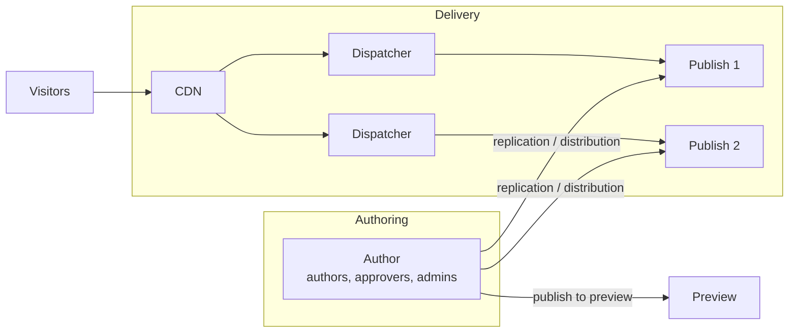
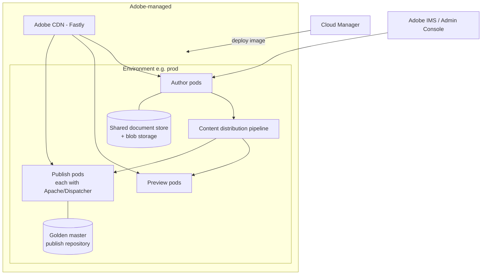
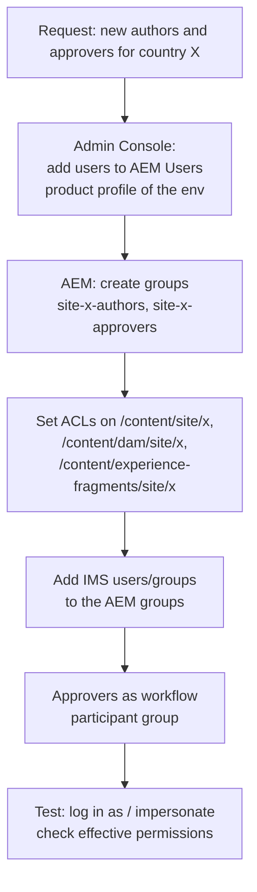
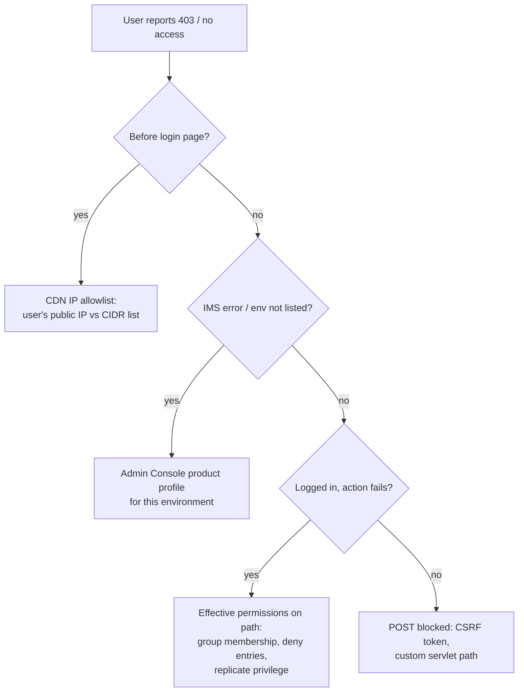
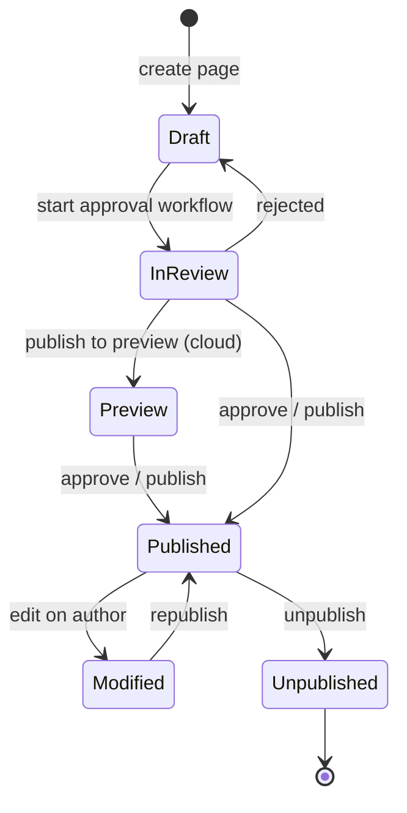
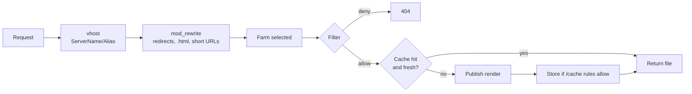

# AEM Administration and Platform Architecture

> Module 3. Goal: understand how AEM is structured and administered, on-premise and as a Cloud Service: products, tiers, users and permissions, content and publication, repository, Dispatcher and CDN.
>
> Labels: **[Hands-on]** your work · **[Adjacent]** touched it, theory is new · **[Theory]** study only · `[fill in]` a detail only you know.

---

## Contents

1. [AEM fundamentals](#1-aem-fundamentals)
2. [AEM as a Cloud Service](#2-aem-as-a-cloud-service)
3. [User and access administration](#3-user-and-access-administration)
4. [Content administration](#4-content-administration)
5. [Repository administration](#5-repository-administration)
6. [Dispatcher administration](#6-dispatcher-administration)
7. [Troubleshooting scenarios](#7-troubleshooting-scenarios)
8. [Revision notes](#8-revision-notes)

---

## 1. AEM fundamentals

### 1.1 AEM as a CMS
Adobe Experience Manager is an enterprise **content management system** and digital asset manager. It separates **creating** content (Author) from **delivering** it (Publish), and lets non-developers build pages from reusable components inside templates controlled by developers and template authors.

| Product | What it manages | Key ideas |
|---------|-----------------|-----------|
| **AEM Sites** | Web pages, sites, languages | Pages, templates, components, Experience Fragments, Content Fragments, MSM (live copies), translation |
| **AEM Assets (DAM)** | Images, video, documents | Metadata, renditions, processing, collections, Dynamic Media, Brand Portal |
| **AEM Forms** | Data-capture forms and documents | Adaptive Forms, form data models, submit actions, document of record |
| **Screens / Guides** | Digital signage / technical docs | [Theory, not needed in depth] |

Your platform: an enterprise multi-site platform, AEM Sites on AEMaaCS with many country sites **[Hands-on]**.

### 1.2 Architecture: Author, Publish, Dispatcher, CDN



| Tier | Role | Scaling |
|------|------|---------|
| Author | Create, edit, review, workflows, assets processing | Cluster sharing one repository (cloud) |
| Publish | Serve published content to visitors | Many independent instances (farm) |
| Preview | Review before go-live (cloud only) | Like publish |
| Dispatcher | Security filter + cache + URL handling in Apache | One per publish |
| CDN | Edge cache, SSL, global delivery, access rules | Adobe-managed (cloud) |

---

## 2. AEM as a Cloud Service

### 2.1 Architecture



Adobe manages: infrastructure, scaling, OS, Java runtime, AEM version updates (continuous), backups, CDN, monitoring of the platform. The customer manages: code and config (through Git and pipelines), content, users (through Admin Console and AEM groups), domains/certificates/allowlists (through Cloud Manager).

### 2.2 Cloud Manager

| Area | You can |
|------|---------|
| Programs and environments | Create dev/stage/prod/RDE, see status, AEM release |
| Pipelines | Create, run, approve, see logs |
| Environment variables | Add plain/secret variables per env and service |
| Domains and SSL | Add certificates, custom domains, domain mappings **[Hands-on]** |
| IP allowlists | Create CIDR lists, apply to author/publish/preview **[Hands-on]** |
| Logs | Download per service and day |
| Developer Console | Bundles, components, configs, queries for an env [Theory] |
| Advanced networking | Egress IP, port forwarding, VPN [Theory] |
| Content copy / restore | Copy content between envs; restore content [Theory] |

### 2.3 Environments
| Environment | Purpose |
|-------------|---------|
| Development (often called QA in projects) | Integration testing |
| Stage | Production-like validation; always paired with prod |
| Production | Live |
| RDE | Rapid Development Environment: fast deploys via aio CLI, no pipeline, for developers |

### 2.4 Traditional AEM vs AEMaaCS

| Topic | AEM 6.5 (on-prem / AMS) | AEMaaCS |
|-------|-------------------------|---------|
| Infrastructure | Customer or Adobe Managed Services servers | Adobe-managed containers, auto-scaling |
| Upgrades | Service packs, upgrade projects | Continuous, automatic |
| Deployment | Package Manager, Jenkins/Maven, any tool | Cloud Manager pipelines only (aio for RDE) |
| `/apps`, `/libs` | Writable | Immutable at runtime |
| Replication | Agents, queues, flush agents | Sling Content Distribution, automatic invalidation |
| Consoles | Felix `/system/console`, CRXDE everywhere | Developer Console; CRXDE on dev author only |
| Users | Local, LDAP, SAML | IMS + Admin Console product profiles |
| Assets processing | DAM Update Asset workflow | Asset microservices + processing profiles |
| Search indexes | Created at runtime | Deployed via pipeline |
| Logs | Files on disk, any tool | Download / tail / forward |
| Maintenance (compaction, purge) | You schedule | Adobe runs most; some tasks configurable |
| Preview tier | No | Yes |

---

## 3. User and access administration

### 3.1 Users and groups
- **User**: a person or technical account (`/home/users`).
- **Group**: collection of users and/or groups (`/home/groups`); permissions are given to groups.
- **Built-in groups**: `administrators`, `everyone` (all users including anonymous on publish), `contributor`, `content-authors`, `workflow-users`, `dam-users`.
- In the cloud, users **log in via Adobe IMS**. The AEM user is created on first login. **Product profiles** in Admin Console ("AEM Users", "AEM Administrators" per environment) control who may log in, and become AEM groups.

### 3.2 Administration workflow for a new country site **[Hands-on]**


`[fill in: exactly which steps you did vs another team]`

### 3.3 Permissions and ACLs

| Privilege | Allows |
|-----------|--------|
| `jcr:read` | See the node |
| `rep:write` / `jcr:modifyProperties`, `jcr:addChildNodes`, `jcr:removeNode` | Edit, create, delete |
| `crx:replicate` | Publish / unpublish |
| `jcr:readAccessControl` / `jcr:modifyAccessControl` | Read / edit permissions |
| `jcr:versionManagement` | Create/restore versions |

**Evaluation rules**:
1. Entries are inherited down the tree; a deeper entry overrides for its subtree.
2. At the same node: entries for the **user** override entries for **groups**; among groups, **later entries override earlier**.
3. **Deny** is not automatically stronger; order and depth decide.
4. Restrictions (`rep:glob`) narrow an entry to a pattern (e.g. only `jcr:content`).

Tools: **Tools → Security → Permissions** (view a principal's ACEs; **Test Privilege** for a path); Users; Groups; in dev, CRXDE "Access Control" tab.

### 3.4 Service users and user mapping
Code should not use admin sessions. It uses a **service user** with only the rights it needs:
1. Create the service user and its ACLs with **Repoinit**.
2. Map bundle + sub-service name to the user:
```json
// org.apache.sling.serviceusermapping.impl.ServiceUserMapperImpl.amended~mysite.cfg.json
{ "user.mapping": [ "com.example.mysite.core:content-reader=[mysite-content-reader]" ] }
```
3. Code gets a resolver with `resolverFactory.getServiceResourceResolver(Map.of(ResourceResolverFactory.SUBSERVICE, "content-reader"))`.

Failure symptom: `LoginException: Cannot derive user name for bundle ... and sub service ...` → mapping missing or service user not created.

### 3.5 Principle of least privilege
Give each person and service the **minimum** rights for their job: authors edit only their country, approvers publish only their country, nobody uses `admin` for daily work, service users only the paths they read/write. Benefits: smaller blast radius, auditability, fewer accidental changes.

### 3.6 Author access issues and 403 troubleshooting


Your case: Regional authors → users and access fine → logs show IP → not in allowlist → CIDR added **[Hands-on]**.

---

## 4. Content administration

### 4.1 Pages, templates, components
- **Page**: `cq:Page` node + `jcr:content` with components as children.
- **Editable template** (`/conf/<site>/settings/wcm/templates`): structure (locked), initial content, policies (allowed components, styles). Template authors manage them.
- **Component**: reusable building block (`/apps/<project>/components`), usually a proxy of a Core Component.
- **Experience Fragment**: reusable group of components (header, footer) under `/content/experience-fragments`.
- **Content Fragment**: structured content (no layout) based on a model, delivered to pages or headless via GraphQL [Theory].

### 4.2 Assets
- Stored under `/content/dam`. Each asset has the original, **renditions** (thumbnails, web sizes) and **metadata**.
- In the cloud, uploads go directly to blob storage and **asset microservices** create renditions; **processing profiles** define custom renditions [Theory].
- On 6.5, the **DAM Update Asset** workflow does processing [Theory].
- Publishing assets: assets referenced by a page are published with it (if selected); unpublished references → broken images.

### 4.3 Activation and the publication lifecycle



### 4.4 Replication: agents and queues (AEM 6.5) [Theory]
- Agents under `/etc/replication/agents.author` (author → publish), `agents.publish` (flush agents → dispatcher).
- Each agent: transport URI (`http://publish:4503/bin/receive?sling:authRequestLogin=1`), transport user, serialization, triggers.
- Queue: items wait; if the first fails, the queue **blocks**. Admin actions: view log, test connection, retry, clear/remove item.
- **Reverse replication**: publish → author (user-generated content), legacy.

### 4.5 Replication in AEMaaCS **[Adjacent]**
- Sling Content Distribution via an Adobe pipeline service; no agents to configure.
- Tools → Deployment → **Distribution**: see the queue, status, blocked items, retry/clear.
- Publish **to Preview** or **to Publish** via Manage Publication **[Hands-on: preview-to-publish workflow]**.
- Dispatcher invalidation happens automatically; CDN expires by TTL.
- API for code: `Replicator` (`com.day.cq.replication`) still works.

### 4.6 Workflow administration
| Admin task | Where |
|-----------|-------|
| Edit models, **Sync** to runtime | Tools → Workflow → Models |
| Launchers (auto-start) | Tools → Workflow → Launchers |
| Running instances: suspend, resume, terminate | Tools → Workflow → Instances |
| Failed steps: retry | Tools → Workflow → Failures |
| Archive / purge | Workflow purge maintenance task |
| Inbox | Users' assigned work items |

Your experience **[Hands-on]**: built a preview-to-publish workflow; recovered when ingestion wiped workflow definitions.

---

## 5. Repository administration

### 5.1 JCR nodes and properties
- **Node**: has a name, a primary type (`cq:Page`, `dam:Asset`, `nt:unstructured`, `sling:Folder`), optional **mixins** (`mix:versionable`, `rep:AccessControllable`), children, properties.
- **Property**: name + value (String, Long, Boolean, Date, Binary, multi-valued).
- Namespaces: `jcr:`, `nt:`, `mix:`, `sling:`, `cq:`, `dam:`, `rep:`, custom prefixes registered before use (your Repoinit fix **[Hands-on]**).

### 5.2 Repository structure

```
/
├── apps/        project code (immutable in cloud)
├── libs/        Adobe product code (never edit; overlay in /apps)
├── conf/        templates, policies, workflow models, cloud configs, context-aware configs
├── content/     sites, dam, experience-fragments, forms, usergenerated
├── etc/         legacy: clientlibs proxy path, older configs (moved to /conf over time)
├── var/         runtime: workflow instances/models, audit, eventing, replication data
├── home/        users, groups, service users
├── oak:index/   index definitions
└── tmp/         temporary
```

| Path | Typical admin activity |
|------|-----------------------|
| `/content/<site>` | Page structure, publish status, permissions per country |
| `/content/dam` | Assets, metadata, permissions |
| `/conf/<site>` | Templates, policies; `/conf/global/settings/workflow` for workflows |
| `/var/workflow` | Instance counts, purge |
| `/home` | Users, groups, service users |
| `/etc.clientlibs` | **URL path** (proxy) for clientlibs stored in `/apps` |

### 5.3 CRXDE Lite and safe repository troubleshooting
- CRXDE Lite (`/crx/de`) browses and edits nodes. In AEMaaCS it is available only on **dev** author and is read-only for `/apps`/`/libs`.
- Safe practice:
  - **Read first**: inspect, do not edit in production.
  - Changes to production go through **code (pipeline)** or **content tools** (UI, packages with approval), never ad-hoc CRXDE edits.
  - Before any manual change on 6.5: package the path as a **backup**.
  - Never edit `/libs`; never delete `rep:policy` nodes blindly; never change `jcr:primaryType`.
  - Use Query (Developer Console / QueryBuilder debugger `/libs/cq/search/content/querydebug.html` on 6.5) carefully: large queries hurt performance.

### 5.4 Repository permissions
The same ACL model as section 3.3, applied to any path. Admin views: CRXDE Access Control tab, Permissions console, `rep:policy` children of a node.

---

## 6. Dispatcher administration

### 6.1 Architecture and flow



### 6.2 Filter rules (allowed and denied paths)
- Start with deny-all; allow only site content, clientlibs, required servlets.
- Deny repository dumps (`.infinity.json`, `.tidy`, `.sysview.xml`), admin paths (`/crx`, `/system`, `/bin` except required), query selectors.
- Remember: last match wins; regex case-sensitive; deny → 404.

### 6.3 Cache rules
```
/cache {
  /docroot "${DOCROOT}"
  /statfileslevel "2"
  /rules { /0000 { /glob "*" /type "allow" } /0001 { /glob "/libs/*" /type "deny" } }
  /invalidate { /0000 { /glob "*" /type "deny" } /0001 { /glob "*.html" /type "allow" } }
  /ignoreUrlParams { /0001 { /glob "*" /type "deny" } /0002 { /glob "utm_*" /type "allow" } }
  /headers { "Cache-Control" "Content-Type" "Expires" "Last-Modified" }
}
```
- `/rules`: what may be cached.
- `/invalidate`: which file types are auto-invalidated by `.stat`.
- `statfileslevel`: e.g. level 2 → `.stat` at `/content/site/.stat`, so publishing a page in one site does not invalidate other sites.
- `/ignoreUrlParams`: allow caching despite marketing parameters.
- `/headers`: which response headers are cached with the file.

### 6.4 Invalidation and CDN interaction
- Publish → content distribution → dispatcher invalidation (cloud, automatic; 6.5 via flush agent).
- CDN keeps its copy until TTL; set sensible `Cache-Control` (short for HTML, long for versioned clientlibs).
- Debug: `Age`, `X-Cache`, cache-bust with query string.

### 6.5 Common access and caching issues
| Issue | Cause |
|-------|-------|
| Asset 404 on publish site | Filter extension/case **[Hands-on]**, not published |
| Wrong site for a domain | vhost/rewrite mapping **[Hands-on]** |
| Extensionless links fail | Missing `.html` rewrite **[Hands-on]** |
| Old content | statfileslevel too deep/shallow, CDN TTL |
| Personal data cached | Page with user data not excluded from cache |
| Unstyled page | `/etc.clientlibs` not allowed |
| Login-protected page cached for everyone | Auth checker / CUG not configured [Theory] |

---

## 7. Troubleshooting scenarios

| Scenario | Path of investigation |
|----------|----------------------|
| New country authors cannot see their site | Product profile → AEM group membership → ACL on `/content/<site>/<country>` → `jcr:read` deny? |
| Approver cannot publish | `crx:replicate` on path; workflow participant group; Manage Publication workflow model present |
| Publish queue blocked (cloud) | Distribution console → blocked item → error.log → fix content/permission → retry |
| Page published, site shows old | Publish status → default domain → dispatcher (query-string) → CDN `Age` |
| Workflow does not start | Launcher enabled? glob/node type/run mode; model synced; instances |
| Service fails with LoginException | Service user exists (Repoinit) + mapping config |
| Content migration namespace error | Register namespace with Repoinit **[Hands-on]** |
| Domain shows wrong site | Cloud Manager domain mapping, DNS, vhost alias, rewrite **[Hands-on]** |
| Author 403 from one office | IP allowlist CIDR **[Hands-on]** |

---

## 8. Revision notes

- AEM = CMS + DAM (+ Forms). Author creates; Publish delivers; Preview reviews (cloud); Dispatcher filters/caches; CDN edges.
- AEMaaCS: Adobe runs infra and updates; customer owns code, content, users, domains via Cloud Manager.
- Envs: dev (QA), stage, prod, RDE (aio CLI).
- Users via IMS + Admin Console product profiles → AEM groups → ACLs.
- ACL rules: inherit down; deeper wins; user beats group at same node; later group entry wins.
- Service users: Repoinit + ServiceUserMapper amendment; never admin sessions.
- Least privilege: country-scoped authoring and publishing groups.
- Publication: 6.5 agents/queues/flush; cloud distribution + Distribution console + auto invalidation.
- Workflows: models (/conf → sync → /var), launchers, instances, failures, purge.
- Repository: /apps /libs /conf /content /etc /var /home /oak:index; namespaces registered before use.
- CRXDE: read in prod, change through code or content tools; backup before change on 6.5.
- Dispatcher: vhost → rewrite → filter → cache; statfileslevel; ignoreUrlParams; deny → 404.
