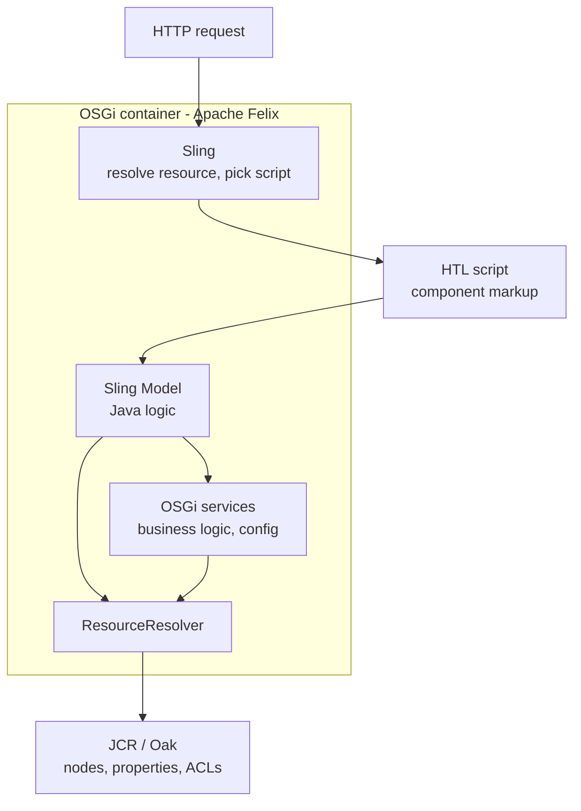
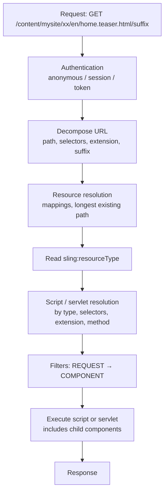
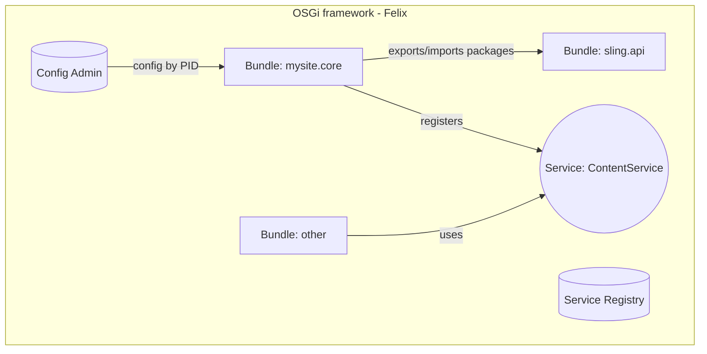
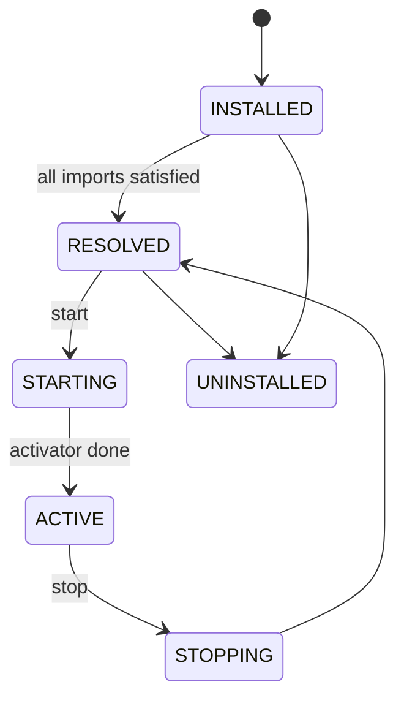
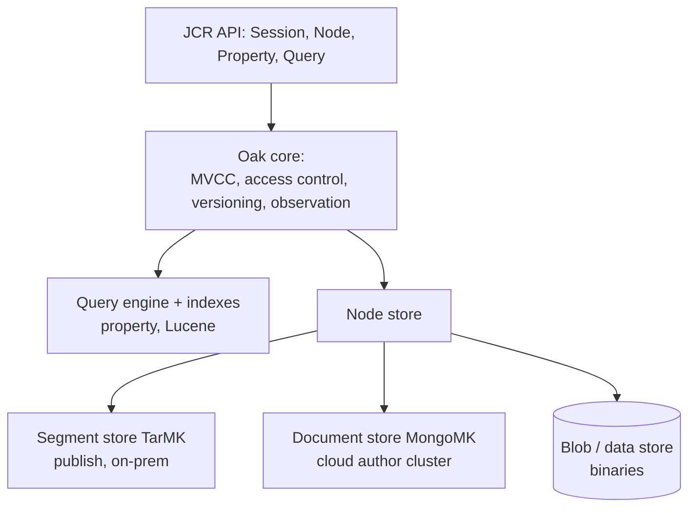
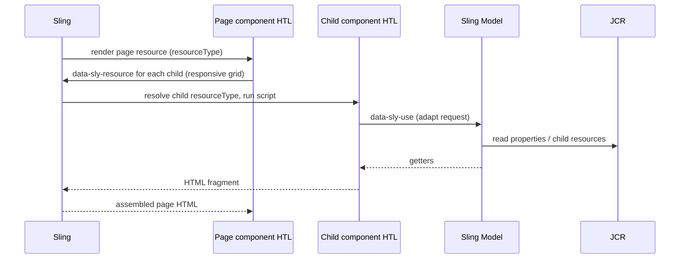

# AEM Internals: Java, Sling, OSGi and JCR

> Module 4. Goal: understand how the frameworks inside AEM work together, so you can follow any request from URL to rendered HTML, and read any stack trace.
>
> Labels: **[Hands-on]** your work · **[Adjacent]** touched it, theory is new · **[Theory]** study only · `[fill in]` a detail only you know.

---

## Contents

1. [How the frameworks fit together](#1-how-the-frameworks-fit-together)
2. [Java fundamentals for AEM](#2-java-fundamentals-for-aem)
3. [Sling framework](#3-sling-framework)
4. [OSGi](#4-osgi)
5. [JCR and Oak](#5-jcr-and-oak)
6. [HTL and AEM components](#6-htl-and-aem-components)
7. [AEM workflows internals](#7-aem-workflows-internals)
8. [One request, end to end](#8-one-request-end-to-end)
9. [Troubleshooting scenarios](#9-troubleshooting-scenarios)
10. [Revision notes](#10-revision-notes)

---

## 1. How the frameworks fit together



- **Java**: the language everything is written in.
- **OSGi**: the module system that loads Java code as bundles and wires services together.
- **Sling**: the web framework (itself a set of OSGi bundles) that maps URLs to content and scripts.
- **JCR/Oak**: the database of content.
- **HTL**: the template language for component markup.

---

## 2. Java fundamentals for AEM

### 2.1 OOP essentials
| Concept | Meaning | AEM example |
|---------|---------|-------------|
| Class / object | Blueprint / instance | `HeroModel` class; one instance per component render |
| Encapsulation | Hide fields, expose methods | Model fields private, getters for HTL |
| Inheritance | Class extends another | Servlet extends `SlingSafeMethodsServlet` |
| Polymorphism | Same call, different implementation | `List` interface → core v4 implementation or your delegate |
| Interface | Contract without implementation | `com.adobe.cq.wcm.core.components.models.List` |
| Abstract class | Partial implementation | `SlingAllMethodsServlet` |

### 2.2 Collections
`List` (ordered: `ArrayList`), `Set` (unique: `HashSet`), `Map` (key→value: `HashMap`, `ConcurrentHashMap` for threads). In AEM: lists of child pages, maps of properties (`ValueMap` is a `Map<String,Object>`).

### 2.3 Exceptions
- **Checked** (`IOException`, `RepositoryException`, `LoginException`): must be caught or declared.
- **Unchecked** (`NullPointerException`, `IllegalArgumentException`): programming errors.
- **Error** (`OutOfMemoryError`, `StackOverflowError`): JVM problems (Module 5).
- Good practice: catch narrowly, log with context (`LOG.error("Failed for {}", path, e)`), never swallow silently, close resources in `try-with-resources`.

### 2.4 Dependency injection
Objects receive what they need instead of creating it. In AEM: OSGi `@Reference` injects services into components; Sling Models inject properties, resources and services with annotations. Benefits: loose coupling, testability, configuration at runtime.

### 2.5 Application lifecycle
A plain Java app has `main()` and runs top to bottom. AEM code has **no main**: OSGi **activates** components when dependencies are ready, Sling **calls** your servlet or model per request, and OSGi **deactivates** them on stop/redeploy. Code must therefore be stateless per request and thread-safe in services.

---

## 3. Sling framework

### 3.1 Architecture
Sling is **resource-first**: every request addresses a resource (usually a JCR node), and the resource's type decides how it is rendered. It is REST-style: URL = resource, method = action, extension = representation.

### 3.2 Request processing



URL decomposition for `/content/mysite/xx/en/home.teaser.mobile.html/foo/bar?x=1`:
| Part | Value |
|------|-------|
| Resource path | `/content/mysite/xx/en/home` |
| Selectors | `teaser`, `mobile` |
| Extension | `html` |
| Suffix | `/foo/bar` |
| Query | `x=1` (not used for resolution; prevents dispatcher caching) |

### 3.3 Resource resolution
- `ResourceResolver.resolve(request, path)` applies **mappings** (`/etc/map`, `resource.resolver.mapping` in the Resource Resolver Factory config) then finds the resource.
- `map()` does the reverse (internal path → public URL), used by link rewriting.
- If nothing exists → `NonExistingResource` → 404 (or the servlet for that path, if registered).
- No read permission = the resource is invisible = 404.

### 3.4 Resource types and script resolution
- `sling:resourceType` = path under `/apps` or `/libs` (search path order: `/apps` first, then `/libs`).
- `sling:resourceSuperType` = inheritance; Sling walks up the chain until a script matches.
- Script names: `<name>.html` (default), `<selector>.html`, `<extension>.<method>` (e.g. `json.GET.js`); most specific wins.

### 3.5 Sling Models
A Java class that adapts a request or resource into an object HTL can use.

```java
@Model(adaptables = SlingHttpServletRequest.class,
       adapters = HeroModel.class,
       defaultInjectionStrategy = DefaultInjectionStrategy.OPTIONAL)
public class HeroModel {

  @ValueMapValue                 // property "title" of the component node
  private String title;

  @ValueMapValue(name = "fileReference")
  private String image;

  @ChildResource
  private List<Resource> links;  // child node "links"

  @OSGiService                   // inject an OSGi service
  private Externalizer externalizer;

  @ScriptVariable
  private Page currentPage;

  @PostConstruct
  protected void init() {
    if (title == null) { title = currentPage.getTitle(); }
  }

  public String getTitle() { return title; }
  public String getImage() { return image; }
}
```

| Annotation | Injects |
|------------|---------|
| `@ValueMapValue` | Property of the resource |
| `@ChildResource` | Child resource(s) |
| `@ResourcePath` | Resource at a path |
| `@OSGiService` | OSGi service |
| `@ScriptVariable` | HTL/JSP bindings: `currentPage`, `properties`, `resource` |
| `@Self` | The adaptable itself (or adapt it to another model) |
| `@Via` | Adapt via something else, e.g. `@Via(type = ResourceSuperType.class)` |
| `@RequestAttribute` | Request attribute |
| `@PostConstruct` | Method run after injection |

**Adaptation**: `request.adaptTo(HeroModel.class)` or `modelFactory.createModel(...)`. Returns `null` (adaptTo) if a **required** injection fails — a classic cause of empty components. Use `OPTIONAL` injection strategy or `@Optional`, and check logs at DEBUG for `org.apache.sling.models`.

**Delegation pattern** (extend a Core Component without copying it) **[Hands-on, List/Teaser]**:
```java
@Model(adaptables = SlingHttpServletRequest.class, adapters = List.class,
       resourceType = "mysite/components/list")
public class DmpList implements List {
  @Self @Via(type = ResourceSuperType.class)
  private List delegate;                         // core List v4 model
  @Override public Collection<ListItem> getListItems() { return delegate.getListItems(); }
  // override only what you need, delegate the rest
}
```

### 3.6 Sling Servlets
```java
@Component(service = Servlet.class)
@SlingServletResourceTypes(resourceTypes = "mysite/components/page",
                           selectors = "search", extensions = "json",
                           methods = HttpConstants.METHOD_GET)
public class SearchServlet extends SlingSafeMethodsServlet {
  @Override
  protected void doGet(SlingHttpServletRequest req, SlingHttpServletResponse resp) throws IOException {
    resp.setContentType("application/json");
    resp.getWriter().write("{\"ok\":true}");
  }
}
```

| Registration | Example | Pros / cons |
|--------------|---------|-------------|
| **Resource type** (+ selector/extension) | `page.search.json` on any page | Respects ACLs of the resource, cacheable URL, preferred |
| **Path** (`@SlingServletPaths("/bin/mysite/search")`) | Fixed URL | Simple, but bypasses resource ACLs, must be allowed in `servletresolver` execution paths and Dispatcher filter, harder to cache per site |

`SlingSafeMethodsServlet` = GET/HEAD; `SlingAllMethodsServlet` adds POST/PUT/DELETE (POST needs CSRF token from author UI).

### 3.7 Sling Filters
```java
@Component(service = Filter.class,
  property = { "sling.filter.scope=REQUEST", "service.ranking:Integer=100",
               "sling.filter.pattern=/content/mysite/.*" })
public class HeaderFilter implements Filter { /* doFilter: add header, then chain.doFilter */ }
```
Scopes: `REQUEST` (once per request), `COMPONENT` (each include), `INCLUDE`, `FORWARD`, `ERROR`. Uses: security headers, logging, redirects. A broken filter affects **every** request in its scope.

### 3.8 ResourceResolver
- In a request: `request.getResourceResolver()` — user's permissions; **do not close**.
- In a background service: get a **service** resolver (Module 3, service users) and **always close** it (`try-with-resources`). Unclosed resolvers leak sessions → memory and warnings "unclosed ResourceResolver".
- API: `getResource(path)`, `resolve`, `map`, `adaptTo(Session.class)`, `adaptTo(PageManager.class)`, `commit()`.

### 3.9 Common Sling troubleshooting
| Symptom | Likely cause |
|---------|--------------|
| 404 for existing page | No read ACL, missing extension, mapping, Dispatcher filter |
| Component renders nothing | Model `adaptTo` returned null (required injection failed); `data-sly-test` false |
| Wrong script used | Selector/extension mismatch; resourceSuperType chain |
| Servlet not called | Not registered (bundle/component inactive), path not in execution paths, filter denies |
| 403 on POST | CSRF token, ACL, servlet method not supported (405) |

---

## 4. OSGi

### 4.1 Architecture



- **Bundle**: JAR + manifest (`Bundle-SymbolicName`, `Import-Package`, `Export-Package`). Each bundle has its own classloader; it sees only what it imports.
- **Service**: object registered under an interface in the service registry; others look it up.
- **Component**: a class managed by **Declarative Services (DS)**; it can provide services and consume others.
- **Config Admin**: delivers configuration (by PID) to components.

### 4.2 Declarative Services

```java
@Component(service = ContentService.class, immediate = true)
@Designate(ocd = ContentServiceImpl.Config.class)
public class ContentServiceImpl implements ContentService {

  @ObjectClassDefinition(name = "Site Content Service")
  public @interface Config {
    @AttributeDefinition(name = "Max items") int maxItems() default 10;
  }

  @Reference
  private ResourceResolverFactory resolverFactory;   // mandatory static reference

  private int maxItems;

  @Activate @Modified
  protected void activate(Config cfg) { maxItems = cfg.maxItems(); }

  @Deactivate
  protected void deactivate() { /* release resources */ }
}
```

Config file (in `ui.config`): `/apps/mysite/osgiconfig/config.publish.prod/com.example.mysite.core.impl.ContentServiceImpl.cfg.json` → `{ "maxItems": 20 }`.

References: **cardinality** (mandatory `1..1`, optional `0..1`, multiple `0..n`), **policy** (static: restart component on change; dynamic: swap live).

### 4.3 Run modes
`author` / `publish` (+ `preview` behaves as publish) and environment `dev` / `stage` / `prod`. Config folders: `config`, `config.author`, `config.publish`, `config.author.dev`, `config.publish.prod`. Most specific wins. In the cloud you cannot add custom run modes; use environment variables for differences.

### 4.4 Bundle states


Stuck in **INSTALLED** = unresolved import (a package no bundle exports, or wrong version range).

### 4.5 Component states
| State | Meaning |
|-------|---------|
| Active | Running, services registered |
| Satisfied | Ready but not yet activated (lazy, nobody uses it yet) |
| Unsatisfied (reference) | A mandatory `@Reference` service is missing |
| Unsatisfied (configuration) | `configurationPolicy = REQUIRE` and no config |
| Failed activation | `activate()` threw an exception (see error.log) |
| Disabled | Turned off |

Where to look: Felix console `/system/console/bundles`, `/components`, `/configMgr` (6.5, local SDK); **Developer Console** in the cloud [Theory]; error.log for activation exceptions.

### 4.6 Dependency and activation failures
| Error / symptom | Cause | Fix |
|-----------------|-------|-----|
| `Unresolved requirement: Import-Package: com.google.x` | Library not available | Embed library or use one AEM provides |
| `missing requirement ... version=[2.0,3)` | Version mismatch | Align dependency version with SDK |
| Component unsatisfied | Referenced service missing/inactive | Fix the dependency service first |
| NullPointerException in activate | Config value missing | Defaults, config file per run mode |
| Feature silently missing | Component never activated | Check component status |

---

## 5. JCR and Oak

### 5.1 Architecture

- **MVCC**: each session sees a consistent snapshot; writes are saved with `session.save()` / `resolver.commit()`. Conflicting concurrent writes fail (`OakState0001` conflict).
- **Observation**: event listeners and Sling resource change listeners fire on changes (launchers use this).

### 5.2 Nodes, properties, sessions
```java
Session session = resolver.adaptTo(Session.class);
Node page = session.getNode("/content/mysite/xx/en/home/jcr:content");
String title = page.getProperty("jcr:title").getString();
page.setProperty("mysite:campaign", "winter");   // custom namespace must be registered
session.save();
```
Prefer the **Sling Resource API** (`Resource`, `ValueMap`, `ModifiableValueMap`) in AEM code; use JCR API for versioning, locking, node types, low-level work.

Resource vs node: a `Resource` is Sling's view (could come from JCR or another provider); `resource.adaptTo(Node.class)` gives the JCR node when it is JCR-backed.

### 5.3 Queries
| Language | Example |
|----------|---------|
| JCR-SQL2 | `SELECT * FROM [cq:Page] AS p WHERE ISDESCENDANTNODE(p, '/content/mysite/xx') AND p.[jcr:content/cq:template] = '/conf/mysite/settings/wcm/templates/article'` |
| QueryBuilder (AEM) | `path=/content/mysite/xx`, `type=cq:Page`, `property=jcr:content/cq:template`, `property.value=...`, `p.limit=20` |
| XPath (deprecated) | `/jcr:root/content/mysite//element(*, cq:Page)` |

**Indexes**: without a matching index, Oak **traverses** nodes (slow; WARN `Traversed 10000 nodes ... consider creating an index`). Lucene indexes under `/oak:index`; in the cloud, deploy custom indexes via pipeline using names like `<name>-custom-1`. Use **Explain Query** to see which index is used.

### 5.4 Repository permissions
Enforced by Oak for every session: a user session sees only what ACLs allow (Module 3 rules). A query returns only readable nodes. A service resolver sees what its service user can.

### 5.5 Content structure and troubleshooting
| Symptom | Check |
|---------|-------|
| Property not saved | Namespace registered? Node type allows the property? Session saved? |
| `ConstraintViolationException` | Node type does not allow child/property (e.g. wrong type under `cq:Workflow`-type content: compare your ingestion case **[Hands-on]**) |
| `AccessDeniedException` | ACL for user/service user |
| `InvalidItemStateException` / conflict | Concurrent modification; retry |
| Slow listing | Traversal query; missing index |

---

## 6. HTL and AEM components

### 6.1 HTL fundamentals
```html
<div data-sly-use.hero="com.example.mysite.core.models.HeroModel"
     data-sly-test="${hero.title}" class="cmp-hero">
  <h2>${hero.title}</h2>
  
  <ul data-sly-list.link="${hero.links}">
    <li><a href="${link.url}">${link.text}</a></li>
  </ul>
  <sly data-sly-resource="${'cta' @ resourceType='mysite/components/button'}"/>
</div>
```
| Block | Purpose |
|-------|---------|
| `data-sly-use` | Load a Sling Model / helper |
| `data-sly-test` | Condition (remove element if false) |
| `data-sly-list` / `data-sly-repeat` | Loops |
| `data-sly-resource` | Include a child resource (another component) |
| `data-sly-include` | Include another script |
| `data-sly-template` / `data-sly-call` | Reusable markup |
| `${... @ context='html'}` | Output encoding (XSS protection is automatic per context) |
| `${... @ i18n}` | Translation |

### 6.2 Component structure
```
/apps/mysite/components/hero/
├── .content.xml            jcr:primaryType=cq:Component, jcr:title, componentGroup,
│                           sling:resourceSuperType (for proxies)
├── hero.html               HTL script
├── _cq_dialog/.content.xml author dialog (Granite UI / Coral fields)
├── _cq_design_dialog/      policy (template-level) dialog
├── _cq_editConfig.xml      edit behaviour (drag-drop, listeners)
└── clientlibs/             component CSS/JS
```
Dialog fields write properties onto the component node (`./title` → `title`), which the Sling Model reads with `@ValueMapValue`.

### 6.3 Editable templates and resource types
- Template under `/conf/<site>/settings/wcm/templates/<name>`: `structure`, `initial`, `policies`.
- The page's `jcr:content` has `cq:template` (which template) and `sling:resourceType` (page component).
- Each component on the page is a child node with its own `sling:resourceType`.
- Policies (`/conf/<site>/settings/wcm/policies`) store design-dialog settings, e.g. List's teaser delegate setting **[Hands-on]**.

### 6.4 Component rendering lifecycle

Each include is a **separate sub-request** through Sling (with COMPONENT filters). Many nested containers = many sub-requests = slower page: the mechanism behind your heavy-page 503 **[Hands-on]**.

### 6.5 Common component failures
| Failure | Cause |
|---------|-------|
| Component missing on page | `data-sly-test` false; model null; not allowed by policy |
| Dialog value not shown | Field name without `./`; wrong property name in model |
| Works on author, broken on publish | Referenced content/XF/asset not published; anonymous can't read; clientlib not allowed by Dispatcher |
| Error in page, others fine | Exception in this model → error.log stack trace |
| Upgrade broke styling | Core component version change (v3→v4) altered markup/BEM classes **[Hands-on: List v3→v4]** |

---

## 7. AEM workflows internals

| Concept | Detail |
|---------|--------|
| Model | Graph of steps; design `/conf/global/settings/workflow/models/<m>`; runtime `/var/workflow/models/<m>` after **Sync** |
| Payload | What the workflow acts on: usually a JCR path (page or asset) |
| Step types | Participant (human), Process (Java), Dynamic Participant, OR/AND split, Goto, Container |
| Launcher | Observation-based auto-start: event type (created/modified/removed), node type, path glob, conditions, run modes |
| Instance | Running copy under `/var/workflow/instances`, with history and metadata |
| Work item | Task in an inbox for a participant |

Process step:
```java
@Component(service = WorkflowProcess.class,
           property = "process.label=Site: Publish to Preview")
public class PublishToPreviewProcess implements WorkflowProcess {
  @Reference private Replicator replicator;
  @Override
  public void execute(WorkItem item, WorkflowSession wfSession, MetaDataMap args) throws WorkflowException {
    String path = item.getWorkflowData().getPayload().toString();
    // replicate path to the preview agent, using ReplicationOptions with an agent filter
  }
}
```
(Illustrative; your actual preview-to-publish workflow implementation: `[fill in: built with model steps only, or custom process step?]`.)

Troubleshooting: instance stuck at a step (check history, error.log for the step class), process step not in dropdown (component not active), launcher not firing (glob, node type, disabled, run mode), models missing after content operations (check `/conf/global/settings/workflow/models` and `/var/workflow/models`) **[Hands-on]**.

---

## 8. One request, end to end

Example: visitor opens `https://www.example.com/en/contact.html` (sanitized).

1. **CDN** → miss → **Dispatcher** vhost for `www.example.com`.
2. **Rewrite**: `/en/contact.html` → `/content/mysite/xx/en/contact.html` (domain mapping) **[Hands-on]**.
3. **Filter**: path under `/content/mysite/*`, extension `html` → allowed. **Cache**: miss.
4. **Publish / Sling**: anonymous auth; resolve `/content/mysite/xx/en/contact` (`cq:Page`); read `jcr:content/sling:resourceType = mysite/components/page`.
5. Script resolution: `/apps/mysite/components/page` → no `page.html` → resourceSuperType `core/wcm/components/page/v3/page` → its HTL.
6. The page HTL includes the responsive grid → each child component (title, text, form container **[Hands-on: Country-site form]**) is a sub-request; each loads its Sling Model.
7. Models read properties from **JCR** (`ValueMap`), may call **OSGi services** (e.g. a mail or config service).
8. HTML returns to Dispatcher → stored in cache → CDN caches per TTL → browser.
9. Form submit (POST) → Dispatcher must allow POST for the form path → form container's **Mail action** → Day CQ Mail Service (OSGi config) → SMTP **[Hands-on: SMTP token]**.

---

## 9. Troubleshooting scenarios

| Scenario | How the internals explain it |
|----------|-----------------------------|
| Page 500 after deployment | New model throws in `@PostConstruct` → error.log `Caused by` → fix code / null checks |
| Component empty only on some pages | Property missing on those nodes; required injection → `adaptTo` null |
| Servlet returns 404 | Component inactive (missing reference), or registered on path not allowed, or Dispatcher filter |
| Feature works local, not in cloud | Bundle imports package missing in cloud SDK; config run-mode folder wrong; env variable missing |
| Background job fails with LoginException | Service user/mapping missing (Repoinit + mapper) |
| Saving fails with namespace error | Register namespace in Repoinit **[Hands-on]** |
| Search slow | Traversal → add/adjust Oak index |
| Emails not sent | Mail service config / credentials / networking **[Hands-on]** |

---

## 10. Revision notes

- Layers: OSGi container hosts Sling, models, services; Sling resolves URLs to JCR resources; HTL renders; models read JCR.
- Java: OOP, interfaces (delegation), collections, checked vs unchecked vs Error, DI, no `main` — lifecycle by OSGi/Sling.
- Sling: path.selectors.extension/suffix; resourceType → script; resourceSuperType inheritance; `/apps` before `/libs`.
- Sling Models: `@Model`, `@ValueMapValue`, `@ChildResource`, `@OSGiService`, `@ScriptVariable`, `@Self @Via(ResourceSuperType)`, `@PostConstruct`; required injection failure → null.
- Servlets: resource-type registration preferred; path servlets bypass ACLs.
- Filters: scopes REQUEST, COMPONENT, INCLUDE, FORWARD, ERROR.
- ResourceResolver: request one not closed; service one always closed.
- OSGi: bundle (INSTALLED → RESOLVED → ACTIVE), component (active/satisfied/unsatisfied/failed), DS `@Component @Reference @Activate @Modified`, configs per run mode.
- JCR/Oak: nodes, properties, types, namespaces, sessions, MVCC, segment vs document store, indexes, traversal warnings.
- HTL: use, test, list, resource, include, template/call; context-aware escaping.
- Component: `.content.xml`, HTL, `_cq_dialog`, design dialog, editConfig, clientlibs; each include = sub-request.
- Workflows: model (sync), payload, steps, launcher, instance, WorkflowProcess.
