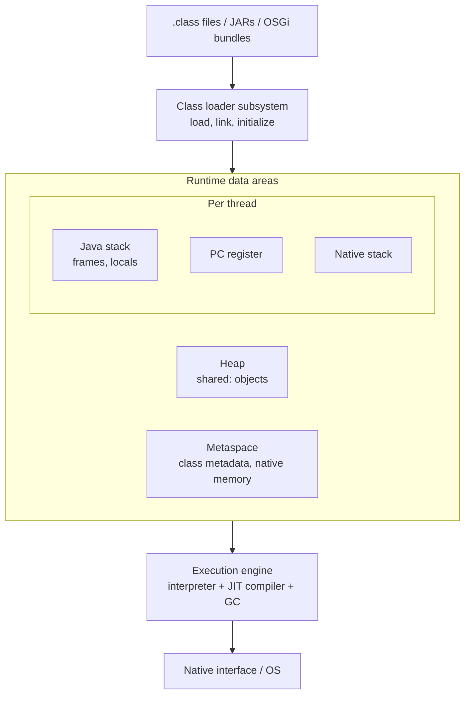
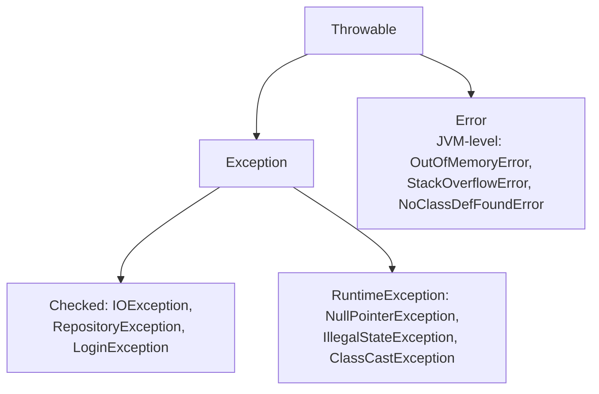
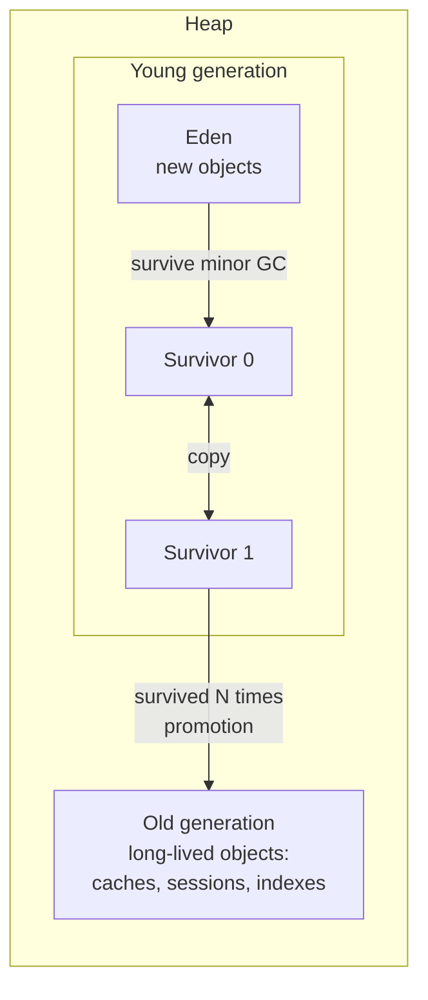
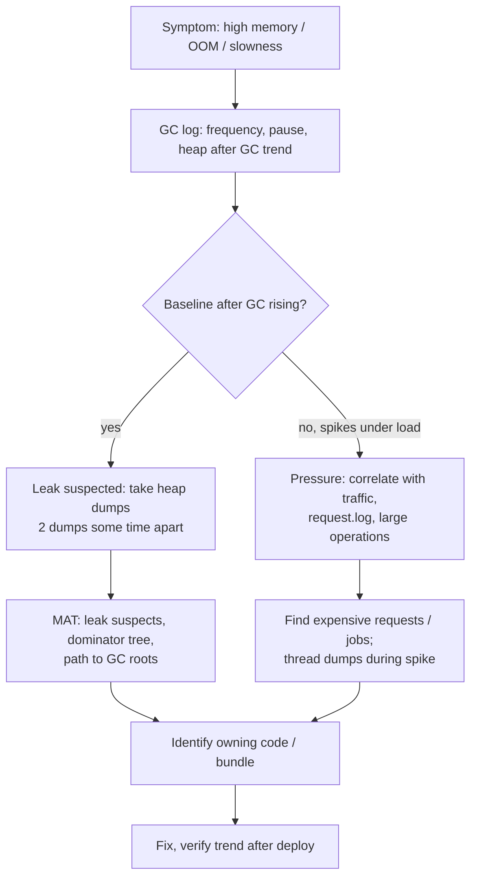
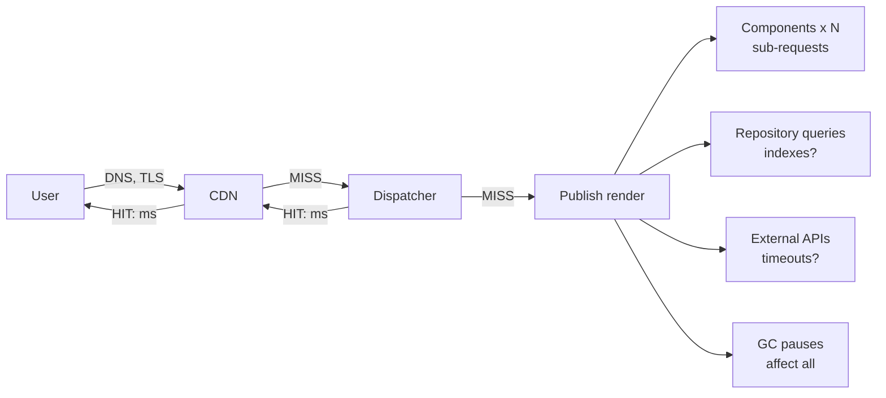
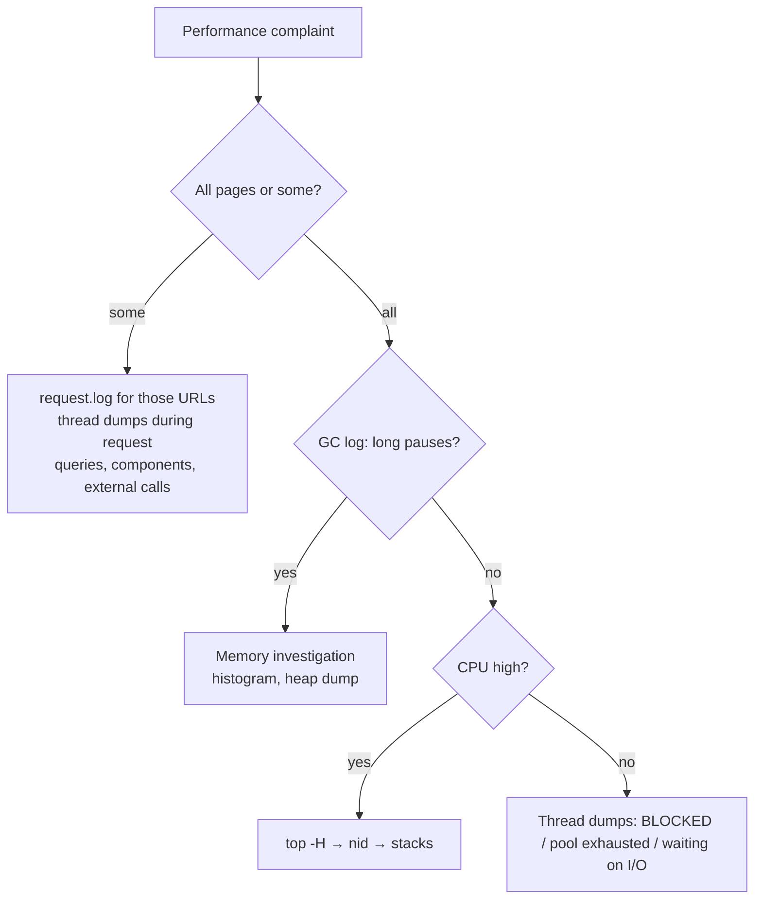

# Java and JVM Performance Troubleshooting for AEM TSE

> Module 5. Goal: understand the Java runtime well enough to diagnose memory, CPU, thread and latency problems in AEM: what to collect, how to read it, and how to reason from evidence.
>
> Labels: **[Hands-on]** your work · **[Adjacent]** touched it, theory is new · **[Theory]** study only · `[fill in]` a detail only you know.

> **Honest framing.** Your task log has no heap-dump or thread-dump analysis. Your Java and Linux background plus the heavy-page 503 case (slow render) are your bridge. Treat this module as **[Theory]** unless you have done these analyses: say "I have studied how to…", and practise with the hands-on exercises at the end so you can speak from real experience by interview day.

---

## Contents

1. [Java runtime fundamentals](#1-java-runtime-fundamentals)
2. [Memory and garbage collection](#2-memory-and-garbage-collection)
3. [Memory troubleshooting](#3-memory-troubleshooting)
4. [Heap dump analysis with Eclipse MAT](#4-heap-dump-analysis-with-eclipse-mat)
5. [Thread dump analysis](#5-thread-dump-analysis)
6. [AEM performance](#6-aem-performance)
7. [Linux troubleshooting commands](#7-linux-troubleshooting-commands)
8. [AEM TSE scenarios](#8-aem-tse-scenarios)
9. [Practice exercises](#9-practice-exercises)
10. [Revision sheet](#10-revision-sheet)

---

## 1. Java runtime fundamentals

### 1.1 JDK, JRE, JVM
| Term | Contains | Use |
|------|----------|-----|
| **JVM** | The virtual machine that runs bytecode: class loader, memory areas, execution engine (interpreter + JIT), GC | Runs any Java program |
| **JRE** | JVM + standard class libraries | Run Java apps (modern JDKs no longer ship a separate JRE) |
| **JDK** | JRE + tools: `javac`, `jar`, `jcmd`, `jstack`, `jmap`, `jstat`, `jfr` | Develop and diagnose |

For diagnostics you need the **JDK tools** on the server (on-prem/AMS), or Adobe engineering collects data (AEMaaCS).

### 1.2 JVM architecture



### 1.3 Class loading
- **Bootstrap** (core `java.*`) → **Platform** → **Application** class loader; parent-first delegation.
- **OSGi**: every bundle has its **own class loader** and sees only imported packages. That is why AEM errors look like `ClassNotFoundException` / `NoClassDefFoundError` when an import is missing, and why redeploying bundles can leak old class loaders (**Metaspace** growth) if something holds references to old classes.

### 1.4 Heap and stack
| | Heap | Stack |
|---|---|---|
| Holds | Objects, arrays (shared by all threads) | Method frames, local variables, references (per thread) |
| Size set by | `-Xms` / `-Xmx` | `-Xss` |
| Cleaned by | Garbage collector | Automatically when method returns |
| Error when full | `OutOfMemoryError: Java heap space` | `StackOverflowError` (deep/infinite recursion) |

### 1.5 Threads
- Each request in AEM runs on a **Jetty request thread**; background work runs on Sling scheduler/job threads, workflow threads, Oak threads.
- AEM renames request threads with the request line, e.g. `"[1795600442311] GET /content/mysite/xx/home.html HTTP/1.1"` — so a thread dump shows **which URL** each thread is serving.
- Thread pools have a max size; when all threads are busy, new requests queue → latency → timeouts (503/504).

### 1.6 Exceptions and Errors

Errors usually mean the JVM is in trouble; after an `OutOfMemoryError` the instance should be considered unhealthy and restarted after evidence is captured.

---

## 2. Memory and garbage collection

### 2.1 Generational heap


- **Weak generational hypothesis**: most objects die young (request objects). Minor GCs clean Eden cheaply.
- Objects that survive several minor GCs are **promoted** to Old.
- Old fills slowly; **mixed/major/full GCs** clean it and are more expensive.
- **Metaspace** (outside heap) holds class metadata.

### 2.2 Garbage collectors
| Collector | Notes |
|-----------|-------|
| **G1** (default since Java 9) | Heap in regions; aims for pause targets (`-XX:MaxGCPauseMillis`); young + mixed collections; full GC only as fallback |
| Parallel | Throughput-oriented, longer pauses |
| ZGC / Shenandoah | Very low pause, large heaps |
| CMS | Old, removed in Java 14 |

A GC is **stop-the-world** for at least some phases: all application threads pause. Long or frequent pauses = slow requests across the board.

### 2.3 GC logs
Enable (Java 11+): `-Xlog:gc*:file=gc.log:time,uptime:filecount=10,filesize=20M`.
```
[2026-11-25T10:14:02.100+0000][info][gc] GC(812) Pause Young (Normal) (G1 Evacuation Pause) 3800M->1200M(8192M) 35.2ms
[2026-11-25T10:14:40.900+0000][info][gc] GC(813) Pause Full (G1 Compaction Pause) 8100M->7900M(8192M) 9450.7ms
```
Reading: before→after(total) and pause time. Second line: a **full GC of 9.4 s that freed almost nothing** — heap is full of live objects: memory pressure or a leak. (Illustrative.)

### 2.4 Memory pressure vs leak
| | Memory pressure | Memory leak |
|---|---|---|
| Pattern | Heap high under load, recovers when load drops | "After GC" baseline rises steadily over hours/days regardless of load |
| Cause | Heap too small for workload, large requests (huge queries, big asset processing) | Objects kept reachable by mistake (static maps, caches without limit, listeners never removed, unclosed resolvers/sessions) |
| Fix | Reduce work per request, tune, size heap | Find the retainer, fix code |

---

## 3. Memory troubleshooting

### 3.1 OutOfMemoryError variants
| Message | Meaning | Typical cause |
|---------|---------|---------------|
| `Java heap space` | Could not allocate in heap | Leak or too much live data |
| `GC overhead limit exceeded` | >98% time in GC, <2% freed | Heap nearly full of live objects |
| `Metaspace` | Class metadata full | Class loader leak (redeploys), too many generated classes |
| `unable to create native thread` | OS refused a new thread | Thread leak, OS limit (`ulimit -u`), memory |
| `Direct buffer memory` | Off-heap NIO buffers | Large binary I/O |
| `Requested array size exceeds VM limit` | Huge array | Bug, giant response in memory |

### 3.2 Object retention
An object stays alive while there is a **path from a GC root** to it. GC roots: thread stacks (local variables of running threads), static fields of loaded classes, JNI references, monitors. A leak = an unintended path from a root (often a `static` collection or a long-lived service) to growing data.

AEM-typical retention sources:
- Unclosed `ResourceResolver` / JCR `Session` (each holds Oak state).
- Static `HashMap` caches in services without eviction.
- Event listeners registered and never unregistered.
- Large query results loaded fully into memory.
- Big strings/byte arrays from reading whole assets into memory.

### 3.3 Large objects
`byte[]`, `char[]`/`String`, `Object[]` (behind ArrayList/HashMap) dominate most heaps. The question is not "which type is big" but "**who holds** them".

### 3.4 Investigation workflow


---

## 4. Heap dump analysis with Eclipse MAT

### 4.1 What a heap dump contains
A snapshot of the heap: every live object, its class, fields, and references, plus GC roots and thread stacks (in HPROF). Size ≈ used heap (an 8 GB heap → up to ~8 GB file). It **pauses** the JVM while being written and can contain **sensitive data** (user data, tokens): handle securely.

### 4.2 When and how to collect
| Method | Command |
|--------|---------|
| Automatically on OOM | `-XX:+HeapDumpOnOutOfMemoryError -XX:HeapDumpPath=/path/dumps` |
| jcmd (preferred) | `jcmd <pid> GC.heap_dump /tmp/aem-heap.hprof` |
| jmap | `jmap -dump:live,format=b,file=/tmp/aem-heap.hprof <pid>` (`live` forces full GC first) |
| Class histogram only (cheap) | `jcmd <pid> GC.class_histogram > histo.txt` |

Collect when: memory high and rising, right after OOM, and **twice** (e.g. 1 hour apart) to compare growth. Ensure disk space ≥ heap size. In AEMaaCS, Adobe collects these.

### 4.3 MAT views
| View | Shows | Use |
|------|-------|-----|
| **Leak Suspects report** | Automatic analysis of big retainers | First look |
| **Histogram** | Count, shallow and retained size per class | Which types are numerous/large; compare two dumps |
| **Dominator tree** | Objects that keep the most memory alive | Find the single owner of a big chunk |
| **Path to GC Roots** (exclude weak/soft refs) | Reference chain that keeps an object alive | Prove *why* it is not collected |
| **OQL** | SQL-like query on objects | e.g. `SELECT * FROM java.util.HashMap WHERE size > 100000` |
| Thread overview | Threads and their stack locals | Who held memory at dump time |

**Shallow heap**: the object's own size. **Retained heap**: memory freed if this object were collected (it and everything only it keeps alive). Sort the dominator tree by **retained heap**.

### 4.4 Example reasoning (illustrative)
```
Dominator tree (top):
  com.example.mysite.core.impl.LinkCacheService @ 0x6c1...   retained 3.1 GB (41%)
    └─ java.util.HashMap  (2,400,000 entries)
         └─ String keys "/content/mysite/..?utm_source=..."
Path to GC roots:
  LinkCacheService <- static field INSTANCE <- class loader of bundle com.example.mysite.core
```
Story: a static, unbounded map caching every URL including tracking parameters → grows forever → leak. Fix: bounded cache (size + expiry), normalise keys, or remove. Verify: after-GC baseline flat after deploy.

### 4.5 Investigating a suspected leak
1. Two dumps apart in time; histogram **delta** shows the growing classes.
2. Dominator tree → the object(s) retaining them.
3. Path to GC roots → the static field / thread / listener holding them.
4. Map the class to a bundle (package name) → customer code or product.
5. Confirm with code review; propose fix; verify trend.

---

## 5. Thread dump analysis

### 5.1 Collecting
| Method | Command |
|--------|---------|
| jstack | `jstack -l <pid> > td-$(date +%H%M%S).txt` |
| jcmd | `jcmd <pid> Thread.print -l > td.txt` |
| Signal | `kill -3 <pid>` (dump goes to JVM stdout log) |
| AEM 6.5 | Felix console Status → Threads; on-prem scripts | 

Take **several dumps 5–10 seconds apart** (e.g. 6 dumps). One dump is a photo; a series is a film: a thread on the **same stack across dumps** is stuck or slow.

```bash
for i in 1 2 3 4 5 6; do jstack -l $PID > td_$i.txt; sleep 10; done
```

### 5.2 Thread states
| State | Meaning | Typical in AEM |
|-------|---------|----------------|
| **RUNNABLE** | Running on CPU or ready (also in native I/O read) | Rendering, regex, query traversal, socket read |
| **BLOCKED** | Waiting to enter a `synchronized` block held by another thread | Lock contention |
| **WAITING** | Waiting indefinitely (`Object.wait`, `LockSupport.park`, `join`) | Idle pool threads, waiting for a lock (`ReentrantLock`) |
| **TIMED_WAITING** | Waiting with timeout (`sleep`, `wait(ms)`, `parkNanos`) | Idle pool threads, polling |
| NEW / TERMINATED | Not started / finished | Rare in dumps |

### 5.3 Reading a thread
```
"[1795600442311] GET /content/mysite/xx/home.html HTTP/1.1" #212 prio=5 os_prio=0 tid=0x00007f.. nid=0x5a3f runnable
   java.lang.Thread.State: RUNNABLE
	at org.apache.jackrabbit.oak.plugins.index.Cursors$TraversingCursor.fetchNext(Cursors.java:...)
	at org.apache.jackrabbit.oak.query.QueryImpl$RowIterator.fetchNext(QueryImpl.java:...)
	at com.example.mysite.core.models.RelatedPagesModel.init(RelatedPagesModel.java:57)
	at org.apache.sling.models.impl.ModelAdapterFactory.createObject(...)
```
(Illustrative.) Read: thread name = URL; state; top of stack = what it is doing now (traversing the repository); first project frame = who asked (`RelatedPagesModel` line 57). If the same in 6 dumps → this query is slow → index or rewrite query.

`nid` is the OS thread ID in **hex**: map it to `top -H` output to find which thread burns CPU (section 7).

### 5.4 Deadlock
```
Found one Java-level deadlock:
=============================
"Thread-A": waiting to lock monitor 0x...(object 0xA, a java.lang.Object),
  which is held by "Thread-B"
"Thread-B": waiting to lock monitor 0x...(object 0xB, a java.lang.Object),
  which is held by "Thread-A"
```
JVM detects monitor/ownable-synchronizer deadlocks and prints them at the end of the dump. Both threads stay BLOCKED forever; requests needing those locks pile up. Fix: consistent lock ordering, smaller synchronized sections, timeouts. Restart only clears it temporarily.

### 5.5 Contention, blocked threads and pool exhaustion
- **Contention**: many threads `BLOCKED` "waiting to lock <0x…>" held by **one** thread → find that owner thread and what it is doing (often slow I/O inside `synchronized`).
- **Pool exhaustion**: all request threads busy (e.g. all in `SocketInputStream.read` to an external API without timeout) → new requests wait → 503/504. Look for many threads with the **same stack**.
- Count by state and by top frame across dumps: tools like **fastThread**, **IBM TMDA**, **Samurai**, or simple `grep`:
```bash
grep -h "java.lang.Thread.State" td_*.txt | sort | uniq -c
grep -A 3 "State: BLOCKED" td_1.txt | grep "waiting to lock" | sort | uniq -c
```

### 5.6 Identifying slow request processing
1. Find slow URLs in `request.log` (high ms).
2. During the slowness, take a dump series.
3. Find threads named with those URLs; read their stacks across dumps.
4. The repeating frame names the cost: query traversal, external call, lock, rendering loop, GC (if all threads are stopped and GC log shows pauses).

---

## 6. AEM performance

### 6.1 Where time goes



| Factor | Evidence | Typical fix |
|--------|----------|-------------|
| Cache hit ratio | CDN/dispatcher logs, `X-Cache`, `Age` | Remove query params, set Cache-Control, correct statfileslevel |
| Render cost | request.log ms per URL; component count | Fewer/lighter components, cache fragments, template policy limits **[Hands-on: heavy-page 503]** |
| Queries | Traversal warnings, Explain Query | Oak index, rewrite query, limit results |
| External latency | Thread dumps in socket read | Timeouts, async, caching, circuit breaker |
| GC pauses | GC log | Fix allocation hot spots / leak, heap sizing |
| CPU | `top`, thread CPU mapping | Fix hot loop/regex, reduce work |
| Author-specific | Asset processing, workflows, many open sessions | Purge workflows, schedule bulk work |

### 6.2 Methodology
1. **Define** the problem: which URL(s), tier, since when, how slow (p50/p95), always or under load.
2. **Baseline**: compare with normal (yesterday, another env).
3. **Locate** the time: CDN vs Dispatcher vs Publish (headers, `curl -w` timings, request.log).
4. **Collect** during the problem: request.log, error.log warnings, GC log, thread dump series, CPU per thread.
5. **Hypothesise** one cause that explains all evidence.
6. **Test** the hypothesis (reproduce on lower env, remove the suspect component, explain the query).
7. **Fix and verify** against the baseline.

### 6.3 Your case through this lens **[Hands-on]**
Regional page 503 after publishing: logs and publish status checked; page not loading on publisher; "too many calls" because of excessive containers. Mechanism: each container and component is a Sling sub-request with its own model; deep nesting multiplies work until the request exceeds the timeout → 503. Fix: re-authored with fewer containers; prevention: guidance (and optionally template policies limiting nesting). A thread-dump series during the slowness would have shown request threads for that URL deep in nested `include` frames — mention as how you would confirm it with JVM tools.

---

## 7. Linux troubleshooting commands

> Applies to on-premise / AMS / local servers. AEMaaCS gives no shell access.

### 7.1 Process identification
```bash
ps -ef | grep -i [c]rx-quickstart        # find AEM java process
pgrep -f crx-quickstart                   # just the PID
jcmd -l                                   # list Java processes (JDK)
cat /proc/<pid>/cmdline | tr '\0' ' '     # full command line incl. -Xmx
```

### 7.2 CPU and memory
```bash
top -c                                    # overall; press 1 for per-CPU, M sort by memory
top -H -p <pid>                           # threads of the process, by CPU
printf '%x\n' <tid>                       # convert thread id to hex → match nid=0x... in jstack
free -m                                   # RAM and swap
vmstat 5                                  # run queue, swap in/out, CPU wait
jstat -gcutil <pid> 5000                  # heap % per area and GC counts every 5s
jcmd <pid> VM.flags                       # effective JVM flags
jcmd <pid> GC.heap_info
```
High-CPU recipe: `top -H -p PID` → hottest TID → `printf '%x'` → find `nid=0x…` in a thread dump taken at the same time → that stack is burning CPU.

### 7.3 Disk usage
```bash
df -h                                     # free space per filesystem (full disk breaks AEM)
du -sh /opt/aem/crx-quickstart/*          # which folder is big (repository, logs)
du -sh crx-quickstart/repository/segmentstore
find /opt/aem -name "*.log*" -size +500M
lsof +L1                                  # deleted files still held open (space not freed)
iostat -x 5                               # disk utilisation / latency
```

### 7.4 Log analysis
```bash
tail -f crx-quickstart/logs/error.log
grep -c "ERROR" error.log
grep "ERROR" error.log | awk '{print $5}' | sort | uniq -c | sort -rn | head    # top loggers
grep -n "Caused by" error.log | tail -20
grep "Traversed" error.log | head
# slowest requests from request.log (ms is last field on "<-" lines)
grep " <- " request.log | awk '{print $NF, $0}' | sort -rn | head -20
zgrep "10:1[0-9]:" error.log.2026-11-25.gz                    # time window
```

### 7.5 Java process inspection
```bash
jcmd <pid> help                     # available diagnostic commands
jcmd <pid> Thread.print -l          # thread dump
jcmd <pid> GC.class_histogram       # objects per class
jcmd <pid> GC.heap_dump /tmp/h.hprof
jcmd <pid> VM.native_memory summary # if -XX:NativeMemoryTracking=summary
jcmd <pid> JFR.start duration=120s filename=/tmp/aem.jfr   # Java Flight Recorder profile
```

### 7.6 Network connectivity
```bash
ss -tanp | grep <pid>                         # connections of the process
ss -s                                         # summary; many TIME_WAIT/CLOSE_WAIT?
curl -v -o /dev/null https://api.partner.com  # reachability, TLS, time
nc -zv smtp.example.com 587                   # port open?
dig www.example.com +short / nslookup         # DNS
traceroute host                               # path
openssl s_client -connect host:443 -servername host   # certificate check
```

### 7.7 Thread and JVM diagnostics summary
| Need | Tool |
|------|------|
| Which thread uses CPU | `top -H` + hex nid + jstack |
| Where threads wait | Thread dump series |
| Heap usage over time | `jstat -gcutil`, GC log |
| What fills the heap | Class histogram, heap dump + MAT |
| Low-overhead profiling | JFR (+ JDK Mission Control) |

---

## 8. AEM TSE scenarios

Each scenario: **signals → collect → analyse → likely causes → actions**.

### 8.1 High memory usage
- Signals: heap > 80–90% constantly, frequent GCs.
- Collect: GC log, `jstat -gcutil`, class histogram, heap dump if rising.
- Analyse: after-GC baseline trend; histogram top classes; dominator tree.
- Causes: unbounded caches, unclosed resolvers/sessions, large queries, big asset processing, too-small heap for workload.
- Actions: fix retainer; limit query sizes; tune heap only after understanding usage.

### 8.2 Production OutOfMemoryError
- Immediate: capture heap dump (automatic flag), thread dump, logs; restore service (restart / failover); note time.
- Analyse: OOM type (heap, metaspace, native thread); MAT leak suspects; recent deployments.
- Prevent: fix, add monitoring on after-GC heap, `HeapDumpOnOutOfMemoryError` always on.

### 8.3 Slow requests
- Find slow URLs (request.log), check cache headers, thread dump series during slowness, error.log traversal warnings, external call timings, GC pauses.
- Causes: render cost, queries without index, external APIs, lock contention, GC.

### 8.4 High CPU
- `top -H` → hot threads → hex nid → stacks.
- Causes: infinite loop, heavy regex, query traversal, GC threads (then it is a memory problem), image processing, rendering storms after cache flush.

### 8.5 Blocked threads
- Many `BLOCKED` on same monitor → find owner → why it holds the lock long (I/O inside synchronized, slow repository write).
- Fix: narrow lock scope, avoid I/O under locks, concurrent structures.

### 8.6 Deadlocks
- Dump shows "Found one Java-level deadlock"; identify both locks and code paths; capture evidence before restart; fix lock order.

### 8.7 Repeated garbage collection
- GC log: back-to-back collections, full GCs freeing little, `GC overhead limit` risk.
- Means: live data close to heap max → leak or pressure (section 2.4).
- Short-term: restart buys time; long-term: fix retention or reduce live data.

### 8.8 JVM performance degradation over time
- Pattern: fine after restart, slower each day.
- Suspects: leak (heap baseline), growing thread count (`ps -o nlwp <pid>`), metaspace growth after redeploys, growing repository (segmentstore without compaction on 6.5), workflow instances not purged, log/disk growth.
- Compare day-1 vs day-N: heap after GC, thread count, histogram, repository size.



---

## 9. Practice exercises

Turn this theory into real experience on a local AEM SDK (your own laptop):
1. Start the SDK quickstart; find its PID with `jcmd -l`.
2. Take a thread dump with `jcmd <pid> Thread.print`; find a request thread while loading a page.
3. Write a small servlet that sleeps 30 s; call it 10 times; take 3 dumps; see `TIMED_WAITING` threads named with the URL.
4. Write a servlet that adds to a static `List` on each call; call it in a loop; take two class histograms and a heap dump; open in Eclipse MAT; find it in the dominator tree and path to GC roots.
5. Run a JCR-SQL2 query without an index in the query tool; find the traversal warning in error.log.
6. Enable GC logging on the SDK JVM and read pause lines.

After this you can honestly say you have analysed heap and thread dumps in a lab.

---

## 10. Revision sheet

- JVM runs bytecode; JRE = JVM + libs; JDK = JRE + tools (`jcmd`, `jstack`, `jmap`, `jstat`, JFR).
- Class loaders: bootstrap → platform → app; OSGi = class loader per bundle (missing import → NoClassDefFoundError; redeploy leaks → Metaspace).
- Heap (objects, shared, `-Xmx`) vs stack (frames, per thread, `-Xss`).
- Young (Eden + survivors) → promotion → Old; G1 default; stop-the-world pauses.
- GC log line: before→after(total), pause ms; full GC freeing little = too much live data.
- Pressure (recovers) vs leak (after-GC baseline climbs).
- OOM types: heap space, GC overhead, Metaspace, native thread, direct buffer.
- Heap dump: `jcmd PID GC.heap_dump file`; `HeapDumpOnOutOfMemoryError`; sensitive; needs disk.
- MAT: leak suspects, histogram, dominator tree (retained heap), path to GC roots; compare two dumps.
- Thread dump: `jcmd PID Thread.print` / `jstack -l` / `kill -3`; take a series 5–10 s apart.
- States: RUNNABLE, BLOCKED (monitor), WAITING, TIMED_WAITING; AEM thread name = request URL.
- Deadlock printed at end of dump; contention = many BLOCKED on one lock; pool exhaustion = all threads same stack.
- High CPU: `top -H -p PID` → `printf '%x' TID` → nid in dump.
- AEM performance: cache hit ratio, render cost (sub-requests), queries/indexes, external latency, GC.
- Linux: `ps`, `top -H`, `free`, `vmstat`, `df`, `du`, `lsof +L1`, `iostat`, `ss`, `curl -v`, `nc -zv`, `dig`, `openssl s_client`, `grep/awk/sort/uniq`.
