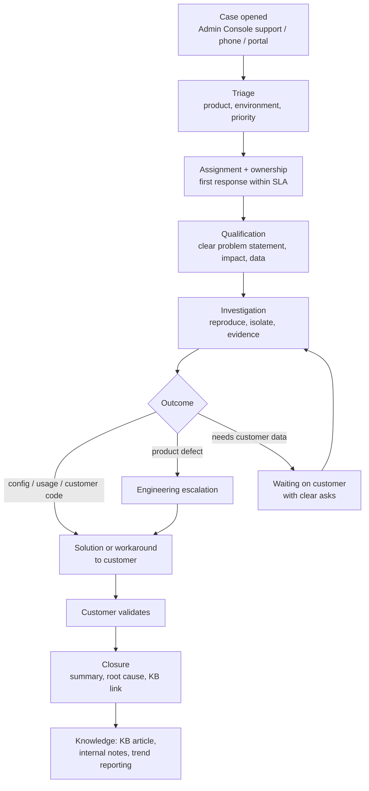
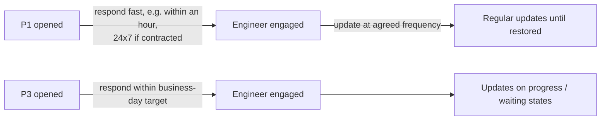
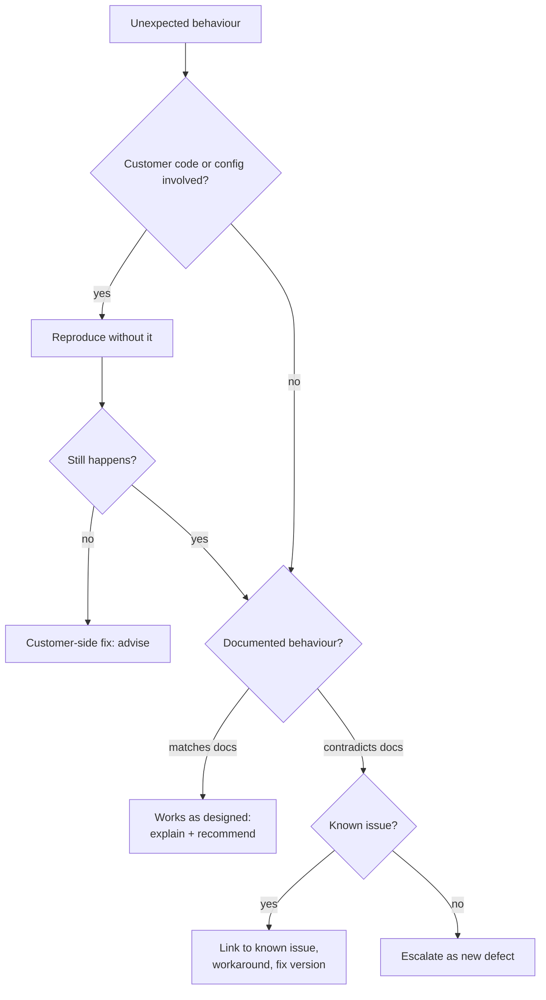

# Adobe Technical Support Engineer: Case Management and Customer Success

> Module 6. Goal: understand the support process an enterprise Adobe TSE runs every day: owning a case from first contact to closure, investigating with evidence, escalating to engineering well, communicating clearly, and turning each case into reusable knowledge.
>
> Labels: **[Hands-on]** your work · **[Adjacent]** touched it, theory is new · **[Theory]** study only · `[fill in]` a detail only you know.

> **Honest framing.** You have run production support from the **customer side** (an enterprise multi-site AEMaaCS platform): raising, investigating and fixing incidents, informing teams, introducing preventive steps **[Hands-on]**. Adobe's internal tools, exact SLA numbers and escalation systems are **[Theory]**: describe the process, not specific internal tools you have not used.

---

## Contents

1. [Support fundamentals](#1-support-fundamentals)
2. [Case investigation](#2-case-investigation)
3. [Engineering escalation](#3-engineering-escalation)
4. [Customer communication](#4-customer-communication)
5. [Support fixes](#5-support-fixes)
6. [Knowledge management](#6-knowledge-management)
7. [Practical scenarios](#7-practical-scenarios)
8. [Templates](#8-templates)
9. [Revision sheet](#9-revision-sheet)

---

## 1. Support fundamentals

### 1.1 Technical support lifecycle



### 1.2 Incident, problem, service request
| Type | In a support context |
|------|----------------------|
| **Incident** | Something is broken now for the customer (site 500, publishing stuck) |
| **Problem** | The underlying cause behind one or many incidents, possibly across customers (a product bug) |
| **Service request / question** | "How do I configure X", "please enable Y", advisory |

### 1.3 Severity, priority, customer impact
Adobe enterprise cases use priority levels. A typical definition set (check Adobe's published support policy for exact wording):

| Priority | Typical meaning | Examples |
|----------|-----------------|----------|
| **P1 Critical** | Production down or critical business function unusable, no workaround | Live site returning 5xx; all authors locked out of prod |
| **P2 High/Urgent** | Major function impaired in production; workaround painful | Publishing failing for one region; severe slowness |
| **P3 Medium** | Partial or non-critical impact; workaround exists | One component broken on stage; intermittent error |
| **P4 Low** | Questions, minor issues, enhancement requests | How-to, documentation |

Impact factors: production vs non-production, number of users/sites, revenue/legal deadline, workaround available, data loss risk, security.

### 1.4 SLA: response time vs resolution time
- **Response time**: time to first meaningful response by an engineer. Usually contractual per priority and support plan.
- **Update frequency**: how often the customer hears from you on open high-priority cases.
- **Resolution time**: time to fix; rarely guaranteed (depends on cause), but tracked as a metric.
- Example SLA flow (illustrative numbers, not Adobe's contract):



### 1.5 Case ownership
The case owner is **accountable until closure**, even when others (engineering, other teams, the customer) are doing work. Ownership means: you track every open action, chase dependencies, keep the customer informed, and make sure the case is closed with a clear outcome. Hand-offs (shift change, region follow-the-sun) carry a written summary.

---

## 2. Case investigation

### 2.1 Qualification
Turn the customer's words into a precise problem statement:

> **Problem statement**: Since 2026-11-25 09:40 UTC, requests to `/content/<site>/xx/*.html` on the production publish tier (program `[id]`, environment `[id]`) return 503 after ~30 s for all visitors. Other countries are unaffected. Last pipeline run: 2026-11-24 18:00 UTC. Content publish of the regional home page at 09:35 UTC.

Checklist:
- [ ] Product and service (Sites, Assets, Forms; AEMaaCS / AMS / on-prem)
- [ ] Program ID, environment ID, tier (author/publish/preview), AEM release version
- [ ] URLs, timestamps with time zone, frequency (always/intermittent)
- [ ] Impact (who, how many, business consequence) → priority
- [ ] Expected vs actual behaviour
- [ ] Recent changes (deployments, content, config, DNS, certificates)
- [ ] What the customer already tried

### 2.2 Reproduction steps
Good reproduction steps are numbered, minimal, and environment-specific:
1. Log in to author as a user in group X.
2. Open page Y, add component Z.
3. Publish.
4. Request `https://…/page.html` → **expected** 200 with new content, **actual** 404.

Reproduce in order of cost: customer environment (if allowed) → local AEM SDK with customer code → clean SDK with minimal sample (proves product behaviour).

### 2.3 Environment and version information
AEM release (cloud: release number in Cloud Manager), Core Components version, Dispatcher module version, Java version (on-prem), browser, customer CDN in front?, custom code involved?

### 2.4 Logs and diagnostic evidence
| Evidence | When |
|----------|------|
| error.log / request.log / access.log windows | Almost always |
| Dispatcher and CDN logs | Delivery, caching, access |
| HAR file / screenshots / curl output | Browser-side symptoms |
| Pipeline logs | Deployment failures |
| Config files (dispatcher, OSGi) | Behaviour differences |
| Thread dumps / heap dumps / GC logs | Performance, memory (Module 5) |
| Package / content samples | Content-specific failures |

Always record **what each piece of evidence showed**, not only that it was collected.

### 2.5 Expected vs actual behaviour
Check against **documentation** and **known behaviour** of the product. Many cases are "works as designed" (e.g. Dispatcher filter denies return 404, CDN TTL delays content) → explain with documentation links and propose the right configuration.

### 2.6 Troubleshooting documentation (case notes)
Keep internal notes as you go: hypothesis → test → result. A colleague must be able to take over from your notes alone.

### 2.7 Product defect validation
Before calling it a bug:
- Reproduced on a **clean** environment/SDK without customer code? 
- Documented behaviour contradicts it?
- Same on the latest release?
- Known issue / existing bug / release note already?
If yes to reproducibility and contradiction → defect → escalate (section 3).



---

## 3. Engineering escalation

### 3.1 When to escalate
- Confirmed or strongly suspected **product defect**.
- Platform-side issue the TSE cannot access (cloud infrastructure, CDN internals, pipeline service).
- **P1** with no progress in the expected time; data loss or security risk.
- Need for platform-level actions (e.g. collecting heap dumps in AEMaaCS, restarting services).

### 3.2 Preparing an escalation
An escalation should let an engineer start working **without asking anything**:
- Clear title: component + symptom + condition.
- Customer impact and priority, business deadline.
- Environment details and versions.
- Exact reproduction steps (ideally on clean SDK), expected vs actual.
- Evidence attached with timestamps (log excerpts, not only whole files).
- What was already ruled out.
- Your hypothesis (marked as hypothesis).

### 3.3 Reproduction package
Minimal content package / sample project / curl commands that reproduce on a clean instance. Remove customer data and code not needed.

### 3.4 Bug reports
| Field | Content |
|-------|---------|
| Summary | `Sites: List v4 renders duplicate items when ... on release X` |
| Affected versions | AEMaaCS release, Core Components version |
| Steps | Numbered |
| Expected / actual | One line each |
| Frequency | Always / intermittent (x of y) |
| Evidence | Logs, screenshots, package |
| Workaround | If any |
| Customer impact | Who, how many, priority |

### 3.5 Collaboration, tracking and customer updates during escalation
- Stay the owner; engineering works the defect, you work the case.
- Agree on next check-in; follow up proactively.
- Tell the customer: escalated, why, what engineering is looking at, interim workaround, next update time. Do not promise a fix date until engineering commits to one.
- When a fix is ready: which release, how to validate, and close only after validation.

---

## 4. Customer communication

### 4.1 Principles
1. **Acknowledge** quickly and show you understood the impact.
2. **Be clear**: simple English, short sentences, technical detail after the plain explanation.
3. **Be specific**: what you checked, what you found, what is next, when you will update.
4. **Be honest**: say what you know, what you do not know yet, and do not guess as fact.
5. **Own it**: "I will…", with a time.
6. **Separate** facts, hypotheses and actions.

### 4.2 Critical production incidents (P1)
- Join quickly (call/bridge if offered); confirm scope and impact.
- Priority is **restore service** (workaround, rollback) before full root cause.
- Fixed update cadence (e.g. every 30–60 min) even if "no change yet".
- Keep a timeline as you go; it becomes the incident report.

### 4.3 Explaining technical findings simply
Pattern: **what happened → why → what we did → what you need to do → how to prevent**.

> *Example (from your .JPG case, sanitized):* "The images were published correctly. They were blocked by the web server's security rules, which only allowed lowercase file extensions such as `.jpg`. Your images use `.JPG`, so the server treated them as unknown files and returned 'not found'. We updated the rule to allow both, and the images now load. To avoid this in future, we recommend allowing extensions case-insensitively and agreeing a list of supported file types."

### 4.4 Managing expectations
- Give ranges and next steps, not unconditional promises.
- Explain dependencies ("waiting for the network team's IP range", "engineering is reproducing").
- If something is not possible (e.g. direct server access in AEMaaCS), say so and offer the supported alternative.

### 4.5 Frustrated customers
- Listen fully; acknowledge feelings and business impact without blame.
- Restate the problem to show understanding.
- Focus on next concrete action and time.
- Do not argue about past events during the incident; capture them for the review.
- Escalate internally (duty manager) if the relationship needs it.

### 4.6 Workarounds
State clearly: what it is, how to apply it, its limitations/risks, that it is temporary, and what the permanent fix will be.

### 4.7 Professional ownership phrases (use naturally, not as scripts)
- "Here is what I have checked so far, and here is what I am doing next."
- "I don't have the answer yet; I will update you by 14:00 UTC."
- "This part is on your side; here is exactly what to change and why."

---

## 5. Support fixes

### 5.1 Identifying trivial defects
A "trivial" defect for a support fix is: small, well-understood, local in scope, with clear reproduction and no design decision (e.g. a wrong default value, missing null check, wrong label, missing allowed extension in a sample config).

### 5.2 Safe support-fix practices
- Reproduce first; write the failing test if possible.
- Smallest change that fixes the cause; no unrelated refactoring.
- Peer review.
- Consider all affected versions/customers.
- Document the change and the reason.

### 5.3 Testing and validation
Unit test, regression test of the area, validate on the customer scenario (or equivalent), and confirm with the customer after release.

### 5.4 Change approval and release
Fix goes through the normal engineering process: code review, CI, inclusion in a release (for AEMaaCS, continuous releases roll out to customers); communicate the release version to the customer.

### 5.5 Regression prevention
Automated tests for the defect, KB article for the symptom, and a note in release notes.

Your parallel experience **[Hands-on]**: fixing production issues safely in your own platform: reverting to a known-good state before re-running ingestion, deploying Dispatcher fixes through pipelines, validating with affected users, and adding a peer-review control.

---

## 6. Knowledge management

| Artifact | Purpose | Contents |
|----------|---------|----------|
| **KB article** | Let customers/colleagues solve a known issue quickly | Symptom (searchable words/errors), environment, cause, resolution, workaround, references |
| **Internal case notes** | Hand-off and audit | Timeline, hypotheses, evidence, decisions |
| **Root cause report** | Explain a major incident | Impact, timeline, root cause with evidence, corrective/preventive actions |
| **Runbook / troubleshooting procedure** | Repeatable steps for a class of issues | Checks in order, commands, decision points |
| **Knowledge transfer** | Spread expertise | Sessions, recordings, pairing on cases |

Good KB titles use the **customer's symptom words**: "Images with uppercase extension return 404 on AEM publish through Dispatcher".

Your parallel experience **[Hands-on]**: informing the team after each incident (CSV peer review, containers guidance, monthly token refresh) is knowledge management in practice; this repository is too.

---

## 7. Practical scenarios

Each scenario is described as a flow of work, not as a question with an answer.

### 7.1 A customer reports a production 500
- **Qualify**: URL(s), since when, all pages or one, recent deployment? Priority P1 if the site is broadly down, P2 if a section.
- **Investigate**: find requests in request.log with status 500; matching error.log stack trace; last `Caused by` points to `com.customer...HeroModel` line 42 after yesterday's deployment.
- **Outcome**: customer code defect → explain finding with the log excerpt, recommend fix or rollback (redeploy previous commit), offer workaround (remove/hide component on affected pages).
- **Close**: after customer deploys and validates; note in case: root cause in customer code, KB if pattern is common.

### 7.2 A customer reports a performance issue
- Qualify: which URLs, author or publish, how slow, since when, baseline.
- Investigate: cache headers (`Age`, `X-Cache`), request.log durations, error.log traversal warnings; in cloud, request JVM diagnostics from engineering if all requests are slow.
- Typical outcome: missing Oak index for a custom query, low cache hit ratio due to query parameters, heavy page structure (like your heavy-page 503 case **[Hands-on]**).
- Communicate measurements before/after.

### 7.3 A bug that cannot be reproduced
- Gather more detail: exact timestamps, user, browser, HAR, frequency, environment differences.
- Compare working vs failing (user, page, time, pod).
- Check intermittent causes: one publish pod with different content (distribution lag), cache variants, race conditions, external dependency timeouts.
- Agree with the customer on a **capture plan** (enable DEBUG logger for a package for a limited time via pipeline; collect at next occurrence).
- Keep the case open with clear next step, or close with an agreed reopen condition.

### 7.4 An issue requiring engineering escalation
- Example pattern: publishing to Preview fails for all content after a platform release on a clean sample too.
- Prepare escalation (section 3.2) with reproduction on clean SDK/environment, logs, impact.
- Workaround for customer (e.g. publish directly / delay review), update cadence, track to fix release, validate, close.

### 7.5 A customer requesting an urgent resolution
- Confirm the impact matches the urgency (adjust priority if justified).
- Separate **restore** (workaround/rollback now) from **resolve** (root cause later).
- Give a concrete next update time; bring in duty manager/engineering if P1 criteria are met.
- Stay factual about what can and cannot be done quickly.

### 7.6 A support fix requiring validation
- Fix identified (e.g. product config default) → reproduced → small change + test → review → release.
- Customer validation plan: what to test, on which environment (stage first), success criteria.
- Close only after validation; publish KB if useful.

---

## 8. Templates

### 8.1 First response
```
Hello <name>,
Thank you for reporting this. I understand that <restated problem> is affecting <impact>.
I have set the priority to P<n> based on <reason>.
To investigate, please share:
  1. <URL(s)> and the time(s) the issue occurred (with time zone)
  2. <environment / program id>
  3. <any recent changes: deployments, content, configuration>
Meanwhile I am checking <first checks>. I will update you by <time, time zone>.
```

### 8.2 Troubleshooting documentation (case notes)
```
Case: <id>   Priority: P<n>   Owner: <name>
Problem statement: <one paragraph>
Environment: <product, release, program/env, tier>
Impact: <who, how many, business effect>
Timeline:
  <UTC time> <event>
Hypotheses and tests:
  H1: <hypothesis> → Test: <what> → Result: <evidence> → Confirmed / Rejected
Current status: <one line>
Next action: <action> by <owner> at <time>
```

### 8.3 Escalation
```
Title: <Product>: <symptom> when <condition> (<release>)
Customer impact: P<n>, <who/how many>, deadline <date>
Environment: <program/env ids, release, versions>
Steps to reproduce (clean environment): 1..n
Expected: <...>   Actual: <...>   Frequency: <...>
Evidence: <log excerpts with timestamps, attachments>
Ruled out: <customer code, config, cache, ...>
Hypothesis: <optional, marked as such>
Workaround given to customer: <...>
```

### 8.4 Closure summary
```
Summary: <what happened>
Root cause: <cause + evidence>
Resolution: <what was changed, by whom>
Validation: <how confirmed>
Prevention / recommendations: <...>
References: <KB, docs, bug id>
```

### 8.5 KB article
```
Title: <symptom in customer words>
Applies to: <product / versions>
Symptoms: <errors, log lines, behaviour>
Cause: <explanation>
Resolution: <steps>
Workaround: <if any>
Related: <docs, other KBs>
```

---

## 9. Revision sheet

- Lifecycle: open → triage → own → qualify → investigate → solve / escalate / wait → validate → close → knowledge.
- Incident (broken now) vs problem (underlying cause) vs service request (ask).
- P1 critical prod down → P4 questions; impact × urgency; SLA = response time + update cadence; resolution rarely guaranteed.
- Owner is accountable to closure, including during escalation.
- Qualify: precise problem statement with env, URLs, UTC times, impact, expected vs actual, recent changes.
- Reproduce: customer env → SDK with customer code → clean SDK minimal sample.
- Defect validation: reproducible without customer code + contradicts docs + not known → escalate.
- Escalation: title, impact, env, steps, expected/actual, evidence, ruled out, workaround.
- Communication: acknowledge, clear, specific, honest, owned, timed updates; facts vs hypotheses.
- P1: restore first, RCA later, fixed update cadence, timeline.
- Workarounds: what, how, limits, temporary, permanent plan.
- Support fixes: reproduce, smallest change, test, review, release, customer validation, regression test.
- Knowledge: KB (symptom words), case notes, RCA, runbooks, knowledge transfer.
