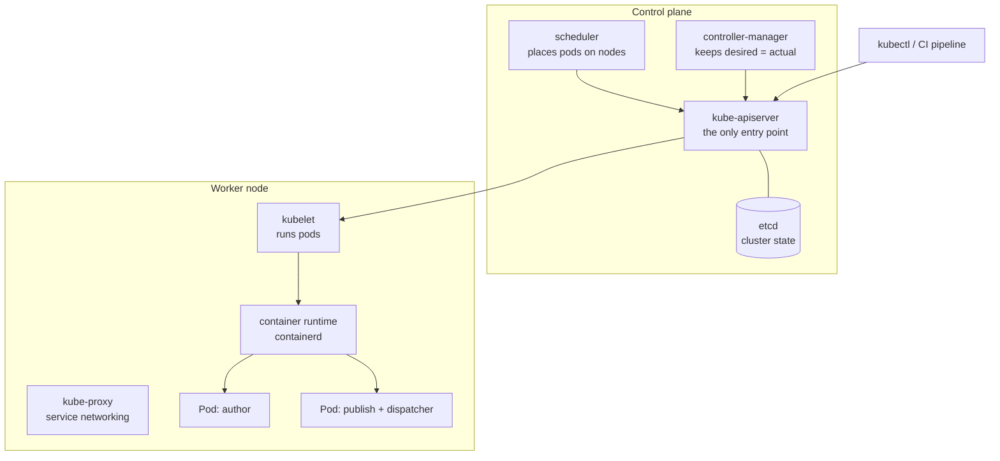
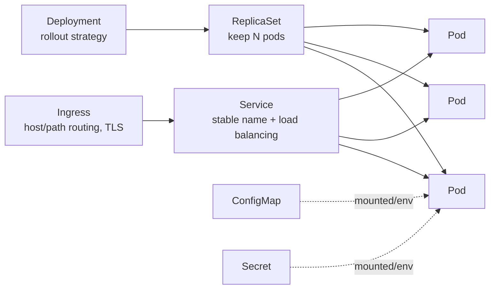
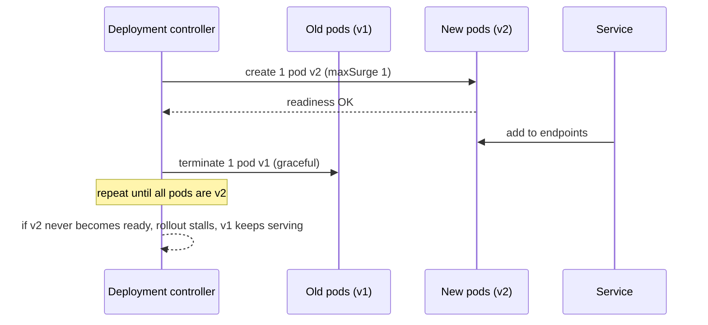
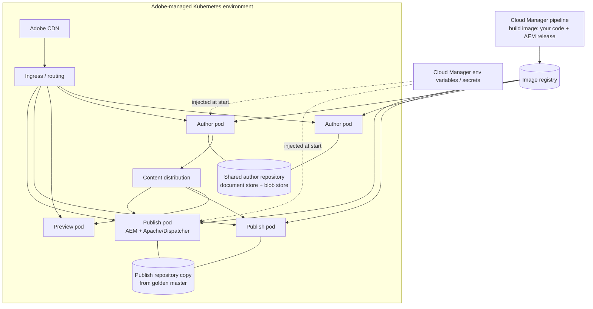
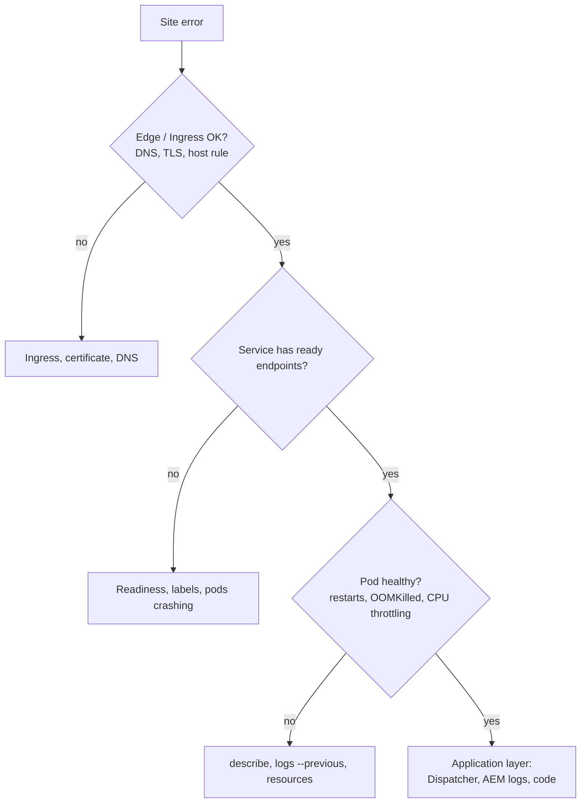

# Kubernetes for AEM Engineers

> Module 7. Goal: understand Kubernetes as a complete subject, and see exactly how it explains what you already experience on AEM as a Cloud Service: pods, rolling deployments, restarts, scaling, configuration and logs.
>
> Labels: **[Hands-on]** your work · **[Adjacent]** touched it, theory is new · **[Theory]** study only · `[fill in]` a detail only you know.

> **Honest framing.** AEM as a Cloud Service runs on Kubernetes, but Adobe operates it: customers never run `kubectl` against it. Your experience is with the **effects** of Kubernetes (pipeline deployments that replace containers with no downtime, environment variables that restart the service, logs collected per service, immutable code) **[Adjacent]**. Kubernetes itself is **[Theory]** until you do the lab in section 10. Say it that way: "I worked on a platform that runs on Kubernetes, and I have studied how Kubernetes works underneath it."

> **Commands:** every Docker, kubectl, Helm and Kustomize command, plus YAML anatomy, is in the companion [commands-reference.md](commands-reference.md).

---

## Contents

1. [Why Kubernetes matters to an AEM engineer](#1-why-kubernetes-matters-to-an-aem-engineer)
2. [Containers first](#2-containers-first)
3. [Kubernetes architecture](#3-kubernetes-architecture)
4. [Core objects](#4-core-objects)
5. [Configuration, secrets and storage](#5-configuration-secrets-and-storage)
6. [Health, resources and scaling](#6-health-resources-and-scaling)
7. [Deployments and rollbacks](#7-deployments-and-rollbacks)
8. [AEM as a Cloud Service through a Kubernetes lens](#8-aem-as-a-cloud-service-through-a-kubernetes-lens)
9. [Troubleshooting Kubernetes](#9-troubleshooting-kubernetes)
10. [Practice lab](#10-practice-lab)
11. [Revision sheet](#11-revision-sheet)

---

## 1. Why Kubernetes matters to an AEM engineer

| What you see in AEMaaCS | The Kubernetes idea behind it |
|---|---|
| A production deployment with no downtime | Rolling update: new pods start, pass health checks, then old pods stop |
| `/apps` cannot be changed at runtime | Code is baked into an **immutable container image** |
| No SSH, no Felix console in prod | Containers are disposable; you change the image or config, not the running box |
| Changing a Cloud Manager environment variable restarts the service | Pod configuration is fixed at start; new values mean new pods |
| Several publish instances, more under load | **ReplicaSet** + **autoscaling** |
| Short 502/503 during a restart | Traffic briefly hitting a pod that is starting or stopping |
| Logs downloaded per service and day | Container logs collected centrally, not read from a server disk |
| Dispatcher deployed with publish | Containers in the same **pod** share network and lifecycle |

Adobe describes AEMaaCS as a container-based, auto-scaling service orchestrated by Kubernetes. Exact internal layout is Adobe's; the mapping in section 8 explains it conceptually.

---

## 2. Containers first

- **Image**: a read-only package of an application and everything it needs (OS libraries, JDK, AEM jar, your code). Built from a `Dockerfile`, stored in a **registry**, identified by a tag or digest.
- **Container**: a running instance of an image, isolated by Linux namespaces (processes, network, filesystem) and limited by **cgroups** (CPU, memory).
- **Immutable infrastructure**: you never patch a running container; you build a new image and replace the container.

```dockerfile
# Illustrative: a Dispatcher-style image
FROM httpd:2.4
COPY dispatcher/src/conf.d/ /usr/local/apache2/conf.d/
COPY mod_dispatcher.so /usr/local/apache2/modules/
EXPOSE 80
```

```bash
docker build -t myorg/dispatcher:1.4.0 .
docker run -p 8080:80 myorg/dispatcher:1.4.0
docker logs <id>; docker exec -it <id> sh
```

AEM link: the **Dispatcher SDK** you use (or should use) to validate dispatcher configs runs Apache + Dispatcher in a **Docker** container locally **[Adjacent]**.

---

## 3. Kubernetes architecture



| Component | Role |
|-----------|------|
| **kube-apiserver** | REST API; every change goes through it |
| **etcd** | Key-value store of the cluster's desired and current state |
| **scheduler** | Chooses a node for each new pod (resources, affinity, taints) |
| **controller-manager** | Control loops: ReplicaSet, Deployment, Node, Job controllers |
| **kubelet** | Agent on each node; starts containers, runs probes, reports status |
| **kube-proxy** | Routes Service traffic to pod IPs |
| **Container runtime** | containerd / CRI-O runs containers |

**The core idea: declarative desired state.** You declare "3 replicas of image X"; controllers continuously compare actual state with desired state and fix the difference (restart crashed pods, replace lost nodes). This **reconciliation loop** is why AEMaaCS heals itself after a pod failure.

---

## 4. Core objects



| Object | What it is | AEM analogy |
|--------|-----------|-------------|
| **Pod** | Smallest unit: one or more containers sharing IP and volumes | One publish instance with its Dispatcher |
| **ReplicaSet** | Keeps N identical pods running | The publish farm |
| **Deployment** | Manages ReplicaSets; rolling updates and rollbacks | A pipeline deployment of a new release |
| **StatefulSet** | Pods with stable names and their own persistent volumes | Instances that need stable identity/storage |
| **DaemonSet** | One pod per node | Log shipper / monitoring agent |
| **Job / CronJob** | Run to completion / on a schedule | Maintenance tasks (purges, reports) |
| **Service** | Stable virtual IP and DNS name in front of pods; types ClusterIP, NodePort, LoadBalancer | The address Dispatcher/CDN uses to reach publish |
| **Ingress** | HTTP(S) routing by host and path, TLS termination | Domain mapping + certificates **[Adjacent]** |
| **Namespace** | Logical partition with quotas and access | Environments (dev/stage/prod) |
| **HPA** | Horizontal Pod Autoscaler: changes replicas by metrics | Publish scaling under traffic |

```yaml
apiVersion: apps/v1
kind: Deployment
metadata: { name: publish, namespace: site-prod }
spec:
  replicas: 3
  selector: { matchLabels: { app: publish } }
  strategy:
    type: RollingUpdate
    rollingUpdate: { maxSurge: 1, maxUnavailable: 0 }
  template:
    metadata: { labels: { app: publish } }
    spec:
      containers:
        - name: aem-publish
          image: registry.example.com/site/aem-publish:2026.11.1
          ports: [{ containerPort: 4503 }]
          envFrom: [{ configMapRef: { name: publish-config } }]
          resources:
            requests: { cpu: "2", memory: "8Gi" }
            limits:   { memory: "8Gi" }
          readinessProbe: { httpGet: { path: /system/health, port: 4503 }, periodSeconds: 10 }
          livenessProbe:  { httpGet: { path: /system/health, port: 4503 }, initialDelaySeconds: 300 }
        - name: dispatcher
          image: registry.example.com/site/dispatcher:2026.11.1
          ports: [{ containerPort: 80 }]
---
apiVersion: v1
kind: Service
metadata: { name: publish, namespace: site-prod }
spec:
  selector: { app: publish }
  ports: [{ port: 80, targetPort: 80 }]
```
(Illustrative manifest for learning. It is not how Adobe defines AEMaaCS internally.)

---

## 5. Configuration, secrets and storage

### 5.1 ConfigMaps and Secrets
- **ConfigMap**: non-secret key/values or files, injected as environment variables or mounted files.
- **Secret**: same, for sensitive values (base64-encoded by default, encrypted at rest if configured; access controlled by RBAC). Often fed from an external vault.
- Pods read env variables **at start**: changing a ConfigMap used as env needs a pod restart (a rollout).

AEM link **[Hands-on concept]**: Cloud Manager environment variables and **secret** variables, referenced in OSGi configs as `$[env:NAME]` / `$[secret:NAME]`, follow the same model: set outside the code, injected at start, changing them restarts the service. Your SMTP token incident is the classic case for storing a rotating credential as a secret variable so rotation needs no code change.

### 5.2 Storage
| Object | Meaning |
|--------|---------|
| **Volume** | Storage mounted into a pod; `emptyDir` lives and dies with the pod |
| **PersistentVolume (PV)** | A piece of real storage (disk, cloud volume) |
| **PersistentVolumeClaim (PVC)** | A pod's request for storage of a size/class |
| **StorageClass** | How PVs are provisioned dynamically (SSD, network disk) |

AEM link: a container's own filesystem is **ephemeral**. Anything written inside a publish pod (for example form submissions stored on publish) can disappear when the pod is replaced. That is why AEMaaCS discourages storing user data on publish, and why repository content lives in managed storage, not on a container disk.

---

## 6. Health, resources and scaling

### 6.1 Probes
| Probe | Question | Failure result |
|-------|----------|----------------|
| **startupProbe** | Has the app finished starting? | Keeps other probes off until started (AEM starts slowly) |
| **readinessProbe** | Can it take traffic now? | Removed from Service endpoints (no traffic), not restarted |
| **livenessProbe** | Is it still alive? | Container **restarted** |

A badly set liveness probe (too short for AEM startup) causes restart loops. A missing readiness probe sends traffic to a pod that is still warming up → errors during deployments.

### 6.2 Requests and limits
- **requests**: what the scheduler reserves (placement).
- **limits**: the maximum. CPU over limit → **throttled** (slow). Memory over limit → container **OOMKilled** (exit code 137).

**JVM link (Module 5)**: Java must fit inside the container memory limit. Heap (`-Xmx` or `-XX:MaxRAMPercentage`) + Metaspace + thread stacks + direct buffers + native memory must stay under the limit.

| Symptom | Meaning |
|---------|---------|
| `java.lang.OutOfMemoryError` in logs | Heap full **inside** the JVM (leak/pressure) |
| Pod status `OOMKilled`, exit 137, no Java OOM in logs | **Container** limit hit: total process memory too big for the limit (heap set too close to limit, native memory) |

### 6.3 Scaling
- **HPA** adds/removes pod replicas based on CPU, memory or custom metrics.
- **Cluster autoscaler** adds/removes nodes when pods cannot be scheduled.
- AEM link: AEMaaCS scales publish horizontally under load. Each new publish pod must get the published content, which is why publish starts from an up-to-date copy of the publish repository (Adobe calls it the "golden master").

---

## 7. Deployments and rollbacks



```bash
kubectl set image deployment/publish aem-publish=registry/site/aem-publish:2026.11.2
kubectl rollout status deployment/publish
kubectl rollout history deployment/publish
kubectl rollout undo deployment/publish            # back to previous ReplicaSet
```

| Strategy | How | Trade-off |
|----------|-----|-----------|
| **RollingUpdate** | Replace pods gradually | Default, no extra full copy |
| **Recreate** | Stop all, start all | Downtime |
| **Blue/green** | Run full new set, switch traffic at once | Fast switch and rollback; double resources |
| **Canary** | Small % of traffic to new version first | Early warning; needs traffic control |

AEM link **[Adjacent]**: in Cloud Manager, the production step builds an image with your code + the current AEM release and replaces the running service in a rolling/blue-green way; if the new version fails health checks, the old one keeps serving. Unlike `kubectl rollout undo`, a customer rolls back code by **redeploying the previous commit** through the pipeline (Module 2).

---

## 8. AEM as a Cloud Service through a Kubernetes lens


(Conceptual picture based on Adobe's public architecture descriptions; exact internals are Adobe's.)

### 8.1 How your experience maps

| Your work | Kubernetes concept that explains it |
|-----------|-------------------------------------|
| Pipelines for RDE, QA, Stage, Prod **[Hands-on]** | CI builds an image; CD rolls it out per namespace/environment |
| Namespaces fixed with Repoinit across all environments **[Hands-on]** | Immutable image + declarative init: every new pod starts with the same structure, so manual fixes would not survive pod replacement |
| Dispatcher rules (`.html` append, `.JPG` filter, domain mapping) **[Hands-on]** | Config baked into the Dispatcher container image; changed only by redeploying |
| SSL certificates and custom domains **[Hands-on]** | Ingress/edge TLS termination and host-based routing |
| IP allowlists with CIDR **[Hands-on]** | Edge access control (comparable to Ingress/NetworkPolicy source-IP rules) |
| SMTP token in configuration **[Hands-on]** | Secret injected at start; rotation = new value + restart |
| Heavy page causing 503 **[Hands-on]** | Request exceeded timeouts; under load, readiness can fail and pods are taken out of rotation |
| Logs per service and day **[Hands-on]** | Container stdout/stderr collected by a log agent (DaemonSet pattern) |

### 8.2 What this means in a support conversation
- "Why can't we install a package on prod through Package Manager?" → code lives in the image; runtime changes would vanish when pods are replaced, and pods differ from each other.
- "Why did publish show a few 502/503 errors at 02:00?" → check whether a deployment, AEM release update or scaling event was running at that time (pods starting/stopping).
- "Why did my env variable change restart the environment?" → configuration is applied at pod start.
- "Can we get a heap dump?" → only Adobe can exec into pods; the TSE requests it internally (Module 5, Module 6).

### 8.3 Where Kubernetes is used around AEM outside AEMaaCS [Theory]
- Running the **Dispatcher** or front-end apps (headless/SPA, Next.js) on a company Kubernetes cluster.
- Self-hosted **Jenkins** with Kubernetes agents (each build runs in a fresh pod with the right JDK/Maven).
- Local/dev AEM environments in containers. Adobe's supported topology for AEM 6.5 is classic servers or Adobe Managed Services; containerising 6.5 is something some teams do themselves, not an Adobe-provided product.

---

## 9. Troubleshooting Kubernetes

### 9.1 The core commands
```bash
kubectl get pods -n site-prod -o wide            # status, restarts, node
kubectl describe pod <pod> -n site-prod          # events: scheduling, probes, OOMKilled, image pulls
kubectl logs <pod> -c aem-publish --since=15m    # container logs
kubectl logs <pod> -c aem-publish --previous     # logs of the crashed previous container
kubectl get events -n site-prod --sort-by=.lastTimestamp
kubectl exec -it <pod> -c aem-publish -- sh      # shell inside (debug only)
kubectl top pods -n site-prod                    # CPU/memory (metrics-server)
kubectl get svc,endpoints -n site-prod           # is the Service pointing at ready pods?
kubectl rollout status|history|undo deployment/publish
kubectl port-forward pod/<pod> 4503:4503         # reach a pod directly, bypassing Ingress/CDN
```

### 9.2 Pod status → meaning → next step

| Status / symptom | Meaning | Check |
|------------------|---------|-------|
| **Pending** | Cannot be scheduled | `describe`: insufficient CPU/memory, PVC not bound, node selector/taints |
| **ImagePullBackOff / ErrImagePull** | Image cannot be pulled | Image name/tag, registry credentials (imagePullSecret), registry reachable |
| **CrashLoopBackOff** | Container starts and exits repeatedly | `logs --previous`, wrong config/env, missing secret, failing liveness probe |
| **OOMKilled** (exit 137) | Container memory limit exceeded | Raise limit or lower heap; check native memory; Module 5 |
| **Running but 0/1 Ready** | Readiness probe failing | Probe path/port, app still starting, dependency down |
| **Running, many restarts** | Liveness failures or crashes | Probe timings vs AEM startup time, `--previous` logs |
| **Service returns 503** | No ready endpoints | `get endpoints`: empty → selector/labels wrong or no ready pods |
| **CreateContainerConfigError** | Referenced ConfigMap/Secret key missing | `describe` event names the missing key |
| **Evicted** | Node under pressure (disk/memory) | Node conditions, ephemeral storage use (logs, temp files) |

### 9.3 Layered approach (same as Module 1)

The AEM layers you already know (Dispatcher filter, Sling, JCR) sit **inside** the pod: Kubernetes problems decide whether a request reaches the pod; AEM problems decide what the pod answers.

---

## 10. Practice lab

To turn theory into experience on your own laptop:
1. Install **Docker Desktop** and enable its Kubernetes, or install **kind**/**minikube**.
2. Run the **AEM Dispatcher SDK** Docker image locally against a local AEM publish (from the AEM SDK) and validate a filter change: you will see the `.JPG` filter lesson in a container.
3. Write a Deployment for a simple `httpd` image with 3 replicas and a Service; `kubectl port-forward` and curl it.
4. Change the image tag → watch `kubectl rollout status`; break the readiness probe → watch the rollout stall while old pods keep serving; `kubectl rollout undo`.
5. Set a tiny memory limit on a Java container (e.g. a Spring Boot or any JVM app with `-Xmx` larger than the limit) → observe `OOMKilled` and exit 137 vs a Java `OutOfMemoryError`.
6. Create a ConfigMap and a Secret, inject as env, change them, observe that pods only see the change after a restart.

---

## 11. Revision sheet

- Container = image (immutable, from registry) running isolated with cgroup limits.
- Control plane: apiserver, etcd, scheduler, controller-manager. Node: kubelet, kube-proxy, runtime.
- Desired state + reconciliation loops = self-healing.
- Pod (containers sharing IP), ReplicaSet (N pods), Deployment (rollouts), StatefulSet (stable identity + storage), DaemonSet, Job/CronJob.
- Service (stable IP/DNS, ClusterIP/NodePort/LoadBalancer) → Ingress (host/path, TLS).
- ConfigMap/Secret → env or files; env read at start → restart to apply.
- PV/PVC/StorageClass; container filesystem is ephemeral.
- Probes: startup, readiness (traffic), liveness (restart).
- Requests (scheduling) vs limits (CPU throttling, memory OOMKilled exit 137).
- Java in containers: heap + native must fit the limit; Java OOM ≠ OOMKilled.
- HPA scales pods; cluster autoscaler scales nodes.
- Rolling update (maxSurge/maxUnavailable), blue/green, canary; `rollout status/history/undo`.
- AEMaaCS: image = your code + AEM release; immutable `/apps`; env vars restart; publish scales horizontally from a golden master; logs collected centrally; no exec for customers.
- Debug order: edge/Ingress → Service endpoints → pod health → application (Dispatcher, AEM).
- Statuses: Pending, ImagePullBackOff, CrashLoopBackOff, OOMKilled, not Ready, Evicted, CreateContainerConfigError.
