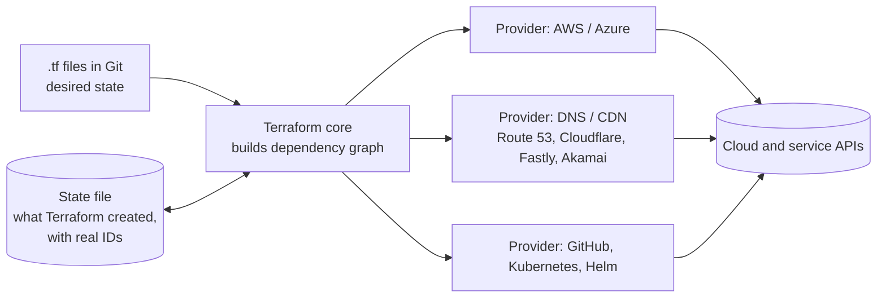
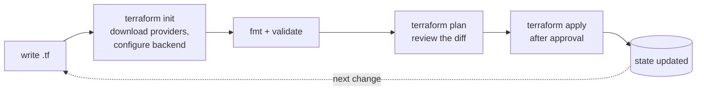
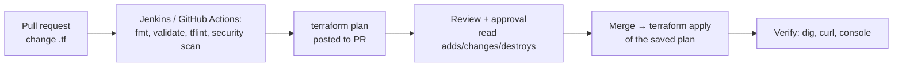
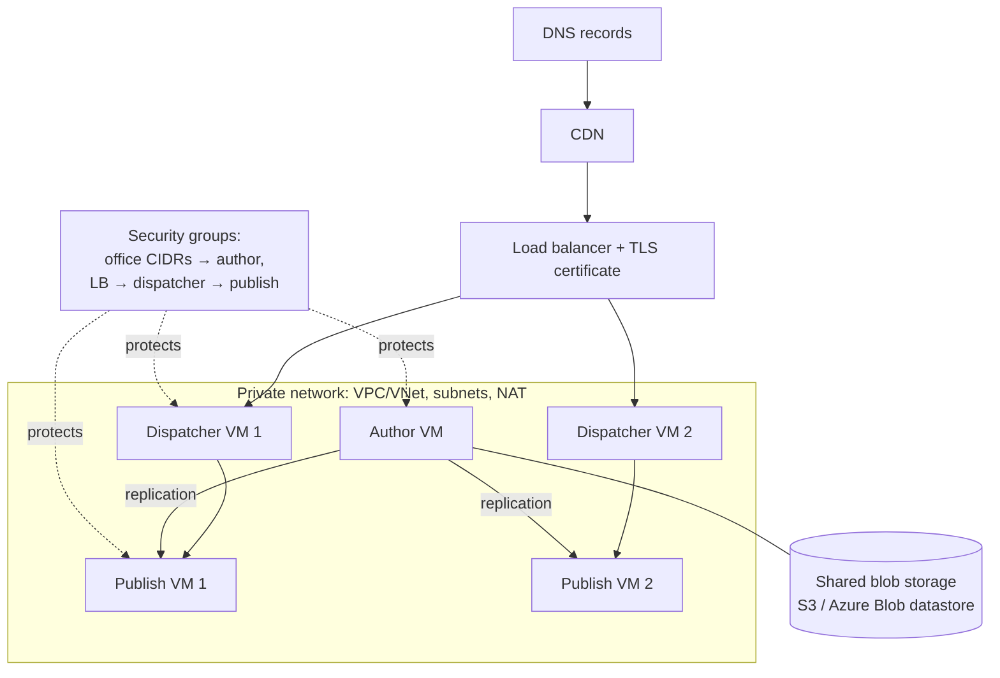

# Terraform for AEM Engineers

> Module 8. Goal: understand Infrastructure as Code with Terraform as a complete subject, and see where it fits around AEM: DNS and domains, certificates, CDN, network access, CI infrastructure, and self-hosted AEM 6.5 environments.
>
> Labels: **[Hands-on]** your work · **[Adjacent]** touched it, theory is new · **[Theory]** study only · `[fill in]` a detail only you know.

> **Honest framing.** Terraform is not in your task log, so it is **[Theory]**. What you *have* done are the manual versions of the things Terraform automates: DNS records pointing to the Adobe CDN with the network team, SSL certificates, IP allowlists from CIDR ranges, environment-by-environment configuration, and pipelines **[Hands-on]**. That is your bridge: "I did these changes through consoles and tickets; Terraform is how I would make them repeatable, reviewed and versioned." Do the lab in section 10 to gain real practice.
>
> **Commands:** every Terraform CLI command and the full HCL syntax are in the companion [commands-reference.md](commands-reference.md).

---

## Contents

1. [Infrastructure as Code](#1-infrastructure-as-code)
2. [How Terraform works](#2-how-terraform-works)
3. [The language: HCL building blocks](#3-the-language-hcl-building-blocks)
4. [State](#4-state)
5. [Modules and environments](#5-modules-and-environments)
6. [Terraform in a CI/CD pipeline](#6-terraform-in-a-cicd-pipeline)
7. [Where Terraform fits around AEM](#7-where-terraform-fits-around-aem)
8. [Worked examples for AEM](#8-worked-examples-for-aem)
9. [Troubleshooting Terraform](#9-troubleshooting-terraform)
10. [Practice lab](#10-practice-lab)
11. [Revision sheet](#11-revision-sheet)

---

## 1. Infrastructure as Code

**Infrastructure as Code (IaC)**: describing infrastructure (networks, servers, DNS, certificates, CDN rules, access lists) in text files, kept in Git, applied by a tool.

| Manual change | IaC |
|---------------|-----|
| Click in a console, or ask another team by ticket | Edit a file, open a pull request |
| Hard to know who changed what | Git history + review |
| Environments drift apart | Same code, different variables per environment |
| Rebuild from memory | Rebuild from code |
| Hard to review the impact | `terraform plan` shows exactly what will change |

**Declarative vs imperative**: Terraform is **declarative**: you describe the end state ("this CNAME should exist with this value"), Terraform works out the steps. A shell script is imperative ("run this command, then that one").

**Mutable vs immutable infrastructure**: Terraform usually **replaces** what cannot be changed in place, which matches the immutable model you know from AEMaaCS images (Module 7).

AEM link: AEMaaCS already applies IaC thinking: code, Dispatcher config, Repoinit and even CDN rules (config pipeline YAML) are files in Git deployed by pipelines **[Adjacent]**. Terraform extends the same idea to infrastructure **around** AEM.

---

## 2. How Terraform works



| Concept | Meaning |
|---------|---------|
| **Provider** | Plugin that talks to one API (aws, azurerm, google, cloudflare, fastly, akamai, github, kubernetes, helm) |
| **Resource** | Something Terraform creates and manages (a DNS record, a VM, a security group) |
| **Data source** | Something Terraform only **reads** (an existing zone, the latest AMI) |
| **State** | Terraform's record mapping your code to real objects |
| **Plan** | Difference between code, state and reality: what will be created (+), changed (~), destroyed (-), replaced (-/+) |
| **Apply** | Execute the plan |

### The core workflow


```bash
terraform init
terraform fmt -recursive && terraform validate
terraform plan -out=tfplan
terraform apply tfplan
```

Reading a plan:
```
  # aws_route53_record.www will be created
  + resource "aws_route53_record" "www" {
      + name    = "www.example.com"
      + records = ["cdn.adobeaemcloud.com"]
      + ttl     = 300
      + type    = "CNAME"
    }
  # aws_security_group_rule.office will be updated in-place
  ~ cidr_blocks = ["203.0.113.0/24"] -> ["203.0.113.0/24", "198.51.100.0/24"]
Plan: 1 to add, 1 to change, 0 to destroy.
```
**Always read the destroy count.** A `-/+` (replace) on a DNS record or load balancer can mean a short outage.

---

## 3. The language: HCL building blocks

```hcl
terraform {
  required_version = ">= 1.6"
  required_providers {
    aws = { source = "hashicorp/aws", version = "~> 5.0" }
  }
  backend "s3" {                       # where state lives (section 4)
    bucket         = "site-tfstate"
    key            = "dns/prod.tfstate"
    region         = "eu-west-1"
    dynamodb_table = "tf-locks"
    encrypt        = true
  }
}

provider "aws" { region = var.region }

variable "region" {
  type    = string
  default = "eu-west-1"
}
variable "environment" { type = string }
variable "office_cidrs" {
  type        = list(string)
  description = "Public egress ranges of offices allowed to reach author"
}

locals {
  domain = var.environment == "prod" ? "www.example.com" : "${var.environment}.example.com"
  tags   = { team = "platform", env = var.environment }
}

data "aws_route53_zone" "main" { name = "example.com" }

resource "aws_route53_record" "site" {
  zone_id = data.aws_route53_zone.main.zone_id
  name    = local.domain
  type    = "CNAME"
  ttl     = 300
  records = ["cdn.adobeaemcloud.com"]
}

output "site_fqdn" { value = aws_route53_record.site.fqdn }
```

| Block | Purpose |
|-------|---------|
| `terraform {}` | Versions, required providers, backend |
| `provider` | Configure a provider (region, credentials from environment) |
| `variable` | Inputs; set via `*.tfvars`, `-var`, or `TF_VAR_name` environment variables |
| `locals` | Computed values reused inside the module |
| `data` | Read existing objects |
| `resource` | Managed objects; referenced as `<type>.<name>.<attribute>` |
| `output` | Values printed after apply / passed to other modules |
| `module` | Reuse a folder of Terraform code |

**Dependencies**: Terraform builds a graph from references (`data.aws_route53_zone.main.zone_id`) and creates things in the right order; `depends_on` only for hidden dependencies.

**Meta-arguments**: `count`, `for_each` (many similar resources), `depends_on`, `provider` (alias), `lifecycle { prevent_destroy, create_before_destroy, ignore_changes }`.

---

## 4. State

- `terraform.tfstate` maps each resource in code to the real object ID and its last known attributes.
- **Remote backend** (S3 + DynamoDB lock, Azure Storage, GCS, Terraform Cloud) so the team and CI share one state, with **locking** so two applies can't run at once.
- State can contain **secrets** (passwords, keys): encrypt it, restrict access, never commit it to Git.
- **Drift**: someone changes the real object by hand (e.g. edits a DNS record in the console). The next `plan` shows Terraform wants to change it back. Decide: update the code, or let Terraform revert.
- State commands (`state list`, `state show`, `state mv`, `state rm`, `import`) are how you repair mismatches (see the command reference).

---

## 5. Modules and environments

```
infra/
├── modules/
│   ├── site-dns/        main.tf variables.tf outputs.tf
│   └── jenkins-agent/
└── envs/
    ├── dev/   main.tf  dev.tfvars    backend: dns/dev.tfstate
    ├── stage/ main.tf  stage.tfvars  backend: dns/stage.tfstate
    └── prod/  main.tf  prod.tfvars   backend: dns/prod.tfstate
```
```hcl
module "dns" {
  source      = "../../modules/site-dns"
  environment = "prod"
  hostnames   = ["www.example.com", "example.co.uk"]
}
```
- One **module** = reusable building block with inputs and outputs.
- Each **environment** has its own variables and its **own state**, so a mistake in dev cannot touch prod.
- Workspaces (`terraform workspace new stage`) are an alternative for near-identical environments; separate folders are clearer for prod isolation.

AEM link: this is the same pattern as AEM run-mode configs (`config.dev`, `config.prod`) and Dispatcher variables per environment: one definition, environment-specific values **[Adjacent]**.

---

## 6. Terraform in a CI/CD pipeline



```groovy
// Illustrative Jenkinsfile stages
stage('Plan')  { steps { sh 'terraform init -input=false && terraform plan -input=false -out=tfplan' } }
stage('Approve') { when { branch 'main' } steps { input message: 'Apply to prod?' } }
stage('Apply') { when { branch 'main' } steps { sh 'terraform apply -input=false tfplan' } }
```
Credentials come from the CI credentials store or cloud identity (never in `.tf` files). This is the infrastructure version of the change control you used for production releases **[Adjacent]**: plan = change ticket evidence, approval = sign-off, apply = deployment, verification = post-deployment checks.

---

## 7. Where Terraform fits around AEM

### 7.1 AEM as a Cloud Service
Adobe manages AEMaaCS infrastructure; the customer does **not** create Kubernetes clusters or servers for it. Terraform is useful for the pieces **around** it:

| Area | What Terraform can manage | Your experience **[Hands-on]** |
|------|---------------------------|-------------------------------|
| **DNS** | CNAME records to `cdn.adobeaemcloud.com`, apex A records, TXT records for domain verification (Route 53, Azure DNS, Cloudflare providers) | You coordinated DNS records with the network team for go-live |
| **Customer-managed CDN** (if used in front of Adobe's) | Fastly / Akamai / Cloudflare configuration: origin = Adobe publish domain, required headers (e.g. `X-Forwarded-Host`, `X-AEM-Edge-Key`), caching, WAF | You worked on CDN and domain mapping |
| **Certificates** | Requesting/renewing certificates in a cloud or CA, storing them in a vault | You updated SSL certificates in Cloud Manager |
| **IP ranges** | One versioned list of office/VPN CIDR ranges, used for firewalls and as the source for allowlists | You added CIDR ranges for an IP allowlist |
| **CI/CD** | Jenkins controller/agents, artifact repository, GitHub repositories, branch protection (github provider) | You built pipelines with Jenkins, Git and Maven |
| **Monitoring and logs** | Splunk/Datadog indexes, dashboards, alerts receiving forwarded AEM/CDN logs | You analysed logs during incidents |
| **Integrations** | Egress allowlists on SMTP or API servers for AEM's dedicated egress IP | You fixed SMTP authentication |

Cloud Manager itself (pipelines, domains, IP allowlists, environment variables) is configured through its UI, its **API** and the **Adobe I/O CLI (`aio`)**. Check the Terraform Registry for any provider before assuming one exists; a common pattern is Terraform for the surrounding infrastructure plus pipeline scripts calling the Cloud Manager API for Cloud Manager settings **[Theory]**.

### 7.2 Self-hosted AEM 6.5 (on-premise in a cloud account) [Theory]
When a company runs AEM 6.5 itself on AWS or Azure, Terraform can build the whole topology:


Terraform creates the network, VMs (with images prepared by Packer or configured by Ansible), disks, security groups, load balancer, certificates and DNS. Installing and configuring AEM itself is usually done by configuration tools (Ansible, scripts) or baked images, not Terraform.

### 7.3 Kubernetes around AEM [Theory]
Terraform can create the Kubernetes cluster (EKS/AKS/GKE) and, with the `kubernetes`/`helm` providers, deploy things onto it: for example a headless front-end that reads AEM content, or Jenkins agents. Kubernetes objects themselves are often better managed by GitOps tools; Terraform builds the cluster (Module 7).

---

## 8. Worked examples for AEM

### 8.1 Go-live DNS for a custom domain (the manual work you did, as code)
```hcl
variable "hostnames" { type = set(string) }   # e.g. ["www.example.com", "www.example.co.uk"]

resource "aws_route53_record" "aem" {
  for_each = var.hostnames
  zone_id  = data.aws_route53_zone.main.zone_id
  name     = each.value
  type     = "CNAME"
  ttl      = 300
  records  = ["cdn.adobeaemcloud.com"]
}

resource "aws_route53_record" "verify" {        # domain ownership TXT record from Cloud Manager
  zone_id = data.aws_route53_zone.main.zone_id
  name    = "_aemverification.www.example.com"
  type    = "TXT"
  ttl     = 300
  records = [var.aem_verification_token]
}
```
(Check the exact verification record name and value Cloud Manager gives you; this is illustrative.)

Lifecycle: plan in a PR → network team reviews → apply in the change window → `dig www.example.com CNAME +short` → add the domain mapping in Cloud Manager → validate with `curl -I`.

### 8.2 One source of truth for office CIDR ranges
```hcl
# ip-ranges/main.tf
locals {
  office_cidrs = {
    region_a_office = "203.0.113.0/24"
    region_b_vpn    = "198.51.100.0/25"
  }
}
output "office_cidrs" { value = values(local.office_cidrs) }
```
Other code (firewalls, a script that updates the Cloud Manager allowlist via API) reads this output. Your 403 incident **[Hands-on]** came from a region's range missing from the allowlist; a single reviewed list, changed through pull requests and announced by the network team, is the preventive action expressed as code.

### 8.3 Customer-managed CDN in front of AEMaaCS (shape only)
```hcl
resource "fastly_service_vcl" "site" {
  name = "site-prod"
  domain { name = "www.example.com" }
  backend {
    name    = "aem-publish"
    address = "publish-p12345-e67890.adobeaemcloud.com"   # illustrative program/env IDs
    port    = 443
    use_ssl = true
    ssl_cert_hostname = "publish-p12345-e67890.adobeaemcloud.com"
  }
  # plus: header that sets X-Forwarded-Host and the X-AEM-Edge-Key secret Adobe requires,
  # caching and logging settings
}
```
**[Theory]**: confirm the current Adobe requirements for customer-managed CDNs in Adobe's documentation before using this.

### 8.4 Jenkins agent infrastructure (connects to your Jenkins/Maven work)
```hcl
resource "aws_instance" "jenkins_agent" {
  count         = 2
  ami           = data.aws_ami.java21.id
  instance_type = "t3.large"
  subnet_id     = var.private_subnet_id
  vpc_security_group_ids = [aws_security_group.jenkins_agent.id]
  tags = merge(local.tags, { Name = "jenkins-agent-${count.index}" })
}
```

---

## 9. Troubleshooting Terraform

| Symptom | Cause | Approach |
|---------|-------|----------|
| `Error acquiring the state lock` | Another run in progress, or a crashed run left the lock | Wait/check CI; only then `terraform force-unlock <ID>` |
| Plan wants to **destroy and recreate** something important | Changed an attribute that forces replacement, or renamed the resource | Read `# forces replacement`; use a `moved {}` block for renames; `create_before_destroy` |
| Plan shows changes nobody made in code | **Drift**: manual change in console | Decide: codify the change or let apply revert it; stop manual changes |
| `Resource already exists` on apply | Object created by hand earlier | `terraform import` it into state |
| `Error: No valid credential sources found` / 403 from provider | Missing or wrong credentials/permissions | Check environment credentials, role, least-privilege policy |
| `Inconsistent dependency lock file` | Provider versions changed | `terraform init -upgrade` and commit `.terraform.lock.hcl` |
| `Cycle` error | Two resources reference each other | Break the reference, split resources |
| Works in dev, fails in prod | Different variables, existing objects, quotas, permissions | Compare tfvars and plans; same principle as "QA works, Stage fails" (Module 2) |
| Apply partially failed | Some resources created, others not | Fix the error and re-run `plan`/`apply`; state already records what exists |
| DNS change applied but site not switching | DNS TTL/caching | `dig` against authoritative and public resolvers; wait for TTL |

General approach: `TF_LOG=DEBUG terraform plan` for provider-level detail; `terraform state show <addr>` to see what Terraform believes; compare with the console.

---

## 10. Practice lab

All free and local:
1. Install Terraform; create a folder with the `local` and `random` providers; write a `local_file` resource; run `init`, `plan`, `apply`, change it, `plan` again, `destroy`.
2. Use the **docker** provider (`kreuzwerker/docker`) to run an `httpd` container from Terraform: a mini "Dispatcher" you create, change and destroy as code.
3. Use the **kind** or **kubernetes** provider to create a namespace and Deployment on a local cluster (ties Module 7 and 8 together).
4. Write a `variable "office_cidrs"` with validation that rejects invalid CIDRs (`can(cidrhost(v, 0))`).
5. Practise state: `terraform state list`, `state mv` after renaming a resource, a `moved {}` block, `import` of a container you created by hand.
6. If you have a free cloud account: a Route 53 or Cloudflare test zone with a CNAME record, then destroy it.

---

## 11. Revision sheet

- IaC: infrastructure in Git, reviewed, repeatable, environments identical except variables.
- Terraform is declarative; providers talk to APIs; resources are managed, data sources read.
- Workflow: `init` → `fmt`/`validate` → `plan` (+ ~ - -/+) → `apply` → state updated.
- Blocks: terraform, provider, variable, locals, data, resource, output, module.
- References build the dependency graph; `depends_on` for hidden dependencies.
- Meta-arguments: count, for_each, depends_on, provider, lifecycle (prevent_destroy, create_before_destroy, ignore_changes).
- State: maps code to real IDs; remote backend + locking; can hold secrets; never in Git.
- Drift = manual change; plan reveals it.
- Modules = reusable blocks; one state per environment.
- CI: PR → fmt/validate/scan → plan posted → approval → apply saved plan → verify.
- Around AEMaaCS: DNS (CNAME to cdn.adobeaemcloud.com, TXT verification), customer CDN, certificates, CIDR lists, Jenkins/GitHub, monitoring; Cloud Manager via UI/API/aio.
- Self-hosted AEM 6.5: VPC, subnets, security groups, VMs, load balancer, certificates, shared blob storage, DNS; AEM install via images/Ansible.
- Troubleshoot: state lock, forced replacement, drift, import, credentials, lock file, cycles, partial apply, DNS TTL.
