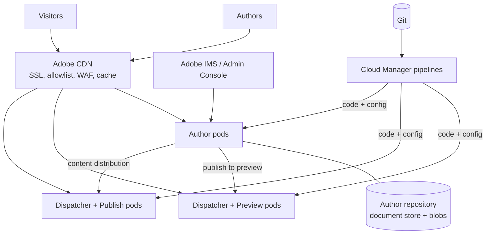
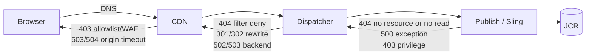
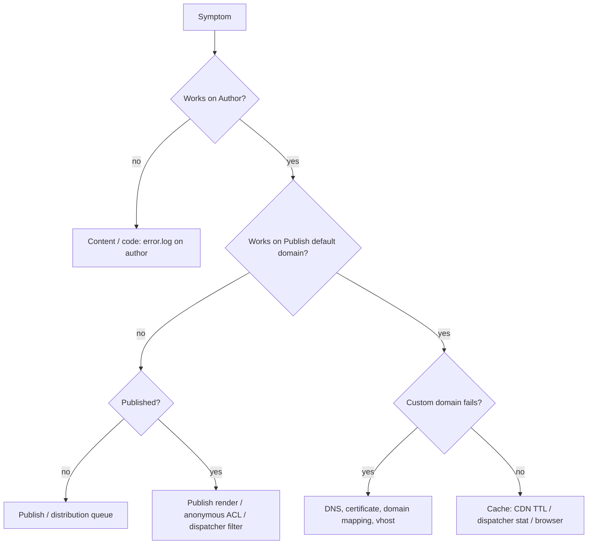
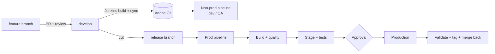
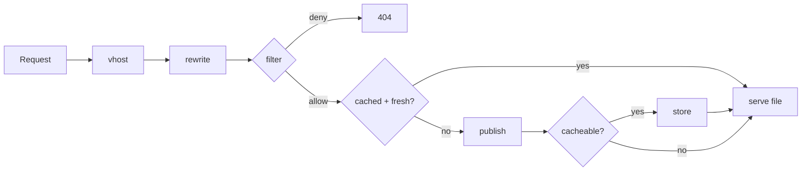
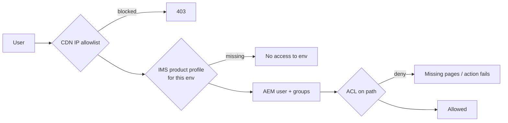
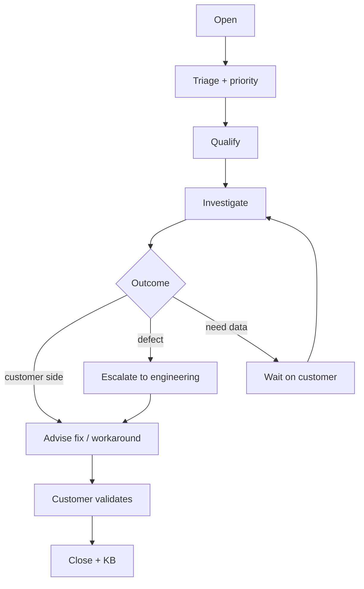
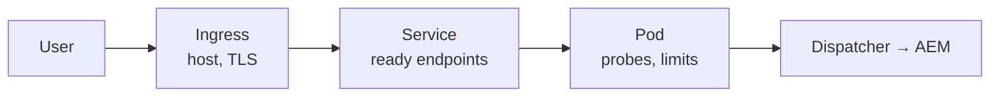
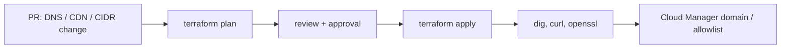
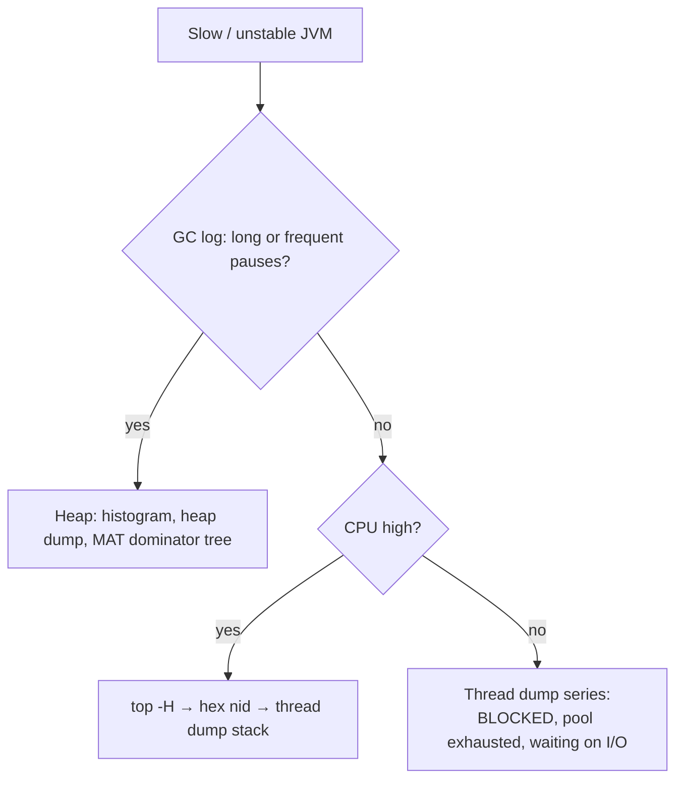

# Architecture and workflow diagrams

Mermaid diagrams render directly on GitHub. `aem-route-map.html` is a standalone visual overview (open it in a browser).

| File | Shows |
|------|-------|
| [aem-route-map.html](aem-route-map.html) | Full visual study page: AEMaaCS route map, Dispatcher flow, pipeline, migration, experience map |
| This file, section 1 | AEMaaCS architecture |
| Section 2 | Request route and where each error is produced |
| Section 3 | Layer isolation flowchart |
| Section 4 | Deployment lifecycle |
| Section 5 | Dispatcher decision flow |
| Section 6 | Access layers (IMS + ACL) |
| Section 7 | Support case lifecycle |
| Section 8 | Kubernetes request path and debug order |
| Section 9 | Terraform change flow around AEM |
| Section 10 | JVM diagnosis flow |

## 1. AEM as a Cloud Service architecture

## 2. Request route and error origin

## 3. Layer isolation

## 4. Deployment lifecycle

## 5. Dispatcher decision flow

## 6. Access layers

## 7. Support case lifecycle

## 8. Kubernetes request path and debug order

## 9. Terraform change flow around AEM

## 10. JVM diagnosis flow

